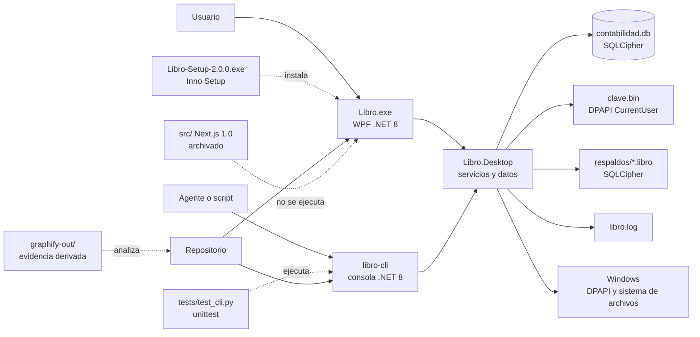
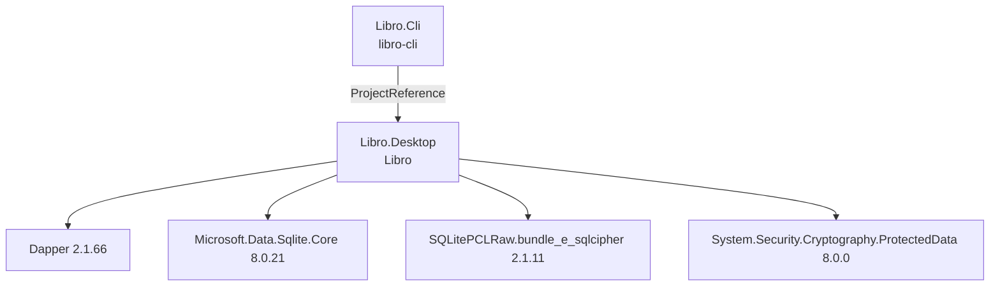
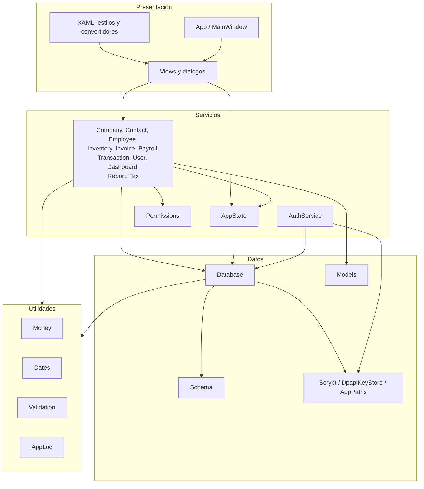
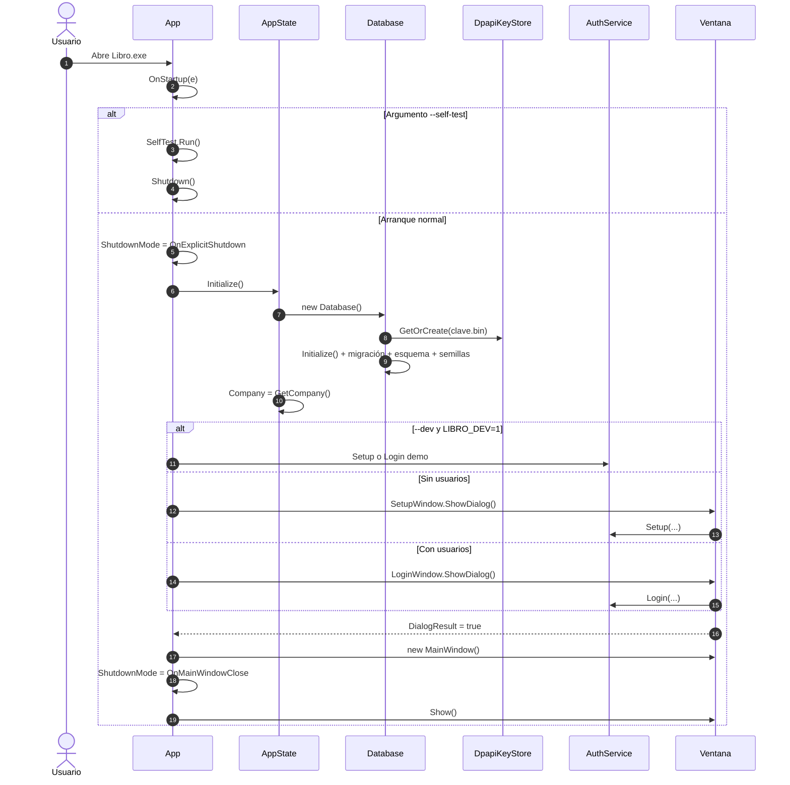
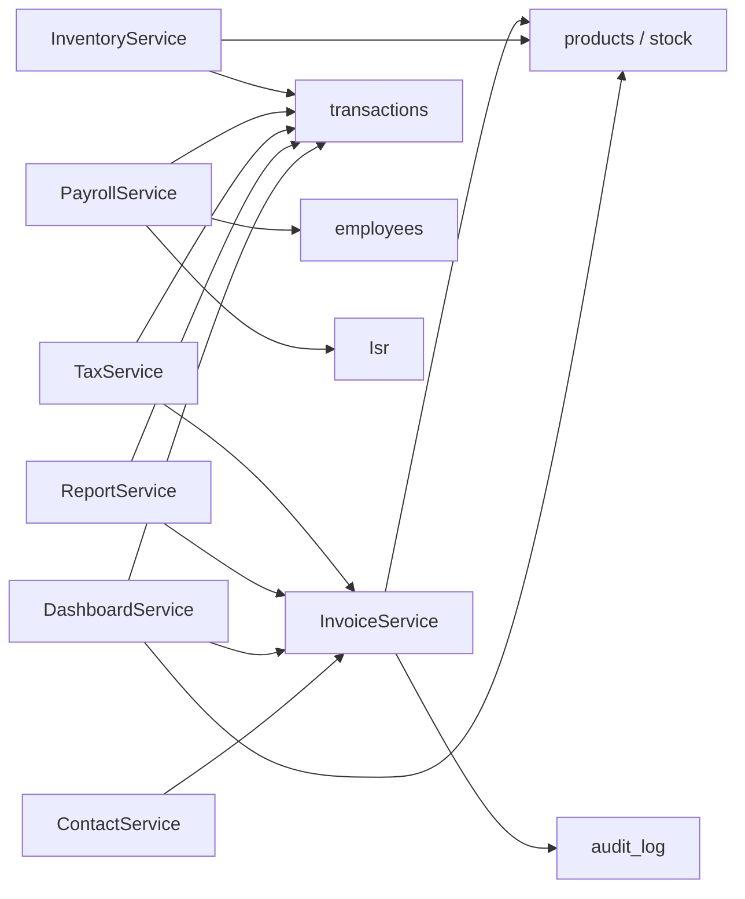
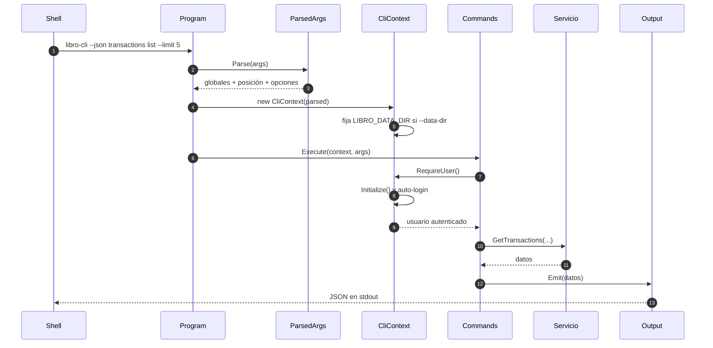

# 02 · Arquitectura

> **Estado:** Vigente.
> **Corte:** 25 de octubre de 2026.
> **Ámbito:** `desktop/` (aplicación WPF), `agent-harness/` (CLI),
> `installer/` (distribución) y su relación con `src/` (legado archivado).
> **No cubre:** columnas exactas de la base ([03](03-modelo-datos.md)), reglas
> contables ([05](05-modulos-flujos.md)), permisos detallados
> ([04](04-seguridad.md)) ni catálogo del CLI ([07](07-cli.md)).

---

## 1. Resumen ejecutivo

Libro 2.0.0 es un **monolito de escritorio** con dos frentes de entrada:

| Frente | Ejecutable | Uso | Se instala |
| --- | --- | --- | --- |
| Aplicación WPF | `Libro.exe` | Operación humana con interfaz gráfica en español. | Sí, `dist\Libro-Setup-2.0.0.exe` |
| CLI para agentes | `libro-cli` (`libro-cli.dll` + `libro-cli.cmd`) | Automatización, scripts, agentes y diagnóstico. | No; se compila desde el repositorio. |

Ambos frentes usan **el mismo ensamblado de dominio** (`Libro.Desktop`,
`AssemblyName = Libro`). El CLI no reimplementa contabilidad, cifrado,
permisos ni respaldos: referencia `desktop\Libro.Desktop\Libro.Desktop.csproj`
y llama a `AppState`, `AuthService` y a los servicios de negocio.

Propiedades estructurales:

- **Un proceso, una base, una empresa.** No hay servidor, API HTTP, WebView ni
  servicio en la nube.
- **Una base SQLCipher** en `%LOCALAPPDATA%\Libro\data\contabilidad.db`.
- **Una llave aleatoria** en `clave.bin`, protegida con DPAPI del usuario de
  Windows.
- **16 tablas** y `PRAGMA user_version = 1`; véase
  [03-modelo-datos.md](03-modelo-datos.md).
- **Capa de servicios estática** sobre Dapper; no hay contenedor de inyección
  de dependencias.
- **Dos modos de ejecución del CLI:** un proceso por comando (*one-shot*) o una
  REPL con sesión en memoria.
- **Cero integraciones fiscales:** las facturas son internas y no son CFDI.
- **Cero telemetría:** el único registro es `libro.log` en la carpeta de datos.

La consecuencia práctica es que la aplicación es fácil de instalar y auditar,
pero su estado global (`AppState`) y su naturaleza síncrona limitan las pruebas
unitarias y el multiusuario. Esas tensiones se describen en la sección 14.

---

## 2. Vista de contenedores



### Fronteras

| Frontera | Qué la cruza | Qué no la cruza |
| --- | --- | --- |
| Proceso | Línea de comandos, archivos, consola | Sockets, HTTP, named pipes |
| Datos | SQLCipher con llave en memoria | SQLite en texto plano (salvo migración detectada) |
| Usuario de Windows | DPAPI y ACL del perfil | Otras cuentas de Windows |
| Fiscal | RFC y régimen para presentación | XML, PAC, SAT, timbrado |
| Distribución | Inno Setup e iconos | Node.js, navegador, WebView |

### Ausencias deliberadas

- No hay servicio Windows, tarea programada ni puerto abierto.
- No hay base remota, replicación ni telemetría.
- No hay autenticación de red: la sesión es local y en memoria.
- No hay API pública. El contrato hacia agentes es el CLI y su JSON.

---

## 3. Proyectos, dependencias y artefactos

### 3.1 Proyectos .NET

| Proyecto | Archivo | Tipo | Framework | Ensamblado | Versión |
| --- | --- | --- | --- | --- | --- |
| Aplicación | `desktop/Libro.Desktop/Libro.Desktop.csproj` | `WinExe` + `UseWPF` | `net8.0-windows` | `Libro` | 2.0.0 |
| CLI | `agent-harness/Libro.Cli/Libro.Cli.csproj` | `Exe` + `UseWPF` | `net8.0-windows` | `libro-cli` | 1.0.0 |



Detalles verificados:

- No existe un archivo `.sln`; cada proyecto se compila por separado con los
  scripts.
- El CLI marca `UseWPF=true` **solo porque referencia un proyecto WPF**. No
  instancia ventanas ni usa el dispatcher: su salida es de consola.
- El CLI hereda transitivamente Dapper, SQLCipher y DPAPI del proyecto de la
  aplicación. No declara paquetes propios.
- `Libro.Desktop` fija `ApplicationIcon` a `installer\libro.ico`,
  `Version=2.0.0` y `FileVersion=2.0.0.0`.
- `Libro.Cli` fija `Version=1.0.0` y `FileVersion=1.0.0.0`.

### 3.2 Cadena de compilación

```text
desktop/Libro.Desktop/*.cs
        │
        ├── dotnet build ─────────────► desktop/Libro.Desktop/bin/<config>/net8.0-windows/Libro.exe
        │
        └── dotnet publish ───────────► installer/native-app/Libro.exe
                                              │
                                              └── ISCC ─► dist/Libro-Setup-2.0.0.exe
                                                              └── .sha256

agent-harness/Libro.Cli/*.cs
        │
        └── dotnet build ─────────────► agent-harness/Libro.Cli/bin/Release/net8.0-windows/libro-cli.dll
                                              │
                                              └── libro-cli.cmd ─► dotnet libro-cli.dll
```

| Script | Qué hace | Salida |
| --- | --- | --- |
| `agent-harness/build.ps1` | Compila el CLI en `Release`; con `-Test` ejecuta `unittest`. | `libro-cli.dll` |
| `agent-harness/libro-cli.cmd` | Localiza `dotnet` y ejecuta el DLL. | Proceso del CLI |
| `agent-harness/run-tests.cmd` | Ejecuta la suite Python contra el DLL ya compilado. | Resultado de pruebas |
| `installer/build-native.ps1` | Publica self-contained, poda culturas, corre `--self-test`, compila Inno Setup y calcula SHA256. | `dist/Libro-Setup-2.0.0.exe` |
| `installer/build.ps1` | Construcción del instalador **legado** de Next.js. | `dist/Libro-Setup-1.0.0.exe` |
| `installer/start-server.cmd` | Arranque del servidor legado. | No aplica a 2.0.0 |

### 3.3 Publicación de la aplicación

`installer/build-native.ps1` ejecuta:

```powershell
dotnet publish desktop\Libro.Desktop\Libro.Desktop.csproj `
  -c Release -r win-x64 --self-contained true `
  -p:DebugType=None -p:DebugSymbols=false -o installer\native-app
```

Después:

1. elimina las carpetas satélite `cs`, `de`, `fr`, `it`, `ja`, `ko`, `pl`,
   `pt-BR`, `ru`, `tr`, `zh-Hans`, `zh-Hant`;
2. exige que existan `Libro.exe` y `e_sqlcipher.dll`;
3. falla si encuentra algún `*.db` en la carpeta publicada;
4. ejecuta `Libro.exe --self-test` y exige `SELFTEST_OK`;
5. compila `installer/libro-native.iss`;
6. escribe `dist/Libro-Setup-2.0.0.exe.sha256`.

El instalador **no incluye el CLI**. `libro-cli` es una herramienta de
desarrollo y operación que se compila desde el repositorio.

---

## 4. Estructura del repositorio

| Ruta | Función | Estado |
| --- | --- | --- |
| `desktop/Libro.Desktop/` | Aplicación WPF, datos, servicios y utilidades. | Vigente |
| `agent-harness/Libro.Cli/` | CLI agent-native. | Vigente |
| `agent-harness/tests/` | Pruebas E2E en Python. | Vigente |
| `agent-harness/skills/` | Skill de OpenCode generada. | Vigente |
| `installer/*.iss`, `installer/*.ps1` | Instaladores nativo y legado. | Nativo vigente; legado archivado |
| `installer/native-app/` | Salida de `dotnet publish` (se regenera). | Artefacto local |
| `dist/` | Instaladores publicados y SHA256. | Artefacto publicado |
| `docs/` | Esta documentación curada. | Vigente |
| `graphify-out/` | Wiki, grafo, HTML y árbol generados. | Generado |
| `src/` | Aplicación Next.js 1.0. | Archivado |
| `tools/Libro.DbTool/` | Utilidad de diagnóstico/reseteo sobre copias. | Vigente, no instalada |
| `scripts/` | Utilidades del proyecto Next.js. | Archivado |
| `data/`, `backups/`, `.next/`, `node_modules/` | Artefactos locales de desarrollo. | Ignorados |
| `README.md`, `RELEASE-NOTES-2.0.0.md` | Documentación de producto. | Vigente con hallazgos |

### Archivos de raíz heredados

`package.json`, `package-lock.json`, `next.config.ts`, `next-env.d.ts`,
`tsconfig.json`, `postcss.config.mjs` y `tsconfig.tsbuildinfo` pertenecen a la
aplicación Next.js archivada. **No participan** en la compilación nativa. El
`README.md` de raíz los menciona al describir el legado; no deben confundirse
con dependencias de `Libro.exe`.

### Separación de responsabilidades

```text
desktop/Libro.Desktop/
├── App.xaml, App.xaml.cs              arranque y recursos globales
├── MainWindow.xaml, .xaml.cs          shell, navegación y logout
├── Data/                              esquema, conexión, modelos, crypto, rutas
├── Payroll/                           cálculo de ISR
├── Services/                          casos de uso y autorización
├── Util/                              dinero, fechas, validación, log
├── Converters/                        formato para XAML
├── Controls/                          DateField
└── Views/                             pantallas y diálogos
```

---

## 5. Capas y reglas de dependencia



### Reglas observadas en el código

1. **Presentación → Servicios → Datos.** Las vistas llaman servicios; los
   servicios usan `Database` o `AppState.Db`.
2. **Las vistas no escriben SQL directo.** Hay una excepción de lectura:
   `InvoiceDialog.xaml.cs` consulta productos con
   `AppState.Db.All<Product>("SELECT * FROM products ...")` para poblar el
   selector.
3. **`SettingsView` usa `Database` directamente** para respaldar y restaurar
   (`BackupTo`, `RestoreFrom`). Es la única pantalla que opera el ciclo de vida
   del archivo de base.
4. **Los modelos son DTOs de Dapper**, no entidades con lógica de persistencia.
   Varias propiedades calculadas viven en los modelos (`Invoice.BalanceCents`,
   `Product.StockStatus`, etc.).
5. **`AppState` es un localizador de servicios global.** No hay inyección de
   dependencias ni interfaces; los servicios son clases estáticas.
6. **`Permissions` es una tabla en código**, no datos en la base. Cambiar la
   matriz exige recompilar.
7. **`Scrypt` y `DpapiKeyStore` son la única puerta criptográfica.** El resto
   del código no maneja la llave maestra.
8. **El CLI es otra capa de presentación.** No accede a SQL directamente; usa
   los mismos servicios que la UI.

### Desviaciones y deuda

- `CompanyService` recibe `Database` por parámetro y **no revalida permisos**;
  confía en que la UI o el CLI los validen. El resto de servicios de escritura
  sí revalidan (véase 5.1).
- `AppState.Company` es una copia en memoria; tras un cambio hay que llamar a
  `RefreshCompany()`.
- No hay interfaces de servicio, por lo que no se pueden sustituir por mocks
  sin cambiar el código de producción.

### 5.1 Autorización por servicio

| Servicio | ¿Revalida permisos en escritura? | Permiso |
| --- | --- | --- |
| `AuthService` | No aplica (es la puerta de autenticación). | — |
| `CompanyService` | **No**; depende de UI/CLI. | `settings.manage`, `accounts.write` |
| `ContactService` | Sí, en `Save` y `SetArchived`. | `contacts.write` |
| `EmployeeService` | Sí, en `SaveEmployee` y `ToggleEmployee`. | `payroll.write` |
| `InventoryService` | Sí, en `SaveProduct`, `ToggleActive` y `AddMovement`. | `products.write` o `inventory.write` |
| `InvoiceService` | Sí, en todas las escrituras. | `invoice.write` |
| `PayrollService` | Sí, en todas las escrituras vía `EnsureWriter`. | `payroll.write` |
| `TransactionService` | Sí, en `Save` y `Delete`. | `tx.write` |
| `UserService` | Sí, en `SaveUser`, `SetActive` y `ResetPassword`. | `users.manage` |
| `AuditService` | Sí, solo lectura. | `audit.view` |

La consecuencia es que **la autorización efectiva se valida dos veces** para la
mayoría de las escrituras: en el punto de entrada (botón visible o
`ctx.RequirePermission`) y en el servicio. `CompanyService` es la excepción
conocida y se registra en
[13-hallazgos-riesgos.md](13-hallazgos-riesgos.md).

---

## 6. Composición de la aplicación WPF

### 6.1 Recursos globales

`App.xaml` fusiona `Resources/Styles.xaml` y registra convertidores:

| Clave | Convertidor | Uso |
| --- | --- | --- |
| `Money` | `MoneyConverter` | Centavos a moneda `es-MX`. |
| `Date` | `DateConverter` | ISO a `dd MMM yyyy`. |
| `Percent` | `PercentConverter` | Tasa `0.16` a `16%`. |
| `StatusLabel` | `StatusLabelConverter` | `borrador` → “Borrador”, etc. |
| `TypeBrush` | `TypeToBrushConverter` | Color por tipo de movimiento. |
| `StatusBrush` | `StatusToBrushConverter` | Color por estado de factura. |
| `ManualVisibility` | `ManualVisibilityConverter` | Acciones solo para movimientos manuales. |
| `AutomaticVisibility` | `AutomaticVisibilityConverter` | Indicador de origen automático. |
| `SourceLabel` | `SourceLabelConverter` | `inventario`/`nomina` → etiqueta legible. |

### 6.2 Shell principal

`MainWindow` tiene dos columnas: barra lateral de **246 px** y contenido. La
ventana abre maximizada, con mínimos de 1080×680.

La barra lateral muestra:

- marca “Libro / Contabilidad”;
- nombre de la empresa (`CompanyLabel`);
- lista de navegación (`NavList`);
- tarjeta de usuario con iniciales, nombre, rol y botón de cerrar sesión.

Elementos de navegación y su condición:

| Clave | Etiqueta | Visible para |
| --- | --- | --- |
| `panel` | Panel | Todos |
| `movimientos` | Movimientos | Todos |
| `facturas` | Facturas | Todos |
| `contactos` | Contactos | Todos |
| `inventario` | Inventario | Todos |
| `nomina` | Nómina | `payroll.view` |
| `empleados` | Empleados | `payroll.view` |
| `impuestos` | Impuestos | `tax.view` |
| `reportes` | Reportes | `reports.view` |
| `configuracion` | Configuración | Todos |
| `usuarios` | Usuarios | `users.manage` o `audit.view` |

“Todos” significa que el elemento aparece en la navegación; las acciones
internas se habilitan u ocultan según el permiso correspondiente. Un rol
`consulta` puede abrir Movimientos y Facturas en modo lectura, pero no crear ni
editar.

### 6.3 Carga de páginas

`MainWindow.ShowPage` crea una **instancia nueva** de la vista en cada
navegación:

```csharp
PageHost.Content = key switch
{
    "panel" => new DashboardView(),
    "movimientos" => new TransactionsView(),
    // ...
    _ => new PlaceholderView("Libro", "Módulo en construcción."),
};
if (PageHost.Content is IRefreshable refreshable) refreshable.Refresh();
```

`IRefreshable` es una interfaz de un solo método (`Refresh`) que implementan las
vistas con datos. El patrón implica:

- no se conserva estado de filtros al salir y volver a una pantalla;
- cada visita vuelve a consultar la base;
- no hay ViewModels persistentes ni navegación con parámetros;
- los diálogos se abren con `ShowDialog()` desde el código subyacente.

### 6.4 Vistas y diálogos

Vistas principales (11):

`DashboardView`, `TransactionsView`, `InvoicesView`, `ContactsView`,
`InventoryView`, `PayrollView`, `EmployeesView`, `TaxesView`, `ReportsView`,
`SettingsView`, `UsersView`.

Ventanas de ciclo de vida:

`SetupWindow` (primer arranque), `LoginWindow` (inicio de sesión),
`MainWindow`, `PlaceholderView`.

Diálogos y ventanas de detalle:

`AccountDialog`, `CategoryDialog`, `ContactDialog`, `EmployeeDialog`,
`InvoiceDialog`, `InvoiceDetailWindow`, `PasswordResetDialog`, `PaymentDialog`,
`PayrollItemDialog`, `PayrollPaymentDialog`, `PayrollPeriodDialog`,
`ProductDialog`, `ProductDetailWindow`, `TextPromptDialog`,
`TransactionDialog`, `UserDialog`.

El detalle de campos, botones y flujos está en
[06-mapa-ui.md](06-mapa-ui.md).

### 6.5 Cierre de sesión

`LogoutButton_Click`:

1. confirma con un `MessageBox` sí/no;
2. `AppState.SignOut()` deja `CurrentUser = null`;
3. abre `LoginWindow` en modal;
4. si el login es correcto, crea un **nuevo** `MainWindow`, lo asigna a
   `Application.Current.MainWindow` y lo muestra;
5. si se cancela, llama a `Application.Current.Shutdown()`;
6. cierra la ventana anterior.

No se reutiliza la instancia de `MainWindow`. Es una decisión simple que evita
limpiar estado de vistas, a costa de recrear toda la shell.

---

## 7. Secuencia de arranque



### 7.1 Arranque paso a paso

1. `App` registra manejadores para `AppDomain.UnhandledException` y
   `DispatcherUnhandledException`.
2. `OnStartup` revisa `--self-test`. Si está presente, ejecuta
   `SelfTest.Run()`, escribe el log y llama a `Shutdown()` **antes** de
   inicializar la base de datos del usuario.
3. Fija `ShutdownMode = OnExplicitShutdown` para que el cierre de las ventanas
   modales no termine el proceso antes de tiempo.
4. Escribe “Inicio de Libro” en `libro.log`.
5. `AppState.Initialize()` crea `Database`, que:
   - resuelve `AppPaths.DataDirectory`;
   - crea la carpeta de datos y `respaldos`;
   - obtiene o crea la llave DPAPI;
   - detecta una base SQLite en texto plano y la migra;
   - aplica `Schema.Sql` (`CREATE TABLE IF NOT EXISTS ...`);
   - fija `PRAGMA user_version = 1`;
   - siembra categorías y cuentas si están vacías;
   - carga `Company` en memoria.
6. Si `--dev` **y** `LIBRO_DEV=1`, entra en modo desarrollo:
   - si no hay usuarios, crea empresa “Abarrotes La Esperanza”, usuario
     “Ana Martínez”, correo `admin@libro.local` y contraseña `Secreta123!`;
   - si ya hay usuarios, intenta iniciar sesión con esas mismas credenciales;
   - abre `MainWindow` directamente.
7. Si no hay usuarios, muestra `SetupWindow`; si se cancela, termina con
   `Shutdown()`.
8. Si hay usuarios, muestra `LoginWindow`; si se cancela, termina.
9. `ShowMainWindow` crea `MainWindow`, la asigna a `Application.MainWindow`,
   cambia `ShutdownMode` a `OnMainWindowClose` y la muestra.

### 7.2 Errores de arranque

Cualquier excepción en el bloque de inicio se registra con `AppLog.Error` y se
muestra en un `MessageBox`:

> “No se pudo iniciar Libro. […] Si el problema continúa, conserva el archivo
> clave.bin y contacta a soporte.”

Después se ejecuta `Shutdown(1)`. El mensaje es deliberado: `clave.bin` es
irrecuperable sin la cuenta de Windows y debe conservarse junto con la base.

### 7.3 Modo desarrollo

| Condición | Efecto |
| --- | --- |
| `--dev` sin `LIBRO_DEV=1` | Se ignora; sigue el flujo normal. |
| `--dev` con `LIBRO_DEV=1` y base vacía | Crea empresa y admin demo. |
| `--dev` con `LIBRO_DEV=1` y usuarios existentes | Intenta login demo; falla si la contraseña no coincide. |

Las credenciales demo son sintéticas y **no deben usarse en producción**. El
modo desarrollo no cambia la ruta de datos: sigue usando
`%LOCALAPPDATA%\Libro\data` salvo que `LIBRO_DATA_DIR` indique otra carpeta.

### 7.4 Autoprueba

`--self-test` ejecuta `SelfTest.Run()` y escribe un log en
`LIBRO_SELFTEST_LOG` o, por defecto, `%TEMP%\libro-selftest.log`. La última
línea es `SELFTEST_OK` o `SELFTEST_FAIL`. El instalador exige `SELFTEST_OK`.
Las pruebas cubren:

- vector conocido de scrypt;
- base cifrada nueva;
- migración de base en texto plano conservando las 16 tablas;
- rechazo de llave incorrecta;
- creación de respaldo;
- rechazo de respaldo corrupto;
- restauración válida.

El detalle está en [09-pruebas.md](09-pruebas.md).

---

## 8. Estado global y ciclo de vida

`AppState` es una clase estática con tres piezas:

| Miembro | Tipo | Ciclo de vida | Mutación |
| --- | --- | --- | --- |
| `Db` | `Database` | Se crea una vez por proceso. | Solo en `Initialize()`. |
| `CurrentUser` | `User?` | Se fija tras setup/login. | `SetCurrentUser`, `SignOut`. |
| `Company` | `Company` | Se carga al inicializar. | `RefreshCompany`. |

```csharp
public static void Initialize()
{
    lock (Gate)
    {
        if (_database is not null) return;
        _database = new Database();
        _database.Initialize();
        Company = CompanyService.GetCompany(_database);
    }
}
```

Consecuencias:

- **No hay reinicialización.** Cambiar de carpeta de datos exige un proceso
  nuevo. El CLI lo impide explícitamente dentro de la REPL.
- **La sesión es en memoria.** No se escribe en la tabla `sessions`; cerrar el
  proceso cierra la sesión. La tabla existe pero no se usa.
- **El estado es global al proceso.** Dos instancias de la app comparten
  archivo, no memoria; no hay bloqueo de instancia única.
- **La UI asume un solo hilo.** `CurrentUser` y `Company` se leen desde el hilo
  de interfaz; no hay sincronización para escrituras concurrentes.
- **El CLI one-shot no conserva sesión.** Cada invocación vuelve a autenticar
  con `--email`/`--password`, `LIBRO_EMAIL`/`LIBRO_PASSWORD` o
  `--password-env`.
- **La REPL conserva la sesión** mientras el proceso vive.

---

## 9. Patrón de acceso a datos

### 9.1 Conexión

`Database` no mantiene una conexión abierta. Cada operación abre una conexión
SQLCipher nueva y la cierra al terminar.

```text
Database.Open()
  └── OpenAt(DbPath, _key, create: true)
        ├── SqliteConnectionStringBuilder
        │     DataSource = ruta
        │     Mode = ReadWriteCreate
        │     Cache = Private
        │     Pooling = false
        │     DefaultTimeout = 10
        ├── PRAGMA key = "x'...'"      (primero)
        ├── PRAGMA cipher_memory_security = ON
        ├── SELECT count(*) FROM sqlite_master  (valida la llave)
        ├── PRAGMA foreign_keys = ON
        ├── PRAGMA busy_timeout = 5000
        ├── PRAGMA synchronous = NORMAL
        └── PRAGMA journal_mode = WAL
```

Notas:

- La llave se pasa como literal hexadecimal `x'...'` producido por
  `DpapiKeyStore.ToSqlCipherKey`. Nunca se concatena la contraseña de usuario.
- `Pooling=false` evita reutilizar conexiones con la llave en memoria más allá
  de la operación.
- `journal_mode=WAL` queda persistido en el archivo; los respaldos fuerzan
  `DELETE` en la copia para que sea un archivo autocontenido.
- `busy_timeout=5000` es la única defensa ante dos procesos que escriben a la
  vez. No hay bloqueo lógico ni detección de conflicto.
- `foreign_keys=ON` se aplica en **cada** conexión; SQLite no lo recuerda entre
  conexiones.

### 9.2 API de `Database`

| Método | Conexión | Transacción | Uso típico |
| --- | --- | --- | --- |
| `Open()` | Nueva | No | Operaciones compuestas que necesitan control manual. |
| `WithConnection` | Nueva | No | Varias consultas sin atomicidad. |
| `InTransaction` | Nueva | Sí | Escrituras de negocio y auditoría en la misma transacción. |
| `Insert` | Nueva | Opcional (riesgo) | Inserción simple y `last_insert_rowid()`. |
| `Execute` | Nueva | No | `UPDATE`/`DELETE` simple. |
| `One<T>` | Nueva | No | Una fila. |
| `All<T>` | Nueva | No | Lista. |
| `ScalarLong` / `ScalarString` | Nueva | No | Conteos y valores únicos. |
| `Audit` | Nueva | No | Auditoría fuera de una transacción de negocio. |
| `BackupTo` | Nueva + destino | No | Respaldo verificado. |
| `RestoreFrom` | Nueva + destino | No | Restauración con respaldo de seguridad. |

**Advertencia de API:** `Insert(sql, parameters, transaction)` abre su propia
conexión y luego ejecuta con un `SqliteTransaction` que pertenece a otra
conexión. En la práctica los servicios no usan `Insert` con transacción; usan
`connection.Execute` dentro de `InTransaction`. La firma queda como riesgo
latente.

### 9.3 Mapeo Dapper

En el constructor estático:

```csharp
SQLitePCL.Batteries_V2.Init();
DefaultTypeMap.MatchNamesWithUnderscores = true;
```

Por eso `opening_balance_cents` mapea a `OpeningBalanceCents` sin atributos.
Los modelos usan propiedades `long`, `string`, `double` y `long?`; no hay
`DateTime` en el modelo: las fechas son texto.

### 9.4 Transacciones y auditoría

Las escrituras críticas siguen este patrón:

```csharp
AppState.Db.InTransaction((connection, transaction) =>
{
    // 1. validar reglas y estado
    // 2. insertar/actualizar
    // 3. insertar en audit_log con el mismo connection/transaction
});
```

Ventajas:

- si falla la auditoría, se revierte la operación;
- los totales y el stock se actualizan atómicamente;
- no quedan movimientos vinculados a facturas inexistentes.

Excepciones:

- `AuthService.Login` actualiza `last_login_at` y audita con llamadas separadas
  (`db.Execute` y `db.Audit`), no en una transacción.
- `PayrollService.DeletePeriod` borra y audita con dos llamadas separadas.
- `Database.BackupTo` y `RestoreFrom` auditan fuera de la transacción de copia
  (no aplica una transacción de base al archivo).
- Las lecturas no auditan.

### 9.5 Migración y evolución del esquema

`Database.Initialize`:

1. si el archivo existe y empieza con `SQLite format 3\0`, ejecuta
   `MigratePlaintextDatabase()`;
2. abre la base cifrada;
3. ejecuta `Schema.Sql`, compuesto solo por `CREATE TABLE IF NOT EXISTS` e
   `CREATE INDEX IF NOT EXISTS`;
4. fija `PRAGMA user_version = 1`;
5. siembra datos.

Limitaciones:

- **No hay marco de migraciones.** `user_version` se escribe pero nunca se lee.
- `CREATE TABLE IF NOT EXISTS` **no altera** una tabla existente: agregar una
  columna en `Schema.cs` no la agrega a una base ya creada.
- No hay tabla de versiones, scripts incrementales ni `ALTER TABLE`.
- Cambiar el esquema en una versión futura requiere diseñar una migración
  explícita; hoy no existe.

### 9.6 Respaldos y restauración

`BackupTo(destination?)`:

1. crea el directorio de respaldos;
2. usa `Libro-yyyyMMdd-HHmmss.libro` si no se indica destino;
3. escribe en `<destino>.creando`;
4. `source.BackupDatabase(target)`;
5. `wal_checkpoint(TRUNCATE)` y `journal_mode=DELETE` en la copia;
6. `PRAGMA integrity_check` debe devolver `ok`;
7. mueve el temporal al destino final;
8. audita `backup`.

`RestoreFrom(backupPath)`:

1. exige que el archivo exista;
2. lo abre con la llave actual y verifica `integrity_check`;
3. crea un respaldo de seguridad `Libro-antes-restaurar-*.libro`;
4. copia a `contabilidad.db.restaurando`;
5. verifica de nuevo;
6. elimina `-wal` y `-shm`, mueve el temporal sobre `contabilidad.db`;
7. vuelve a abrir y verificar;
8. audita `restore`;
9. si algo falla, intenta recuperar el respaldo de seguridad.

El detalle de seguridad y operación está en [04-seguridad.md](04-seguridad.md) y
[08-operacion-instalador.md](08-operacion-instalador.md).

---

## 10. Catálogo de servicios

| Servicio | Responsabilidad | Acceso a datos | Escrituras principales |
| --- | --- | --- | --- |
| `AppState` | Estado global: base, usuario, empresa, permisos. | `Database` | `Initialize`, `SetCurrentUser`, `SignOut`. |
| `AuthService` | Setup inicial, login, cambio de contraseña. | `Database` por parámetro | `users`, `company`, `audit_log`. |
| `CompanyService` | Empresa, cuentas, categorías y catálogos auxiliares. | `Database` por parámetro | `company`, `accounts`, `categories`. |
| `ContactService` | Clientes/proveedores, archivo y saldos. | `AppState.Db` | `contacts`. |
| `DashboardService` | Agregados del panel. | `Database` por parámetro | Solo lectura. |
| `EmployeeService` | Plantilla y sueldos. | `AppState.Db` | `employees`. |
| `InventoryService` | Productos, stock, movimientos y compras. | `AppState.Db` | `products`, `inventory_movements`, `transactions`. |
| `InvoiceService` | Facturas internas, conceptos, pagos y cancelación. | `AppState.Db` | `invoices`, `invoice_items`, `payments`, `products`, `audit_log`. |
| `PayrollService` | Periodos, conceptos, ISR/IMSS, pago y reversión. | `AppState.Db` | `payroll_periods`, `payroll_items`, `transactions`. |
| `ReportService` | Estado de resultados, flujo, antigüedad, mensual, saldos. | `AppState.Db` | Solo lectura. |
| `TaxService` | IVA trasladado/acreditable/neto y resumen anual. | `AppState.Db` | Solo lectura. |
| `TransactionService` | Ingresos no facturados y gastos. | `AppState.Db` | `transactions`, `audit_log`. |
| `UserService` | Usuarios, activación, reseteo y resumen. | `AppState.Db` | `users`, `audit_log`. |
| `AuditService` | Consulta del registro de auditoría. | `AppState.Db` | Solo lectura. |
| `Permissions` | Matriz rol → permisos y etiquetas. | Ninguno | Ninguna. |
| `Isr` | Tarifas y cálculo de ISR. | Ninguno | Ninguna. |

`AuditService` vive en el mismo archivo que `UserService`
(`Services/UserService.cs`), no en un archivo separado. Es una clase estática
con `GetEntries`, `GetActions` y `GetEntities`.

### 10.1 Dependencias entre servicios



No hay llamadas de un servicio a otro para escrituras, salvo las relaciones
implícitas por tablas:

- `InvoiceService` descuenta stock y consulta productos.
- `InventoryService` crea un gasto en `transactions` al registrar una compra.
- `PayrollService` crea un gasto en `transactions` al pagar.
- `TaxService` y `ReportService` leen facturas, pagos y movimientos.

Estas dependencias se documentan con sus fórmulas en
[05-modulos-flujos.md](05-modulos-flujos.md).

---

## 11. Arquitectura del CLI

### 11.1 Flujo de un comando



### 11.2 Fases

| Fase | Código | Efecto |
| --- | --- | --- |
| Parseo | `ParsedArgs.Parse` | Separa globales (antes del primer posicional) de opciones del comando. |
| Contexto | `CliContext` | Resuelve `--data-dir`, credenciales y banderas. |
| Ejecución | `Commands.Execute` | Despacha grupo/acción. |
| Autorización | `RequireUser`, `RequirePermission`, `RequireAnyPermission` | Autentica y valida rol. |
| Inicialización | `CliContext.Initialize` | `AppState.Initialize()` una vez por proceso. |
| Salida | `Output` | JSON o tabla/key-values. |

### 11.3 Regla de opciones globales

Las opciones globales son:

`--data-dir`, `--email`, `--password`, `--password-env`, `--json`, `--debug`,
`--help`, `--no-color`, `--pretty`.

`ParsedArgs.Parse` las reconoce **solo antes del primer token posicional**:

```text
libro-cli --email admin@x --password clave --json users list
          └──────────── globales ────────────┘ └ comando ┘

libro-cli users save --email nuevo@x --input usuario.json
                     └ opción del comando ┘
```

Esto evita que `users save --email` sobrescriba el correo de la sesión. Si una
opción global se coloca después del comando, se interpreta como opción de la
operación y puede no tener efecto.

### 11.4 Modelo de proceso

| Modo | Cuándo | Sesión | Estado |
| --- | --- | --- | --- |
| One-shot | Hay posición (grupo/acción). | Se autentica en cada invocación. | Termina al devolver el código de salida. |
| REPL | Sin posición o `repl`. | Se conserva en memoria. | Vive hasta `exit`, EOF o error fatal. |

En one-shot, `--data-dir` se aplica a `Environment.SetEnvironmentVariable`
antes de `AppState.Initialize`. En REPL, cambiar `--data-dir` a mitad de sesión
lanza un `CliException`; hay que reiniciar el proceso.

### 11.5 Salida y errores

- **Éxito:** JSON en `stdout` si `--json`; si no, tabla o pares clave-valor.
- **Error:** JSON en `stderr` si `--json`, con forma
  `{"ok":false,"error":"...","detail":null}`; si no, `ERROR: ...`.
- **Código de salida:** `0` éxito; `1` error de validación, permiso, E/S o
  inesperado; un `CliException` puede declarar otro código, pero hoy todos usan
  el valor por defecto.
- **`--debug`:** agrega `detail` con el `ToString()` de la excepción.
- **JSON de entrada:** `--input archivo.json` o `--stdin`; se aceptan
  comentarios, comas finales y números como cadena.
- **Formato JSON:** camelCase, indentado, omite `null`, escapa español de forma
  relajada.

El catálogo completo, opciones y ejemplos están en [07-cli.md](07-cli.md).

### 11.6 REPL

- Prompt `libro>` sin sesión; `<nombre>>` con sesión.
- `help`, `exit`, `quit`, `q`, `clear`, `cls`.
- Líneas vacías y comentarios con `#` se ignoran.
- `CliContext.Tokenize` conserva barras invertidas de Windows dentro de comillas:
  `--input "C:\temp\archivo.json"` no se corrompe.
- Un error en un comando no termina la REPL; se imprime y se continúa.
- Los globales iniciales (`--json`, `--debug`, credenciales, `--data-dir`) se
  fusionan en cada comando.

### 11.7 Acoplamiento al ensamblado WPF

El CLI referencia el proyecto WPF, no una biblioteca separada. Ventajas:

- una sola implementación de reglas y cifrado;
- los cambios de esquema y servicios quedan disponibles de inmediato;
- no hay duplicación de DTOs.

Costos:

- el CLI no se puede compilar para Linux/macOS;
- arrastra el runtime de escritorio de Windows;
- el ensamblado `Libro` incluye XAML y recursos que el CLI no usa;
- una futura biblioteca `Libro.Core` separaría dominio de presentación.

---

## 12. Manejo de errores, registro y diagnóstico

### 12.1 Aplicación

| Situación | Manejo |
| --- | --- |
| Excepción no controlada en el dominio | `AppDomain.UnhandledException` → `AppLog.Error`. |
| Excepción en el hilo de UI | `DispatcherUnhandledException` → log + `MessageBox` + `Handled=true`. |
| Error de arranque | Log + `MessageBox` + `Shutdown(1)`. |
| Error en una vista o diálogo | Captura local + texto rojo en el formulario. |
| Error de respaldo/restauración | `MessageBox` y el respaldo de seguridad queda en disco. |

`AppLog` escribe en `<data>\libro.log` con marca local
`yyyy-MM-dd HH:mm:ss.fff`. Si no puede crear la carpeta, usa
`%TEMP%\libro.log`. No hay rotación ni límite de tamaño.

### 12.2 CLI

`Program` captura por separado:

- `CliException` (mensajes de uso/negocio);
- `UnauthorizedAccessException` (permisos);
- `ArgumentException` (validación);
- `InvalidOperationException` (estado);
- `IOException` (archivos);
- `Exception` (inesperado).

Todos terminan en `Output.Error` y código `1`, salvo el éxito. En la REPL, el
mismo conjunto se captura por comando y el bucle continúa.

### 12.3 Diagnóstico

`libro-cli doctor` reporta:

- ruta de datos, base y llave;
- existencia y tamaño de la base;
- tipo de archivo (`sqlcipher`, `plaintext`, `missing`);
- cantidad de respaldos;
- si la base se pudo abrir;
- conteos por tabla si se abrió.

No imprime la llave ni hashes de contraseña. Si falta `clave.bin` y la base está
cifrada, **no crea una llave nueva**: reporta el problema para no destruir la
posibilidad de recuperación.

### 12.4 Registro de auditoría

La tabla `audit_log` guarda:

| Columna | Contenido |
| --- | --- |
| `user_id` | Usuario que actuó; `NULL` en acciones del sistema (backup/restore/login fallido). |
| `action` | `login`, `login_failed`, `setup`, `create`, `update`, `delete`, `emit`, `cancel`, `payment`, `revert_payment`, `backup`, `restore`, etc. |
| `entity` | `company`, `user`, `transaction`, `invoice`, `payroll`, `product`, `database`, etc. |
| `entity_id` | ID como texto; puede ser vacío. |
| `detail` | Texto libre (folio, total, correo, nombre de archivo). |
| `created_at` | `datetime('now')` de SQLite (UTC, sin `T` ni `Z`). |

La auditoría es **de aplicación**, no de base: un usuario con acceso al archivo
y la llave podría modificarla. Su objetivo es trazabilidad operativa, no
prueba forense.

---

## 13. Compilación, publicación y despliegue

### 13.1 Compilar la aplicación

```powershell
$dotnet = "$env:LOCALAPPDATA\Microsoft\dotnet\dotnet.exe"
& $dotnet build desktop\Libro.Desktop\Libro.Desktop.csproj -c Release
```

Salida principal:

```text
desktop\Libro.Desktop\bin\Release\net8.0-windows\Libro.exe
```

### 13.2 Compilar el CLI

```powershell
powershell -ExecutionPolicy Bypass -File agent-harness\build.ps1
```

Salida:

```text
agent-harness\Libro.Cli\bin\Release\net8.0-windows\libro-cli.dll
agent-harness\Libro.Cli\bin\Release\net8.0-windows\libro-cli.exe
```

El wrapper `libro-cli.cmd` prefiere
`%LOCALAPPDATA%\Microsoft\dotnet\dotnet.exe`; si no existe, usa `dotnet` del
`PATH`; se puede forzar con `LIBRO_CLI_DOTNET`.

### 13.3 Generar el instalador

```powershell
powershell -ExecutionPolicy Bypass -File installer\build-native.ps1
```

Requisitos:

- .NET 8 SDK;
- Inno Setup 6 en
  `%LOCALAPPDATA%\Programs\Inno Setup 6\ISCC.exe`;
- `installer\libro.ico`.

Salida:

```text
dist\Libro-Setup-2.0.0.exe
dist\Libro-Setup-2.0.0.exe.sha256
```

El instalador es **por usuario**, `PrivilegesRequired=lowest`, instala en
`%LOCALAPPDATA%\Programs\Libro` y conserva `%LOCALAPPDATA%\Libro\data`. No hay
firma de código en el script de compilación; si se distribuye fuera del equipo
de desarrollo, debe firmarse y documentarse la huella.

### 13.4 Matriz de artefactos

| Artefacto | Ruta | Se versiona | Se instala |
| --- | --- | --- | --- |
| Código WPF | `desktop/Libro.Desktop/` | Sí | — |
| Código CLI | `agent-harness/Libro.Cli/` | Sí | No |
| Pruebas E2E | `agent-harness/tests/` | Sí | No |
| Publicación | `installer/native-app/` | No (ignorado) | Empaquetada |
| Instalador | `dist/Libro-Setup-2.0.0.exe` | No (ignorado) | Sí |
| Datos de usuario | `%LOCALAPPDATA%\Libro\data` | No | No |
| Respaldos | `<data>\respaldos\*.libro` | No | No |
| Evidencia Graphify | `graphify-out/` | No (ignorado) | No |

`dist/`, `backups/`, `data/`, `graphify-out/` y las salidas de compilación están
en `.gitignore`. La documentación no depende de que esos artefactos estén
versionados; cuando se citan tamaños o SHA256, son del corte documental.

---

## 14. Tensiones y límites arquitectónicos

| Tema | Situación actual | Consecuencia | Referencia |
| --- | --- | --- | --- |
| Estado global | `AppState` estático, sin reset. | Dificulta pruebas en proceso y cambios de carpeta. | §8 |
| Inyección de dependencias | No existe; servicios estáticos. | No hay mocks ni sustitución de implementaciones. | §5 |
| Migraciones | `user_version` se escribe, no se lee; solo `CREATE IF NOT EXISTS`. | Agregar columnas rompe bases existentes. | §9.5 |
| Multiusuario | Sin bloqueo de instancia ni control de concurrencia lógico. | Dos procesos pueden sobrescribirse; WAL solo evita corrupción. | §9.1 |
| Sesiones | Tabla `sessions` sin uso; login en memoria. | Reiniciar la app cierra la sesión; no hay “recordarme”. | §8 |
| Límite de intentos | Diccionario estático por proceso. | Un ataque por CLI one-shot reinicia el contador. | [04](04-seguridad.md) |
| Impresión | Sin `PrintDialog`, `FlowDocument` ni PDF en `desktop/`. | El README y las notas la anunciaban; corregido documentalmente, el código sigue sin impresión. | [13](13-hallazgos-riesgos.md) |
| UI síncrona | Consultas y reportes en el hilo de UI. | Periodos grandes pueden congelar la ventana. | §6 |
| CLI acoplado a WPF | `ProjectReference` a `WinExe`. | No hay CLI multiplataforma ni biblioteca de dominio reutilizable. | §11.7 |
| Banderas del CLI | `--pretty`, `--no-color`, `--quiet`, `--all` se aceptan pero no cambian la salida. | Un agente puede esperar un efecto inexistente. | [07](07-cli.md) |
| Respaldo externo | `backup list` solo mira la carpeta por defecto. | Un respaldo creado con `--output` no aparece en la lista. | [07](07-cli.md) |
| Firma de código | El build no firma el `.exe`. | SmartScreen puede advertir; no hay cadena de confianza. | §13.3 |
| Instancia única | No hay `Mutex` ni named pipe. | El usuario puede abrir dos ventanas sobre la misma base. | §9.1 |
| Empresa única | `company.id = 1` y una base por carpeta. | No hay multiempresa. | [03](03-modelo-datos.md) |

Estas tensiones no impiden la operación actual, pero definen el orden de
trabajo si Libro crece: separar `Libro.Core`, introducir migraciones, agregar
pruebas de servicios y resolver la impresión.

---

## 15. Archivos de referencia

| Área | Archivos |
| --- | --- |
| Arranque | `desktop/Libro.Desktop/App.xaml`, `App.xaml.cs` |
| Shell | `desktop/Libro.Desktop/MainWindow.xaml`, `MainWindow.xaml.cs` |
| Estado | `desktop/Libro.Desktop/Services/AppState.cs` |
| Datos | `desktop/Libro.Desktop/Data/Database.cs`, `Schema.cs`, `Models.cs`, `AppPaths.cs` |
| Criptografía | `desktop/Libro.Desktop/Data/Scrypt.cs`, `DpapiKeyStore.cs` |
| Servicios | `desktop/Libro.Desktop/Services/*.cs` |
| Utilidades | `desktop/Libro.Desktop/Util/*.cs` |
| Vistas | `desktop/Libro.Desktop/Views/` |
| CLI | `agent-harness/Libro.Cli/Program.cs`, `Cli.cs`, `Commands.cs` |
| Pruebas | `agent-harness/tests/test_cli.py`, `desktop/Libro.Desktop/SelfTest.cs` |
| Distribución | `installer/build-native.ps1`, `installer/libro-native.iss` |

### Comandos de verificación

```powershell
# Compilar CLI y ejecutar pruebas
powershell -ExecutionPolicy Bypass -File agent-harness\build.ps1 -Test

# Diagnóstico sin abrir la base real de forma destructiva
agent-harness\libro-cli.cmd --json doctor

# Ver la estructura de la base (si existe la llave)
agent-harness\libro-cli.cmd --json schema
```

### Documentos relacionados

- [03-modelo-datos.md](03-modelo-datos.md): tablas, columnas e índices.
- [04-seguridad.md](04-seguridad.md): DPAPI, SQLCipher, scrypt y permisos.
- [05-modulos-flujos.md](05-modulos-flujos.md): reglas y máquinas de estado.
- [06-mapa-ui.md](06-mapa-ui.md): pantallas y acciones.
- [07-cli.md](07-cli.md): contrato del CLI.
- [08-operacion-instalador.md](08-operacion-instalador.md): instalación y
  runbook.
- [09-pruebas.md](09-pruebas.md): evidencia de pruebas.
- [13-hallazgos-riesgos.md](13-hallazgos-riesgos.md): riesgos y acciones.
