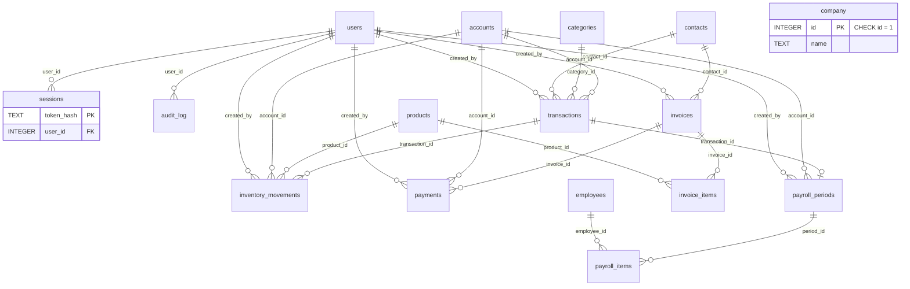

# 03 · Modelo de datos

> **Estado:** Vigente.
> **Corte:** 25 de octubre de 2026.
> **Fuente de verdad:** `desktop/Libro.Desktop/Data/Schema.cs` y
> `desktop/Libro.Desktop/Data/Models.cs`.
> **Motor:** SQLite 3 cifrado con SQLCipher; una base por carpeta de datos.
> **Versión de esquema:** `PRAGMA user_version = 1`.

---

## 1. Resumen

La base `contabilidad.db` contiene **16 tablas**:

| # | Tabla | Dominio | Filas esperadas |
| --- | --- | --- | --- |
| 1 | `company` | Datos del negocio y parámetros. | 0 o 1 |
| 2 | `users` | Usuarios y roles. | 1..n |
| 3 | `sessions` | Sesiones (sin uso nativo). | 0 |
| 4 | `audit_log` | Trazabilidad de acciones. | 0..n |
| 5 | `accounts` | Caja, banco y tarjetas. | 2..n |
| 6 | `categories` | Categorías de ingreso/gasto/costo. | 13..n |
| 7 | `contacts` | Clientes y proveedores. | 0..n |
| 8 | `products` | Productos y servicios. | 0..n |
| 9 | `transactions` | Ingresos no facturados y gastos. | 0..n |
| 10 | `inventory_movements` | Bitácora de stock. | 0..n |
| 11 | `invoices` | Facturas internas. | 0..n |
| 12 | `invoice_items` | Conceptos de factura. | 0..n |
| 13 | `payments` | Cobros de factura. | 0..n |
| 14 | `employees` | Plantilla. | 0..n |
| 15 | `payroll_periods` | Periodos de nómina. | 0..n |
| 16 | `payroll_items` | Conceptos por empleado y periodo. | 0..n |

No hay tablas de configuración, migraciones, colas, caché ni auditoría de
sesión. La configuración del negocio vive en `company`; la de la aplicación,
en variables de entorno y en el código.

### Archivos que forman el estado

| Archivo | Contenido | Se puede copiar solo |
| --- | --- | --- |
| `contabilidad.db` | Base SQLCipher. | No; requiere `clave.bin` y la misma cuenta de Windows. |
| `contabilidad.db-wal` | Write-ahead log transitorio. | No de forma independiente. |
| `contabilidad.db-shm` | Memoria compartida de WAL. | No. |
| `clave.bin` | Llave maestra protegida con DPAPI. | Solo junto con la base y en la misma cuenta. |
| `respaldos/*.libro` | Copias SQLCipher autocontenidas. | Sí, con la misma cuenta y llave. |
| `libro.log` | Registro de la aplicación. | Sí; no contiene la llave. |

Los sufijos `.creando`, `.cifrando`, `.plano` y `.restaurando` son temporales
del proceso de respaldo, migración o restauración. No deben distribuirse.

---

## 2. Convenciones de tipos y valores

| Concepto | Representación | Ejemplo | Nota |
| --- | --- | --- | --- |
| Dinero | `INTEGER` en centavos | `12345` = `$123.45` | Nunca `REAL` para importes. |
| Tasas | `REAL` en `0..1` | `0.16` = 16 % | IVA e IMSS. |
| Cantidades | `REAL` | `2.5` | Hasta 3 decimales en la UI. |
| Días de nómina | `REAL` | `15` o `30` | Prorrateo. |
| Fechas de negocio | `TEXT` `yyyy-MM-dd` | `2026-10-25` | Zona México. |
| Marcas de tiempo | `TEXT` UTC | `2026-10-25T18:30:00.000Z` o `2026-10-25 18:30:00` | Dos formatos heredados. |
| Booleanos | `INTEGER` `0`/`1` | `active = 1` | Sin tipo `BOOLEAN`. |
| IDs | `INTEGER PRIMARY KEY AUTOINCREMENT` | `42` | No se reutilizan tras un `DELETE`. |
| Enumeraciones | `TEXT` + `CHECK` | `status = 'emitida'` | Salvo `transactions.source`. |
| Texto libre | `TEXT NOT NULL DEFAULT ''` | `notes = ''` | No hay `NULL` salvo fechas/IDs opcionales. |

La base no usa `DECIMAL`, `DATE`, `BOOLEAN` ni `BLOB` para datos de negocio.
SQLite aplica afinidad de tipos, pero no impide insertar un texto en una columna
`INTEGER`; la validación real está en los servicios y en los `CHECK`.

---

## 3. Diagrama entidad-relación



`company` no tiene relación física con las demás tablas: es una fila única que
la aplicación lee y actualiza por `id = 1`. `transactions.source_id` es una
relación **lógica**, no una clave foránea.

---

## 4. Definición de las 16 tablas

### 4.1 `company`

Fila única con los datos del negocio y los parámetros de cálculo.

| Columna | Tipo | Nulo | Default / restricción |
| --- | --- | --- | --- |
| `id` | INTEGER | No | PK; `CHECK (id = 1)` |
| `name` | TEXT | No | — |
| `rfc` | TEXT | No | `''` |
| `regimen_fiscal` | TEXT | No | `''` |
| `address` | TEXT | No | `''` |
| `phone` | TEXT | No | `''` |
| `email` | TEXT | No | `''` |
| `iva_rate` | REAL | No | `0.16` |
| `invoice_series` | TEXT | No | `'A'` |
| `next_invoice_number` | INTEGER | No | `1` |
| `imss_rate` | REAL | No | `0.025` |
| `isr_brackets` | TEXT | No | `''`; JSON de tarifas |
| `created_at` | TEXT | No | `datetime('now')` |

Notas:

- El `CHECK (id = 1)` impide una segunda fila, pero **no obliga a que exista**.
- `AuthService.Setup` inserta la fila con `ON CONFLICT(id) DO UPDATE SET name`.
- Si no hay fila, `CompanyService.GetCompany` devuelve un objeto en memoria con
  `Name = "Mi negocio"` e `IsrBrackets = Isr.DefaultJson`; no la crea.
- `next_invoice_number` se incrementa al emitir una factura, no al crear un
  borrador.
- `isr_brackets` guarda un arreglo JSON de objetos
  `{ lower, upper, rate, fixed }`; véase `Payroll/Isr.cs`.
- No hay índice adicional: la tabla siempre se busca por PK.

### 4.2 `users`

| Columna | Tipo | Nulo | Default / restricción |
| --- | --- | --- | --- |
| `id` | INTEGER | No | PK AUTOINCREMENT |
| `name` | TEXT | No | — |
| `email` | TEXT | No | `COLLATE NOCASE UNIQUE` |
| `password_hash` | TEXT | No | Formato `scrypt$N$r$p$saltHex$hashHex` |
| `role` | TEXT | No | `CHECK (role IN ('admin','contador','capturista','consulta'))` |
| `active` | INTEGER | No | `1` |
| `created_at` | TEXT | No | `datetime('now')` |
| `last_login_at` | TEXT | Sí | `NULL` |

Notas:

- El correo es único sin distinguir mayúsculas. La aplicación lo normaliza a
  minúsculas antes de guardar.
- `password_hash` usa scrypt con `N=16384`, `r=8`, `p=1`, sal de 16 bytes y
  hash de 64 bytes. Nunca se muestra en la UI ni en el CLI.
- `role` se valida también en `Permissions` y en `UserService`.
- `last_login_at` se actualiza en cada login correcto y en el setup inicial.
- No hay `updated_at`; los cambios de nombre/rol no dejan marca de tiempo.
- Borrar un usuario deja `NULL` en las referencias (`ON DELETE SET NULL`) y
  elimina sus sesiones (`CASCADE`). La aplicación no borra usuarios: los
  desactiva.

### 4.3 `sessions`

| Columna | Tipo | Nulo | Default / restricción |
| --- | --- | --- | --- |
| `token_hash` | TEXT | No | PK |
| `user_id` | INTEGER | No | FK `users(id) ON DELETE CASCADE` |
| `created_at` | TEXT | No | — |
| `expires_at` | TEXT | No | — |
| `user_agent` | TEXT | No | `''` |

Índice: `idx_sessions_expires (expires_at)`.

Estado real: **la aplicación nativa no lee ni escribe esta tabla**. La sesión
vive en `AppState.CurrentUser`. `SelfTest` inserta una fila únicamente para
comprobar que la migración de una base antigua conserva las 16 tablas. La tabla
se mantiene por compatibilidad de esquema.

### 4.4 `audit_log`

| Columna | Tipo | Nulo | Default / restricción |
| --- | --- | --- | --- |
| `id` | INTEGER | No | PK AUTOINCREMENT |
| `user_id` | INTEGER | Sí | FK `users(id) ON DELETE SET NULL` |
| `action` | TEXT | No | — |
| `entity` | TEXT | No | — |
| `entity_id` | TEXT | No | `''` |
| `detail` | TEXT | No | `''` |
| `created_at` | TEXT | No | `datetime('now')` |

Índice: `idx_audit_created (created_at)`.

Notas:

- `action` y `entity` no tienen `CHECK`; los valores son convenciones de los
  servicios.
- `entity_id` es texto para admitir IDs numéricos y vacíos.
- `user_id` es `NULL` en acciones del sistema: respaldo, restauración, login
  fallido y setup antes de tener usuario.
- La auditoría se escribe en la misma transacción que la operación en la
  mayoría de los servicios; en login y borrado de nómina se usan llamadas
  separadas.
- No hay trigger de base que audite cambios directos por SQL.

### 4.5 `accounts`

| Columna | Tipo | Nulo | Default / restricción |
| --- | --- | --- | --- |
| `id` | INTEGER | No | PK AUTOINCREMENT |
| `name` | TEXT | No | `UNIQUE` |
| `type` | TEXT | No | `CHECK (type IN ('efectivo','banco','tarjeta'))` |
| `opening_balance_cents` | INTEGER | No | `0` |
| `active` | INTEGER | No | `1` |
| `created_at` | TEXT | No | `datetime('now')` |

Notas:

- El nombre es único global, no por tipo.
- `opening_balance_cents` es el saldo inicial y se suma al saldo calculado.
- `active = 0` es archivo lógico; no se borra una cuenta con movimientos.
- **Contradicción verificada:** `AccountDialog` ofrece “Otro” con `Tag="otro"`,
  pero el `CHECK` solo admite `efectivo`, `banco` o `tarjeta`. Guardar “Otro”
  produce un error de restricción. Véase
  [13-hallazgos-riesgos.md](13-hallazgos-riesgos.md).
- El saldo no se almacena: se calcula con `opening + transacciones + pagos`.
  La fórmula exacta está en la sección 7.3.

### 4.6 `categories`

| Columna | Tipo | Nulo | Default / restricción |
| --- | --- | --- | --- |
| `id` | INTEGER | No | PK AUTOINCREMENT |
| `name` | TEXT | No | — |
| `kind` | TEXT | No | `CHECK (kind IN ('ingreso','gasto','costo'))` |
| `archived` | INTEGER | No | `0` |
| `created_at` | TEXT | No | `datetime('now')` |
| — | — | — | `UNIQUE (name, kind)` |

Notas:

- Un mismo nombre puede existir como ingreso y como gasto.
- `costo` existe en el esquema y `TransactionService` lo acepta para gastos,
  pero la UI solo ofrece ingreso/gasto y las semillas no crean costos.
- `archived = 1` impide seleccionarla en movimientos nuevos, pero no rompe los
  movimientos históricos.
- No hay `updated_at`; renombrar una categoría no deja rastro temporal.

### 4.7 `contacts`

| Columna | Tipo | Nulo | Default / restricción |
| --- | --- | --- | --- |
| `id` | INTEGER | No | PK AUTOINCREMENT |
| `type` | TEXT | No | `CHECK (type IN ('cliente','proveedor','ambos'))` |
| `name` | TEXT | No | — |
| `rfc` | TEXT | No | `''` |
| `email` | TEXT | No | `''` |
| `phone` | TEXT | No | `''` |
| `address` | TEXT | No | `''` |
| `notes` | TEXT | No | `''` |
| `archived` | INTEGER | No | `0` |
| `created_at` | TEXT | No | `datetime('now')` |

Notas:

- No hay unicidad por RFC ni por nombre; pueden existir duplicados.
- `type = 'ambos'` aparece tanto en filtros de cliente como de proveedor.
- `archived = 1` es la baja lógica; no se borra un contacto con facturas.
- `ReceivableCents` y `DisplayName` son propiedades calculadas, no columnas.
- `rfc` se guarda en mayúsculas; el servicio limita a 20 caracteres, pero no
  valida el formato fiscal.

### 4.8 `products`

| Columna | Tipo | Nulo | Default / restricción |
| --- | --- | --- | --- |
| `id` | INTEGER | No | PK AUTOINCREMENT |
| `sku` | TEXT | No | `''` |
| `name` | TEXT | No | — |
| `description` | TEXT | No | `''` |
| `unit` | TEXT | No | `'pieza'` |
| `price_cents` | INTEGER | No | `0` |
| `cost_cents` | INTEGER | No | `0` |
| `iva_rate` | REAL | No | `0.16` |
| `stock` | REAL | No | `0` |
| `min_stock` | REAL | No | `0` |
| `track_stock` | INTEGER | No | `1` |
| `active` | INTEGER | No | `1` |
| `created_at` | TEXT | No | `datetime('now')` |
| — | — | — | Índice único parcial `sku WHERE sku <> ''` |

Notas:

- El SKU vacío se permite repetido; un SKU no vacío es único.
- `track_stock = 0` convierte el producto en servicio: no se descuenta stock ni
  se registran movimientos.
- `stock` es la fuente de verdad operativa; `inventory_movements` es la
  bitácora. La suma de `qty` coincide si todas las escrituras pasan por los
  servicios.
- `cost_cents` es el costo promedio ponderado; se recalcula en entradas.
- No hay `updated_at`; los cambios de precio/costo no tienen marca temporal.
- No hay `CHECK` de precios, costos, stock o tasa; los valida
  `InventoryService.ValidateProduct`.
- Al crear con stock inicial, se inserta un movimiento `ajuste` con razón
  “Saldo inicial”.

### 4.9 `transactions`

| Columna | Tipo | Nulo | Default / restricción |
| --- | --- | --- | --- |
| `id` | INTEGER | No | PK AUTOINCREMENT |
| `date` | TEXT | No | `yyyy-MM-dd` |
| `type` | TEXT | No | `CHECK (type IN ('ingreso','gasto'))` |
| `category_id` | INTEGER | Sí | FK `categories(id) ON DELETE SET NULL` |
| `contact_id` | INTEGER | Sí | FK `contacts(id) ON DELETE SET NULL` |
| `account_id` | INTEGER | Sí | FK `accounts(id) ON DELETE SET NULL` |
| `description` | TEXT | No | — |
| `subtotal_cents` | INTEGER | No | — |
| `iva_cents` | INTEGER | No | `0` |
| `total_cents` | INTEGER | No | — |
| `iva_rate` | REAL | No | `0` |
| `method` | TEXT | No | `''` |
| `reference` | TEXT | No | `''` |
| `source` | TEXT | No | `'manual'`; sin `CHECK` |
| `source_id` | INTEGER | Sí | Sin FK; referencia lógica |
| `created_by` | INTEGER | Sí | FK `users(id) ON DELETE SET NULL` |
| `created_at` | TEXT | No | `datetime('now')` |
| `updated_at` | TEXT | No | `datetime('now')` |

Índices: `idx_tx_date (date)`, `idx_tx_type (type)`.

Notas:

- **Las facturas no generan filas en `transactions`.** El ingreso facturado se
  contabiliza en `invoices`; los ingresos no facturados, en `transactions` con
  `type = 'ingreso'`. Esta separación evita la doble contabilidad.
- `source = 'manual'` es el único valor que la UI puede editar o borrar.
- Valores usados por los servicios:
  - `manual`: captura humana.
  - `inventario`: gasto por compra de inventario; `source_id` = ID del
    movimiento de inventario.
  - `nomina`: gasto por pago de nómina; `source_id` = ID del periodo.
- `source` no tiene `CHECK`; un valor inesperado se muestra como “Automático” y
  no se puede editar (el servicio exige exactamente `manual`).
- `total_cents = subtotal_cents + iva_cents` se calcula en el servicio, no en la
  base.
- No hay `CHECK` de importes positivos, IVA o fechas.
- `category_id` puede quedar `NULL` si se borra la categoría por SQL; la app
  solo la archiva.

### 4.10 `inventory_movements`

| Columna | Tipo | Nulo | Default / restricción |
| --- | --- | --- | --- |
| `id` | INTEGER | No | PK AUTOINCREMENT |
| `product_id` | INTEGER | No | FK `products(id) ON DELETE CASCADE` |
| `date` | TEXT | No | `yyyy-MM-dd` |
| `type` | TEXT | No | `CHECK (type IN ('entrada','salida','ajuste'))` |
| `qty` | REAL | No | Firmada: entrada `+`, salida `-`, ajuste `delta` |
| `unit_cost_cents` | INTEGER | No | `0` |
| `reason` | TEXT | No | `''` |
| `reference` | TEXT | No | `''` |
| `account_id` | INTEGER | Sí | FK `accounts(id) ON DELETE SET NULL` |
| `transaction_id` | INTEGER | Sí | FK `transactions(id) ON DELETE SET NULL` |
| `created_by` | INTEGER | Sí | FK `users(id) ON DELETE SET NULL` |
| `created_at` | TEXT | No | `datetime('now')` |

Índice: `idx_inv_product (product_id, date)`.

Notas:

- La bitácora es inmutable: no hay `updated_at` ni operaciones de edición.
- `type = 'entrada'` con `account_id` genera un gasto en `transactions` con
  IVA y enlaza `transaction_id`.
- `type = 'salida'` reduce stock; no genera gasto.
- `type = 'ajuste'` fija el stock al valor indicado y guarda la diferencia como
  `qty`.
- La emisión de factura inserta una `salida` por cada producto con control de
  stock; la cancelación inserta una `entrada`.
- No se permite un movimiento si el producto no controla stock o si dejaría
  existencias negativas.
- Borrar un producto por SQL elimina su bitácora (`CASCADE`); la app solo
  desactiva.

### 4.11 `invoices`

| Columna | Tipo | Nulo | Default / restricción |
| --- | --- | --- | --- |
| `id` | INTEGER | No | PK AUTOINCREMENT |
| `series` | TEXT | No | — |
| `number` | INTEGER | Sí | `NULL` en borrador |
| `contact_id` | INTEGER | No | FK `contacts(id)` sin acción |
| `date` | TEXT | No | `yyyy-MM-dd` |
| `due_date` | TEXT | No | `yyyy-MM-dd` |
| `status` | TEXT | No | `CHECK (status IN ('borrador','emitida','pagada','cancelada'))` |
| `subtotal_cents` | INTEGER | No | `0` |
| `iva_cents` | INTEGER | No | `0` |
| `total_cents` | INTEGER | No | `0` |
| `paid_cents` | INTEGER | No | `0` |
| `notes` | TEXT | No | `''` |
| `payment_terms` | TEXT | No | `''` |
| `created_by` | INTEGER | Sí | FK `users(id) ON DELETE SET NULL` |
| `created_at` | TEXT | No | `datetime('now')` |
| `updated_at` | TEXT | No | `datetime('now')` |
| `cancelled_reason` | TEXT | No | `''` |
| `cancelled_at` | TEXT | Sí | `NULL` |

Restricciones e índices:

- `UNIQUE (series, number)`: SQLite permite múltiples `NULL` en `number`, por
  eso varios borradores pueden coexistir con `series = 'A'`.
- `idx_inv_date (date)`, `idx_inv_status (status)`.
- No hay índice por `contact_id`; la cobranza por cliente usa `JOIN` y filtro.

Notas:

- El folio se asigna al emitir: `number = next_invoice_number`, luego se
  incrementa `company.next_invoice_number`.
- El bucle de emisión incrementa `number` si ya existe `(series, number)`.
- `paid_cents` se actualiza al registrar o eliminar pagos.
- `status = 'pagada'` cuando `paid_cents >= total_cents`; no hay `CHECK` que lo
  garantice.
- Cancelar una factura emitida repone stock; cancelar un borrador no.
- No se puede cancelar una factura con pagos: primero se eliminan los pagos.
- No se puede editar ni eliminar una factura emitida; solo un borrador se
  elimina.
- **No es CFDI:** no hay UUID, XML, sello, certificado, PAC ni campo SAT.

### 4.12 `invoice_items`

| Columna | Tipo | Nulo | Default / restricción |
| --- | --- | --- | --- |
| `id` | INTEGER | No | PK AUTOINCREMENT |
| `invoice_id` | INTEGER | No | FK `invoices(id) ON DELETE CASCADE` |
| `product_id` | INTEGER | Sí | FK `products(id) ON DELETE SET NULL` |
| `position` | INTEGER | No | `0`; orden 0-based |
| `description` | TEXT | No | — |
| `qty` | REAL | No | — |
| `unit_price_cents` | INTEGER | No | — |
| `iva_rate` | REAL | No | `0.16` |
| `subtotal_cents` | INTEGER | No | — |
| `iva_cents` | INTEGER | No | `0` |
| `total_cents` | INTEGER | No | — |
| `unit_cost_cents` | INTEGER | No | `0`; foto del costo al guardar |

Índice: `idx_items_invoice (invoice_id)`.

Notas:

- `subtotal_cents = round(qty * unit_price_cents)` con
  `MidpointRounding.AwayFromZero`.
- `iva_cents = round(subtotal_cents * iva_rate)` con el mismo redondeo.
- `unit_cost_cents` se copia del producto al guardar el concepto; se usa para
  el costo de ventas de referencia y para el movimiento de salida.
- `product_id` puede ser `NULL` para conceptos libres.
- Borrar una factura elimina sus conceptos en cascada.
- No hay `created_at` por línea.

### 4.13 `payments`

| Columna | Tipo | Nulo | Default / restricción |
| --- | --- | --- | --- |
| `id` | INTEGER | No | PK AUTOINCREMENT |
| `invoice_id` | INTEGER | No | FK `invoices(id) ON DELETE CASCADE` |
| `date` | TEXT | No | `yyyy-MM-dd` |
| `amount_cents` | INTEGER | No | — |
| `account_id` | INTEGER | Sí | FK `accounts(id) ON DELETE SET NULL` |
| `method` | TEXT | No | `''` |
| `reference` | TEXT | No | `''` |
| `notes` | TEXT | No | `''` |
| `created_by` | INTEGER | Sí | FK `users(id) ON DELETE SET NULL` |
| `created_at` | TEXT | No | `datetime('now')` |

Índice: `idx_payments_invoice (invoice_id)`.

Notas:

- Un pago no puede exceder el saldo pendiente.
- Se permite registrar pagos sobre una factura `pagada` solo si el saldo es
  mayor a cero; el servicio lo valida.
- El pago no genera un `transaction`; el ingreso se refleja en el saldo de la
  cuenta sumando `payments.amount_cents`.
- Si `account_id` es `NULL`, el pago no afecta el saldo de ninguna cuenta.
- Eliminar un pago recalcula `paid_cents` y el estado de la factura.
- No hay `updated_at`; un pago no se edita, se elimina y se vuelve a crear.

### 4.14 `employees`

| Columna | Tipo | Nulo | Default / restricción |
| --- | --- | --- | --- |
| `id` | INTEGER | No | PK AUTOINCREMENT |
| `name` | TEXT | No | — |
| `rfc` | TEXT | No | `''` |
| `curp` | TEXT | No | `''` |
| `nss` | TEXT | No | `''` |
| `position` | TEXT | No | `''` |
| `department` | TEXT | No | `''` |
| `salary_cents` | INTEGER | No | `0` |
| `start_date` | TEXT | No | `yyyy-MM-dd` |
| `end_date` | TEXT | Sí | `NULL` |
| `status` | TEXT | No | `'activo'`; `CHECK (status IN ('activo','inactivo'))` |
| `bank_name` | TEXT | No | `''` |
| `bank_account` | TEXT | No | `''` |
| `created_at` | TEXT | No | `datetime('now')` |

Notas:

- No hay unicidad de RFC, CURP o NSS.
- `salary_cents` es el sueldo **mensual** de referencia.
- `start_date` es obligatoria; `end_date` es opcional y no puede ser anterior a
  `start_date` (validación de servicio).
- `status = 'inactivo'` es la baja lógica. `ToggleEmployee` cambia el estado,
  pero **no** escribe `end_date` automáticamente.
- No se puede borrar un empleado con conceptos de nómina por la FK sin acción.
  La app no ofrece borrado, solo baja.

### 4.15 `payroll_periods`

| Columna | Tipo | Nulo | Default / restricción |
| --- | --- | --- | --- |
| `id` | INTEGER | No | PK AUTOINCREMENT |
| `year` | INTEGER | No | — |
| `month` | INTEGER | No | — |
| `period_type` | TEXT | No | `CHECK (period_type IN ('mensual','quincenal'))` |
| `quincena` | INTEGER | No | `0`; 1 o 2 solo si es quincenal |
| `start_date` | TEXT | No | `yyyy-MM-dd` |
| `end_date` | TEXT | No | `yyyy-MM-dd` |
| `status` | TEXT | No | `'borrador'`; `CHECK (status IN ('borrador','pagada'))` |
| `account_id` | INTEGER | Sí | FK `accounts(id) ON DELETE SET NULL` |
| `transaction_id` | INTEGER | Sí | FK `transactions(id) ON DELETE SET NULL` |
| `paid_at` | TEXT | Sí | `NULL`; ISO de C# al pagar |
| `created_by` | INTEGER | Sí | FK `users(id) ON DELETE SET NULL` |
| `created_at` | TEXT | No | `datetime('now')` |
| — | — | — | `UNIQUE (year, month, period_type, quincena)` |

Notas:

- La combinación único evita duplicar el mismo periodo.
- `quincena = 0` para mensual; `1` del 1 al 15; `2` del 16 al último día.
- `start_date`/`end_date` se calculan al crear, pero no hay `CHECK` que los
  relacione con año/mes/quincena.
- `status = 'pagada'` exige al menos un concepto y neto mayor a cero.
- Al pagar se crea un `transaction` de gasto y se guarda su ID.
- Al revertir se elimina el gasto vinculado y se vuelve a `borrador`.
- No se puede eliminar un periodo pagado; primero se revierte.
- No hay `updated_at`.

### 4.16 `payroll_items`

| Columna | Tipo | Nulo | Default / restricción |
| --- | --- | --- | --- |
| `id` | INTEGER | No | PK AUTOINCREMENT |
| `period_id` | INTEGER | No | FK `payroll_periods(id) ON DELETE CASCADE` |
| `employee_id` | INTEGER | No | FK `employees(id)` sin acción |
| `days` | REAL | No | `0` |
| `base_cents` | INTEGER | No | `0` |
| `extra_perceptions_cents` | INTEGER | No | `0` |
| `isr_cents` | INTEGER | No | `0` |
| `imss_cents` | INTEGER | No | `0` |
| `infonavit_cents` | INTEGER | No | `0` |
| `other_deductions_cents` | INTEGER | No | `0` |
| `net_cents` | INTEGER | No | `0` |
| `notes` | TEXT | No | `''` |
| — | — | — | `UNIQUE (period_id, employee_id)` |

Notas:

- Un empleado aparece una sola vez por periodo.
- `net_cents = max(0, base + extra - ISR - IMSS - INFONAVIT - otras)`.
- Los importes son editables mientras el periodo esté en borrador.
- No hay `created_at`; el alta se deduce del periodo.
- Borrar el periodo elimina sus conceptos en cascada.
- `employee_id` sin `ON DELETE` impide borrar un empleado con conceptos.

---

## 5. Enumeraciones y dominios

| Tabla.Columna | Valores permitidos | Valores usados por la app |
| --- | --- | --- |
| `users.role` | `admin`, `contador`, `capturista`, `consulta` | Los cuatro. |
| `accounts.type` | `efectivo`, `banco`, `tarjeta` | Los tres; la UI ofrece además `otro` (error). |
| `categories.kind` | `ingreso`, `gasto`, `costo` | `ingreso` y `gasto`; `costo` solo por API/SQL. |
| `contacts.type` | `cliente`, `proveedor`, `ambos` | Los tres. |
| `transactions.type` | `ingreso`, `gasto` | Los dos. |
| `transactions.source` | Sin `CHECK` | `manual`, `inventario`, `nomina`. |
| `inventory_movements.type` | `entrada`, `salida`, `ajuste` | Los tres. |
| `invoices.status` | `borrador`, `emitida`, `pagada`, `cancelada` | Los cuatro. |
| `employees.status` | `activo`, `inactivo` | Los dos. |
| `payroll_periods.period_type` | `mensual`, `quincenal` | Los dos. |
| `payroll_periods.status` | `borrador`, `pagada` | Los dos. |
| `payroll_periods.quincena` | Sin `CHECK` | `0`, `1`, `2`. |
| `products.track_stock` | Sin `CHECK` | `0`, `1`. |
| `products.active` | Sin `CHECK` | `0`, `1`. |
| `accounts.active` | Sin `CHECK` | `0`, `1`. |
| `categories.archived` | Sin `CHECK` | `0`, `1`. |
| `contacts.archived` | Sin `CHECK` | `0`, `1`. |
| `users.active` | Sin `CHECK` | `0`, `1`. |
| `company.id` | `CHECK (id = 1)` | `1`. |

### Booleanos

No hay tipo booleano. Los campos `active`, `archived` y `track_stock` usan
`0`/`1`; la UI los convierte con `Visibility` y `CheckBox`. Un valor distinto
de `0` se interpreta como verdadero en las comparaciones `== 1` solo si es
exactamente `1`; los servicios escriben `0`/`1`.

---

## 6. Relaciones y reglas de borrado

| Relación | Cardinalidad | FK | Al borrar el padre |
| --- | --- | --- | --- |
| `users` → `sessions` | 1:N | `user_id` | `CASCADE`. |
| `users` → `audit_log` | 1:N | `user_id` | `SET NULL`. |
| `users` → `transactions` | 1:N | `created_by` | `SET NULL`. |
| `users` → `invoices` | 1:N | `created_by` | `SET NULL`. |
| `users` → `inventory_movements` | 1:N | `created_by` | `SET NULL`. |
| `users` → `payments` | 1:N | `created_by` | `SET NULL`. |
| `users` → `payroll_periods` | 1:N | `created_by` | `SET NULL`. |
| `contacts` → `transactions` | 1:N | `contact_id` | `SET NULL`. |
| `contacts` → `invoices` | 1:N | `contact_id` | Sin acción; bloquea. |
| `categories` → `transactions` | 1:N | `category_id` | `SET NULL`. |
| `accounts` → `transactions` | 1:N | `account_id` | `SET NULL`. |
| `accounts` → `inventory_movements` | 1:N | `account_id` | `SET NULL`. |
| `accounts` → `payments` | 1:N | `account_id` | `SET NULL`. |
| `accounts` → `payroll_periods` | 1:N | `account_id` | `SET NULL`. |
| `products` → `inventory_movements` | 1:N | `product_id` | `CASCADE`. |
| `products` → `invoice_items` | 1:N | `product_id` | `SET NULL`. |
| `invoices` → `invoice_items` | 1:N | `invoice_id` | `CASCADE`. |
| `invoices` → `payments` | 1:N | `invoice_id` | `CASCADE`. |
| `employees` → `payroll_items` | 1:N | `employee_id` | Sin acción; bloquea. |
| `payroll_periods` → `payroll_items` | 1:N | `period_id` | `CASCADE`. |
| `transactions` → `inventory_movements` | 1:N | `transaction_id` | `SET NULL`. |
| `transactions` → `payroll_periods` | 1:0..1 | `transaction_id` | `SET NULL`. |

### Política real de la aplicación

| Entidad | ¿Se borra? | Mecanismo real |
| --- | --- | --- |
| Empresa | No | Actualización de la fila única. |
| Usuario | No | `active = 0`. |
| Cuenta | No | `active = 0`. |
| Categoría | No | `archived = 1`. |
| Contacto | No | `archived = 1`. |
| Producto | No | `active = 0`. |
| Movimiento manual | Sí | `DELETE` con auditoría. |
| Movimiento automático | No | Bloqueado por `source`. |
| Movimiento de inventario | No | Bitácora inmutable. |
| Factura borrador | Sí | `DELETE` + cascada de conceptos. |
| Factura emitida/pagada | No | Solo cancelación. |
| Pago | Sí | `DELETE` + recálculo de factura. |
| Empleado | No | `status = 'inactivo'`. |
| Periodo de nómina | Sí, si es borrador | `DELETE` + cascada de conceptos. |
| Periodo pagado | No | Primero revertir el pago. |

La app prefiere **archivar/desactivar** antes que borrar. El borrado físico se
reserva para movimientos manuales, borradores y pagos, y siempre deja auditoría.

---

## 7. Propiedades calculadas

Ninguna de estas propiedades se almacena; se calculan al leer o se rellenan en
la consulta.

### 7.1 Modelos

| Propiedad | Fórmula / regla | Archivo |
| --- | --- | --- |
| `Contact.DisplayName` | `Name` o `Name · Rfc` si hay RFC. | `Data/Models.cs` |
| `Contact.ReceivableCents` | Suma de `total_cents - paid_cents` de facturas `emitida` del contacto. | `ContactService.GetContacts` |
| `Product.DisplayName` | Nombre + SKU + “stock N” si controla stock. | `Data/Models.cs` |
| `Product.IsLowStock` | `TrackStock == 1 && Stock <= MinStock`. | `Data/Models.cs` |
| `Product.InventoryValueCents` | `round(Stock * CostCents)` si controla stock; si no, `0`. | `Data/Models.cs` |
| `Product.InventoryStatus` | Inactivo / Sin stock / Agotado / Bajo stock / Disponible. | `Data/Models.cs` |
| `Product.StockLabel` | `Stock` con hasta 3 decimales + unidad, o `—`. | `Data/Models.cs` |
| `Product.MarginRate` | `(Price - Cost) / Price` si `Price > 0`; si no, `0`. | `Data/Models.cs` |
| `TransactionRow.SourceNote` | `Nómina`, `Inventario`, `Automático` o vacío. | `Data/Models.cs` |
| `Invoice.Folio` | `Series` si no hay número; si no, `Series-0000`. | `Data/Models.cs` |
| `Invoice.DisplayFolio` | `Borrador #Id` o `Series-0000`. | `Data/Models.cs` |
| `Invoice.BalanceCents` | `TotalCents - PaidCents`. | `Data/Models.cs` |
| `Invoice.IsOverdue` | `Status == 'emitida' && DueDate < hoy`. | `InvoiceService` |
| `Employee.StatusLabel` | `Activo` / `Inactivo`. | `Data/Models.cs` |
| `Employee.RoleLabel` | `Position` o `Department`. | `Data/Models.cs` |
| `Employee.Initials` | Iniciales de nombre y apellido. | `Data/Models.cs` |
| `PayrollPeriod.Label` | “Octubre 2026 · 1.ª quincena”. | `Dates.PayrollPeriodLabel` |
| `PayrollPeriod.StatusLabel` | `Pagada` / `Borrador`. | `Data/Models.cs` |
| `PayrollPeriod.RangeLabel` | Fechas formateadas del periodo. | `Data/Models.cs` |
| `PayrollItem.DeductionsCents` | ISR + IMSS + INFONAVIT + otras. | `Data/Models.cs` |
| `PayrollItem.PerceptionsCents` | Base + percepciones extra. | `Data/Models.cs` |
| `InventoryMovement.TypeLabel` | Entrada / Salida / Ajuste. | `Data/Models.cs` |
| `InventoryMovement.QtyLabel` | `+` si es positivo, con 3 decimales. | `Data/Models.cs` |
| `AccountBalance.BalanceCents` | Saldo inicial + movimientos + pagos. | `CompanyService` |

### 7.2 Totales de factura

```text
subtotal_linea = round(qty * unit_price_cents)
iva_linea      = round(subtotal_linea * iva_rate)
total_linea    = subtotal_linea + iva_linea

subtotal_factura = suma(subtotal_linea)
iva_factura      = suma(iva_linea)
total_factura    = suma(total_linea)
saldo            = total_factura - paid_cents
```

El redondeo es `MidpointRounding.AwayFromZero` en cada línea. Los totales de la
factura se recalculan al guardar y al emitir; no se confía en los valores que
envíe el cliente.

### 7.3 Saldo de cuenta

```text
saldo = opening_balance_cents
      + Σ(total_cents de transactions ingreso)
      - Σ(total_cents de transactions gasto)
      + Σ(amount_cents de payments)
```

Solo se suman movimientos y pagos cuyo `account_id` coincide. Un pago sin
cuenta no afecta el saldo. La fórmula está en
`CompanyService.GetAccountBalances`.

### 7.4 Totales de nómina

```text
percepciones = base_cents + extra_perceptions_cents
deducciones  = isr_cents + imss_cents + infonavit_cents + other_deductions_cents
neto         = max(0, percepciones - deducciones)
```

`PayrollPeriod.EmployeeCount`, `TotalNetCents` y `TotalDeductionsCents` se
calculan con `COUNT`/`SUM` sobre `payroll_items` en `GetPeriods` y `GetPeriod`.

### 7.5 Existencias

```text
stock_nuevo_entrada = stock_actual + qty
costo_promedio      = round((stock_base * costo_actual + qty * costo_entrada) / stock_nuevo)
stock_nuevo_salida  = stock_actual - qty
stock_nuevo_ajuste  = qty_absoluta
delta_ajuste        = stock_nuevo - stock_actual
```

`stock_base = max(0, stock_actual)` para no propagar un stock negativo previo.
La fórmula exacta está en `InventoryService.AddMovement`.

---

## 8. DTOs de lectura

Estos tipos no son tablas ni se persisten; son proyecciones para pantallas,
reportes y JSON del CLI.

| DTO | Origen | Contenido |
| --- | --- | --- |
| `AccountBalance` | `CompanyService` | Cuenta + saldo calculado. |
| `TransactionTotals` | `TransactionService` | Subtotal/IVA de ingresos y gastos, conteo, neto. |
| `TransactionPage` | `TransactionService` | Filas + total para paginación. |
| `InvoiceOverview` | `InvoiceService` | Por cobrar, vencido, mes, borradores. |
| `InvoicePage` | `InvoiceService` | Facturas + total. |
| `DashboardData` | `DashboardService` | Ingresos, gastos, utilidad, IVA, caja, inventario, gráfica. |
| `IncomeStatement` | `ReportService` | Ingresos, gastos, utilidad, COGS de referencia, gastos por categoría. |
| `CashflowSummary` | `ReportService` | Entradas, salidas, neto y serie. |
| `AgingResult` | `ReportService` | Antigüedad de saldos por tramos. |
| `MonthlyPerformanceRow` | `ReportService` | Facturado, otros ingresos, gastos, utilidad por mes. |
| `TaxSummary` | `TaxService` | IVA trasladado, acreditable, neto y filas. |
| `MonthlyTaxRow` | `TaxService` | IVA por mes del año. |
| `PayrollSummary` | `PayrollService` | Borradores, pagadas, neto, empleados. |
| `EmployeeSummary` | `EmployeeService` | Activos, inactivos, nómina mensual. |
| `InventorySummary` | `InventoryService` | Valor, productos, unidades, stock bajo. |
| `ContactStats` | `ContactService` | Clientes, proveedores, archivados, por cobrar. |
| `UserSummary` | `UserService` | Total, activos, admins. |
| `AuditEntry` | `AuditService` | Entrada de auditoría + nombre de usuario. |

Los campos y fórmulas de cada reporte se detallan en
[05-modulos-flujos.md](05-modulos-flujos.md).

---

## 9. Datos semilla

`Database.SeedDefaults` se ejecuta en cada `Initialize`, pero solo inserta si la
tabla correspondiente está vacía.

### 9.1 Categorías (13)

| Nombre | `kind` |
| --- | --- |
| Ventas | `ingreso` |
| Servicios | `ingreso` |
| Otros ingresos | `ingreso` |
| Renta | `gasto` |
| Servicios (luz, agua, internet) | `gasto` |
| Papelería y oficina | `gasto` |
| Publicidad | `gasto` |
| Transporte | `gasto` |
| Nómina | `gasto` |
| Impuestos y cuotas | `gasto` |
| Compras de inventario | `gasto` |
| Mantenimiento | `gasto` |
| Otros gastos | `gasto` |

### 9.2 Cuentas (2)

| Nombre | `type` | `opening_balance_cents` |
| --- | --- | --- |
| Caja | `efectivo` | `0` |
| Banco | `banco` | `0` |

### 9.3 Empresa y usuarios

- **No** se siembra una fila en `company`.
- **No** se siembra un usuario.
- `AuthService.Setup` crea la empresa y el primer `admin`.
- El modo `--dev` crea “Abarrotes La Esperanza” y
  `admin@libro.local` / `Secreta123!` **solo** si `LIBRO_DEV=1` y la base no
  tiene usuarios.

### 9.4 Condiciones de resiembra

- Si `categories` tiene al menos una fila, no se insertan las 13.
- Si `accounts` tiene al menos una fila, no se insertan Caja/Banco.
- Borrar todas las categorías y reiniciar la app vuelve a sembrarlas.
- Archivar una categoría no cuenta como “vacío”: no se resiembra.
- Cambiar los nombres de las semillas no actualiza filas existentes.

---

## 10. Migración y evolución

### 10.1 Base nueva

1. `AppPaths.EnsureDirectories` crea `<data>` y `<data>\respaldos`.
2. `DpapiKeyStore.GetOrCreate` crea `clave.bin` si no existe.
3. `OpenAt` abre/crea `contabilidad.db` con SQLCipher.
4. `Schema.Sql` crea tablas e índices que falten.
5. `PRAGMA user_version = 1`.
6. `SeedDefaults` inserta categorías y cuentas.

### 10.2 Base SQLite en texto plano

`Database.Initialize` lee los primeros 16 bytes del archivo. Si coinciden con
`SQLite format 3\0`, ejecuta `MigratePlaintextDatabase`:

1. checkpoint del WAL;
2. abre un archivo temporal `<db>.cifrando` con la llave;
3. aplica el esquema cifrado;
4. copia las 16 tablas en orden, columna por columna, con `foreign_keys=OFF`
   en el destino y una transacción;
5. omite tablas que no existan en el origen;
6. verifica `integrity_check` del archivo cifrado;
7. mueve el original a `<db>.plano` y el cifrado a `<db>`;
8. elimina `-wal`/`-shm`, verifica de nuevo y borra `<db>.plano`;
9. si algo falla, restaura `<db>.plano` si hace falta y lanza un error.

La lista de tablas está **hardcodeada** en `Database.Tables`. Si se agrega una
tabla al esquema y no se agrega a esa lista, la migración no la copiará. Lo
mismo aplica a `SelfTest.PlaintextMigration`, que verifica 16 nombres.

### 10.3 Base ya cifrada

No hay migraciones incrementales. `Schema.Sql` solo contiene
`CREATE TABLE IF NOT EXISTS` y `CREATE INDEX IF NOT EXISTS`; no hay
`ALTER TABLE`. `PRAGMA user_version` se escribe pero no se lee.

Consecuencias:

- Agregar una columna a `Schema.cs` **no** la agrega a bases existentes.
- Cambiar un `CHECK` no se aplica a una tabla ya creada.
- Cambiar un default no afecta filas existentes.
- Una versión futura necesita un plan de migración explícito antes de tocar el
  esquema.

### 10.4 Compatibilidad con respaldos

Un respaldo `.libro` es una base SQLCipher completa. Al restaurar:

- se verifica que la llave actual pueda abrirla;
- se verifica `integrity_check`;
- se reemplaza la base completa;
- no se ejecuta una migración de esquema;
- si el respaldo es de una versión con otro esquema, la app no lo adapta.

Por eso los respaldos deben restaurarse con la **misma versión** o con una
versión que pueda leer el esquema. La app 2.0.0 no tiene un migrador de
respaldos.

### 10.5 Clave faltante

`DpapiKeyStore.GetOrCreate` crea una llave nueva si `clave.bin` no existe. Si la
base ya estaba cifrada con otra llave, la apertura falla con
“La llave no coincide o el archivo está dañado”. La app **no** puede recuperar
la llave anterior. `doctor` detecta el caso y no crea una llave nueva, pero el
arranque normal sí puede crear un `clave.bin` inservible antes de fallar. Es un
riesgo operativo documentado en
[13-hallazgos-riesgos.md](13-hallazgos-riesgos.md).

---

## 11. Fechas, horas y zona horaria

### 11.1 Formatos almacenados

| Columnas | Formato | Origen |
| --- | --- | --- |
| `transactions.date`, `invoices.date`, `invoices.due_date`, `payments.date`, `inventory_movements.date`, `employees.start_date`, `employees.end_date`, `payroll_periods.start_date`, `payroll_periods.end_date` | `yyyy-MM-dd` | UI/CLI/servicios. |
| `created_at` de todas las tablas | `yyyy-MM-dd HH:mm:ss` | `datetime('now')` de SQLite (UTC). |
| `updated_at` de `transactions`/`invoices` | `yyyy-MM-dd HH:mm:ss` | `datetime('now')` (UTC). |
| `last_login_at` | `yyyy-MM-ddTHH:mm:ss.fffZ` | `Dates.NowIso()` (UTC). |
| `paid_at` de nómina | `yyyy-MM-ddTHH:mm:ss.fffZ` | `Dates.NowIso()` (UTC). |
| `cancelled_at` | `yyyy-MM-dd HH:mm:ss` | `datetime('now')` (UTC). |

### 11.2 Zona de negocio

- `Dates.TodayIso()` convierte `DateTime.UtcNow` a
  `Central Standard Time (Mexico)` o `America/Mexico_City`; si no existen, usa
  la zona local.
- Las fechas de negocio (`date`, `start_date`, `end_date`) se eligen en la zona
  de México.
- Las marcas de tiempo se guardan en UTC; la UI las muestra en la zona de
  México con `Dates.FormatDateTime`.
- Un rango `2026-10-01` a `2026-10-31` incluye fechas de negocio, no timestamps
  UTC.

### 11.3 Comparaciones

- Las fechas `yyyy-MM-dd` se comparan como texto; el formato es ordenable.
- `string.CompareOrdinal` se usa para vencimiento y rangos.
- No se comparan timestamps de distinto formato directamente en SQL; los
  reportes usan `date` de negocio.
- `PayrollSummary` compara `paid_at` con `start + ' 00:00:00'` y
  `end + ' 23:59:59'`; como `paid_at` usa `T` y `Z`, la comparación lexicográfica
  entre ambos formatos es un punto frágil documentado en
  [13-hallazgos-riesgos.md](13-hallazgos-riesgos.md).

---

## 12. Reglas de integridad no declaradas

La base confía en los servicios para estas reglas. Un `INSERT` directo por SQL
puede violarlas sin que SQLite lo impida.

| Regla | Dónde se valida |
| --- | --- |
| `total = subtotal + IVA` en movimientos. | `TransactionService.Save`. |
| `total = suma de conceptos` en facturas. | `InvoiceService.Save`/`Emit`. |
| `paid_cents = suma de payments`. | `InvoiceService.RegisterPayment`/`DeletePayment`. |
| `status = 'pagada'` si `paid >= total`. | `InvoiceService`. |
| `paid_cents <= total_cents`. | `RegisterPayment` valida el saldo. |
| `number` no nulo en facturas emitidas. | `EmitInternal`. |
| `number` único por serie. | `UNIQUE (series, number)` + bucle. |
| Stock no negativo. | `AddMovement` y `EmitInternal`. |
| `qty` de salida no mayor al stock. | `AddMovement` y `EmitInternal`. |
| `net = max(0, percepciones - deducciones)`. | `PayrollService.UpdateItem`. |
| `days >= 0` y conceptos no negativos. | `PayrollService.UpdateItem`. |
| Fechas en formato ISO. | `Dates.IsValidIsoDate` y `TryParseExact`. |
| Correo válido en contactos. | `ContactService.Save`. |
| Tipo de cuenta válido. | `CHECK` de SQLite. |
| Tipo de movimiento válido. | `CHECK` de SQLite. |
| Una empresa por base. | `CHECK (id = 1)`. |
| Una fila por empleado y periodo. | `UNIQUE (period_id, employee_id)`. |

### Reglas ausentes que conviene conocer

- No hay `CHECK` de importes positivos.
- No hay `CHECK` de `paid_cents <= total_cents`.
- No hay `CHECK` de `stock >= 0`.
- No hay `CHECK` de `year`/`month`/`quincena`.
- No hay `CHECK` de `transactions.source`.
- No hay trigger de auditoría.
- No hay `ON UPDATE` en fechas.
- No hay índice único de RFC de contacto ni de empleado.
- No hay `updated_at` en contactos, productos, cuentas, categorías, empleados ni
  nómina.

---

## 13. Consultas de verificación

Con el CLI compilado y una base accesible:

```powershell
# Estado general y conteos por tabla
agent-harness\libro-cli.cmd --json doctor

# Resumen de usuarios
agent-harness\libro-cli.cmd --json users summary

# Resumen de inventario
agent-harness\libro-cli.cmd --json inventory summary

# Resumen de nómina
agent-harness\libro-cli.cmd --json payroll summary
```

Para inspeccionar el esquema con una herramienta SQLite externa se necesita la
llave SQLCipher; no se debe copiar `clave.bin` ni la base a otro equipo. La
documentación no reproduce la llave ni hashes reales.

---

## 14. Mantenimiento del modelo

Actualiza este documento cuando cambie:

| Cambio | Sección |
| --- | --- |
| Tabla o columna | 4 |
| `CHECK`, `UNIQUE`, `FK` o índice | 4, 6 |
| Valor de enum | 5 |
| Fórmula calculada | 7 |
| Semilla | 9 |
| Migración o versión de esquema | 10 |
| Formato de fecha | 11 |
| Regla de integridad | 12 |

Checklist para agregar una tabla:

1. agregarla a `Schema.Sql`;
2. agregarla a `Database.Tables` para la migración de texto plano;
3. agregarla a `SelfTest.PlaintextMigration` y a su lista de 16;
4. definir su política de borrado/archivo;
5. agregar permisos si la escribe un rol;
6. documentarla aquí y en [10-inventario-archivos.md](10-inventario-archivos.md).

### Documentos relacionados

- [02-arquitectura.md](02-arquitectura.md): acceso a datos y migración.
- [04-seguridad.md](04-seguridad.md): cifrado, DPAPI y permisos.
- [05-modulos-flujos.md](05-modulos-flujos.md): fórmulas y estados.
- [09-pruebas.md](09-pruebas.md): verificación de las 16 tablas.
- [13-hallazgos-riesgos.md](13-hallazgos-riesgos.md): inconsistencias del
  esquema.
