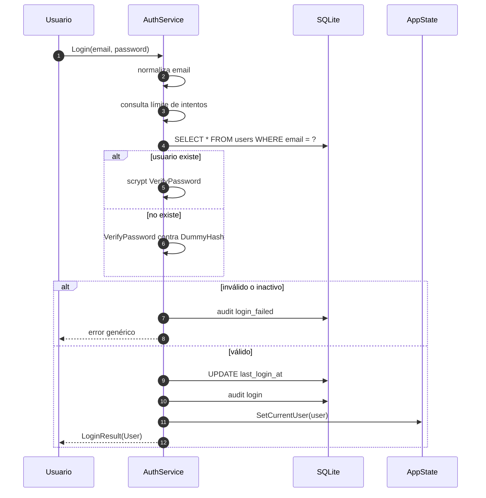

# 04 · Seguridad, privacidad y auditoría

> **Estado:** Vigente.
> **Corte:** 25 de octubre de 2026.
> **Ámbito:** cifrado de la base, llave DPAPI, contraseñas, autenticación,
> autorización por roles, auditoría, respaldos y superficie de exposición.
> **Fuente de verdad:** `Data/DpapiKeyStore.cs`, `Data/Scrypt.cs`,
> `Data/Database.cs`, `Services/AuthService.cs`, `Services/Permissions.cs`,
> `Services/UserService.cs` y `agent-harness/Libro.Cli/Cli.cs`.
> **No cubre:** instalación y runbook ([08](08-operacion-instalador.md)),
> modelo de datos ([03](03-modelo-datos.md)) ni reglas contables
> ([05](05-modulos-flujos.md)).

---

## 1. Postura de seguridad en una página

Libro protege **un archivo local** con **una llave local** y **un usuario de
Windows**. No hay servidor, nube, API ni autenticación de red. La seguridad se
apoya en cuatro capas:

| Capa | Mecanismo | Qué protege | Qué no protege |
| --- | --- | --- | --- |
| Disco | SQLCipher (AES-256) | Contenido de `contabilidad.db` y respaldos. | Metadatos del sistema de archivos, tamaño, fechas, existencia. |
| Llave | DPAPI `CurrentUser` | `clave.bin` contra otra cuenta de Windows o un archivo copiado. | Una sesión de Windows ya comprometida. |
| Identidad | scrypt + rol | Acceso a la aplicación y operaciones por rol. | Acceso directo al archivo con la llave desbloqueada. |
| Trazabilidad | `audit_log` | Quién hizo qué dentro de la app. | Manipulación por quien controla la base y la llave. |

**Modelo de confianza:** el usuario de Windows que ejecuta Libro es el
propietario legítimo de los datos. La aplicación no defiende contra un
administrador del equipo, un proceso con la misma cuenta o alguien que copie
`clave.bin` **y** la base mientras la sesión de Windows esté activa. Sí defiende
contra:

- otra cuenta de Windows en el mismo equipo;
- copiar la carpeta de datos a otro equipo;
- inspeccionar el archivo con `sqlite3`, un editor hexadecimal o un visor de
  texto;
- restaurar un respaldo ajeno sin la llave;
- que un rol sin permiso modifique datos desde la interfaz o el CLI.

**Invariante fiscal:** las facturas son documentos internos. **No son CFDI**,
no se timbran, no hay XML, sello, certificado, PAC ni SAT. La seguridad descrita
aquí no sustituye las obligaciones fiscales del negocio.

---

## 2. Activos y clasificación

| Activo | Ubicación | Sensibilidad | Cifrado en reposo | Se audita |
| --- | --- | --- | --- | --- |
| Base contable | `<data>\contabilidad.db` | Alta | SQLCipher | Parcial |
| Llave maestra | `<data>\clave.bin` | Crítica | DPAPI | No |
| Respaldos | `<data>\respaldos\*.libro` | Alta | SQLCipher | Sí (`backup`) |
| Contraseñas | `users.password_hash` | Alta | scrypt (hash) | Sí (cambio/reseteo) |
| Datos personales de contactos | `contacts` | Media | SQLCipher | Sí (alta/cambio/archivo) |
| Datos de empleados (RFC, CURP, NSS, cuenta bancaria) | `employees` | Alta | SQLCipher | Sí (alta/cambio/baja) |
| Movimientos y facturas | `transactions`, `invoices` | Alta | SQLCipher | Sí |
| Bitácora de auditoría | `audit_log` | Media | SQLCipher | No (es el registro) |
| Registro de aplicación | `<data>\libro.log` | Media | No | No |
| Credenciales demo | Código (`--dev`) | Baja | No | No |
| Configuración del negocio | `company` | Media | SQLCipher | Sí |

`libro.log` **no está cifrado**. No debe contener contraseñas ni la llave; en la
práctica registra mensajes y trazas de excepción. Aun así, puede revelar rutas,
nombres de tablas y detalles operativos: trátalo como información interna.

---

## 3. Cifrado de la base

### 3.1 Motor y algoritmo

- **SQLCipher** mediante `SQLitePCLRaw.bundle_e_sqlcipher 2.1.11` y
  `Microsoft.Data.Sqlite.Core 8.0.21`.
- SQLCipher usa AES-256 en modo CBC con autenticación HMAC-SHA512 por página
  (valores por defecto de la versión empaquetada). Libro **no** cambia
  `cipher_page_size`, `kdf_iter`, `cipher_hmac_algorithm` ni
  `cipher_kdf_algorithm`.
- La llave es de **32 bytes aleatorios** (`RandomNumberGenerator.GetBytes(32)`),
  no una contraseña derivada.
- La llave se entrega como literal hexadecimal:
  `PRAGMA key = "x'<64 hex>'";`.

### 3.2 Secuencia de apertura

```text
Database.OpenAt(path, key, create)
  1. SqliteConnectionStringBuilder
       DataSource = path
       Mode       = ReadWriteCreate | ReadWrite
       Cache      = Private
       Pooling    = false
       DefaultTimeout = 10
  2. connection.Open()
  3. PRAGMA key = "x'...'"                  ← primero, obligatorio
  4. PRAGMA cipher_memory_security = ON
  5. SELECT count(*) FROM sqlite_master     ← valida la llave
  6. PRAGMA foreign_keys = ON
  7. PRAGMA busy_timeout = 5000
  8. PRAGMA synchronous = NORMAL
  9. PRAGMA journal_mode = WAL
```

Detalles que importan:

- **`Pooling=false`**: cada operación abre y cierra su conexión. La llave no se
  reutiliza en un pool que sobreviva a la operación.
- **`cipher_memory_security=ON`**: SQLCipher intenta limpiar memoria sensible;
  es una mitigación, no una garantía contra un volcado de memoria del proceso.
- **Validación temprana**: si `sqlite_master` falla, se lanza
  “No se pudo abrir la base cifrada. La llave no coincide o el archivo está
  dañado.”
- **WAL**: `-wal` y `-shm` también contienen páginas cifradas, pero deben
  copiarse junto con la base o cerrarse limpiamente. Los respaldos usan
  `journal_mode=DELETE` para ser autocontenidos.
- **Sin `ATTACH`**: no se abren bases externas desde la app.

### 3.3 Qué revela el archivo cifrado

Aunque el contenido esté cifrado, el sistema de archivos y SQLCipher exponen:

- existencia y ruta de `contabilidad.db`;
- tamaño aproximado y crecimiento;
- fechas de creación/modificación;
- presencia de `clave.bin`, `respaldos`, `libro.log`;
- que el archivo es SQLCipher (cabecera aleatoria, pero el motor es identificable
  por herramientas especializadas).

No hay cifrado del nombre de archivo, del directorio ni de los metadatos. Si eso
importa, el volumen o la carpeta deben protegerse con BitLocker/EFS/ACL.

### 3.4 Migración desde texto plano

`Database.Initialize` detecta la cabecera `SQLite format 3\0` y migra:

1. checkpoint del WAL;
2. crea `<db>.cifrando` con la llave;
3. copia las 16 tablas;
4. verifica `integrity_check` y `foreign_key_check`;
5. mueve el original a `<db>.plano`;
6. mueve el cifrado a `<db>`;
7. borra `<db>.plano` al verificar.

Ventana de riesgo: durante la migración existen **dos archivos**, uno en texto
plano (`.plano`) y otro cifrado. Si el proceso se interrumpe, el `.plano` puede
quedar en disco. El código intenta restaurarlo y limpiarlo, pero una caída de
energía puede dejar residuos. El procedimiento de recuperación está en
[08](08-operacion-instalador.md).

---

## 4. Llave maestra y DPAPI

### 4.1 Formato de `clave.bin`

| Offset | Bytes | Contenido |
| --- | --- | --- |
| 0 | 4 | ASCII `LBK1` |
| 4 | variable | Blob DPAPI de la llave de 32 bytes |

- La entropía adicional es fija: `Libro.Contabilidad.Key.v1` (UTF-8).
- El ámbito es `DataProtectionScope.CurrentUser`.
- El archivo se escribe primero como `clave.bin.tmp` y se mueve con
  `File.Move(..., overwrite: false)`. Si ya existe, la creación falla en vez de
  sobrescribir.
- Al leer, se valida el magic y que la llave desprotegida mida exactamente 32
  bytes.
- Si DPAPI falla, el mensaje pide verificar que se use **la misma cuenta de
  Windows** que creó los datos.

### 4.2 Propiedades de seguridad

| Propiedad | Efecto |
| --- | --- |
| DPAPI `CurrentUser` | Solo la misma cuenta de Windows puede desproteger el blob. |
| Entropía fija | Un blob copiado no se puede desproteger sin conocer la entropía. |
| 32 bytes aleatorios | La llave no se deriva de contraseña, correo ni nombre de equipo. |
| Sin exportación | La app no ofrece exportar, imprimir ni rotar la llave. |
| Sin ACL explícita | La protección efectiva es la del perfil de usuario de Windows. |

**No hay rotación de llave.** Cambiar `clave.bin` sin re-cifrar la base la deja
inaccesible. Cambiar la contraseña de usuario **no** cambia la llave de la base.

### 4.3 Copia y restauración

- Copiar solo `contabilidad.db` a otro equipo **no** basta: falta `clave.bin`.
- Copiar ambos a otra cuenta de Windows **no** basta: DPAPI no desprotege.
- Copiar ambos a la misma cuenta en otro equipo puede fallar si DPAPI no migró
  el perfil (cuenta local vs. cuenta de dominio, o perfil nuevo).
- Los respaldos `.libro` están cifrados con la **misma llave**; no tienen llave
  propia ni contraseña independiente.
- Si se pierde `clave.bin`, no hay recuperación. La app no guarda una copia de
  respaldo de la llave.

### 4.4 Caso “base cifrada sin `clave.bin`”

`DpapiKeyStore.GetOrCreate` crea una llave nueva si el archivo no existe. En el
arranque normal, si la base ya estaba cifrada con otra llave:

1. se crea un `clave.bin` nuevo;
2. la apertura falla;
3. el `clave.bin` nuevo **no** sirve para la base existente y puede dar una
   falsa sensación de recuperación.

`libro-cli doctor` evita este caso: si detecta una base cifrada sin llave,
**no crea** una llave nueva y reporta el problema. Es una razón para diagnosticar
con `doctor` antes de abrir la app cuando falte `clave.bin`. Véase
[13-hallazgos-riesgos.md](13-hallazgos-riesgos.md).

---

## 5. Contraseñas de usuario

### 5.1 Almacenamiento

Formato exacto:

```text
scrypt$16384$8$1$<saltHex>$<hashHex>
```

| Parámetro | Valor | Nota |
| --- | --- | --- |
| Algoritmo | scrypt | Implementación propia en `Data/Scrypt.cs`. |
| `N` | 16384 | Costo de CPU/memoria. |
| `r` | 8 | Tamaño de bloque. |
| `p` | 1 | Paralelización. |
| Sal | 16 bytes aleatorios | `RandomNumberGenerator.GetBytes(16)`. |
| Hash | 64 bytes | 512 bits. |
| Codificación | hex minúsculas | Compatible con el formato existente. |

- La contraseña se procesa como UTF-8.
- `VerifyPassword` valida la estructura, decodifica sal/hash y compara en tiempo
  constante con `CryptographicOperations.FixedTimeEquals`.
- Un hash con formato inválido devuelve `false`, no lanza.
- El hash **nunca** se muestra en la UI, el CLI ni los reportes. El CLI omite
  `PasswordHash` en sus proyecciones.
- No hay “pepper” ni clave secreta de aplicación.
- No hay rehash automático si se sube `N` en el futuro; habría que hacerlo al
  iniciar sesión.

### 5.2 Política de contraseñas

`Validation.ValidatePassword` exige **mínimo 8 caracteres**. No exige:

- mayúsculas, minúsculas, dígitos ni símbolos;
- que no sea igual al correo o al nombre;
- que no esté en una lista de contraseñas comunes;
- historial, caducidad ni bloqueo por antigüedad.

La única defensa adicional es el límite de intentos. Una contraseña de 8
caracteres débiles es aceptada. La longitud máxima no se valida; el formulario
WPF limita por `MaxLength` si está configurado, y el CLI no impone tope.

### 5.3 Límite de intentos

- Diccionario estático `email → (Count, ResetAt)` en `AuthService`.
- **10 intentos fallidos** dentro de **10 minutos** bloquean ese correo.
- Mensaje: “Demasiados intentos. Espera unos minutos e intenta de nuevo.”
- Un login correcto limpia el contador del correo.
- El estado vive **en el proceso**. Reiniciar la app o ejecutar un CLI one-shot
  reinicia el conteo.
- No hay bloqueo de cuenta persistente, notificación ni retardo progresivo.
- El correo se normaliza a minúsculas; el contador es por correo, no por IP ni
  por usuario.

### 5.4 Defensa contra enumeración de usuarios

Si el correo no existe, `Login` verifica la contraseña contra un hash ficticio
(`DummyHash`) calculado al arrancar. Así el tiempo de respuesta es similar al de
un correo existente. El mensaje es el mismo: “Correo o contraseña incorrectos.”
También se registra `login_failed` con el correo intentado, exista o no.

### 5.5 Cambio y reseteo

| Caso | Quién | Requiere contraseña actual | Requiere permiso | Auditoría |
| --- | --- | --- | --- | --- |
| Cambio propio | Usuario | Sí (`ChangePassword`) | No | `change_password` |
| Reseteo por administrador | `admin` | No | `users.manage` | `reset_password` |
| Alta de usuario | `admin` | No | `users.manage` | `create` |
| Cambio dentro de edición de usuario | `admin` | No | `users.manage` | `update` |

`ChangePassword` se invoca desde el CLI (`auth change-password`) y no está
expuesto en la navegación WPF verificada; el cambio en la UI se hace por
administración. El reseteo por administrador no invalida sesiones existentes
porque no hay sesiones persistentes: al reiniciar, la nueva contraseña aplica.

### 5.6 Credenciales demo

`--dev` con `LIBRO_DEV=1` crea o usa:

```text
admin@libro.local
Secreta123!
```

Son credenciales **públicas y sintéticas**. No deben existir en producción. El
modo dev no cambia la carpeta de datos salvo que `LIBRO_DATA_DIR` lo indique, por
lo que es posible crear el admin demo en una base real si se ejecuta por error.
El binario instalado no activa `--dev` por sí solo.

---

## 6. Autenticación y sesión

### 6.1 Flujo



### 6.2 Propiedades

- La sesión es **en memoria** (`AppState.CurrentUser`).
- La tabla `sessions` **no se usa** en la app nativa ni en el CLI; solo
  `SelfTest` inserta una fila para verificar la migración.
- No hay tokens, cookies, “recordarme”, refresh ni expiración.
- Cerrar sesión (`SignOut`) solo pone `CurrentUser = null`; no borra nada en la
  base.
- Cada proceso del CLI one-shot vuelve a autenticar.
- La REPL conserva la sesión hasta `exit`, EOF o fallo fatal.
- Un usuario desactivado no puede iniciar sesión (`user.Active != 1`), pero una
  sesión ya abierta en otro proceso sigue activa hasta cerrarse; no hay
  invalidación en caliente.
- No hay MFA, biometría, SSO ni integración con Windows Hello.

### 6.3 Setup inicial

`AuthService.Setup`:

1. recorta nombre de empresa, nombre y correo;
2. normaliza el correo a minúsculas;
3. valida empresa/nombre no vacíos, correo y contraseña;
4. exige que **no exista ningún usuario**;
5. en una transacción inserta/actualiza `company(id=1)` con `isr_brackets`
   por defecto, inserta el `admin` y audita `setup`;
6. devuelve el usuario con `last_login_at = now`.

No hay correo de verificación ni recuperación de contraseña por correo. Si se
pierde la contraseña del único admin y no hay otro admin activo, el acceso se
resuelve con una copia de la base y `tools/Libro.DbTool` o con respaldo, no con
un flujo de autoservicio.

---

## 7. Autorización

### 7.1 Modelo

- **Roles fijos en código**, no en base de datos.
- **14 permisos** atómicos.
- Un rol tiene un conjunto de permisos; no hay permisos por usuario.
- La UI oculta o deshabilita acciones; los servicios de escritura revalidan.
- El CLI valida con `RequirePermission`/`RequireAnyPermission` antes de llamar
  al servicio.

### 7.2 Matriz completa

| Permiso | admin | contador | capturista | consulta |
| --- | :---: | :---: | :---: | :---: |
| `users.manage` | ✔ | — | — | — |
| `settings.manage` | ✔ | — | — | — |
| `backup.manage` | ✔ | — | — | — |
| `audit.view` | ✔ | ✔ | — | — |
| `payroll.view` | ✔ | ✔ | — | — |
| `payroll.write` | ✔ | ✔ | — | — |
| `tax.view` | ✔ | ✔ | — | ✔ |
| `reports.view` | ✔ | ✔ | — | ✔ |
| `tx.write` | ✔ | ✔ | ✔ | — |
| `invoice.write` | ✔ | ✔ | ✔ | — |
| `inventory.write` | ✔ | ✔ | ✔ | — |
| `contacts.write` | ✔ | ✔ | ✔ | — |
| `products.write` | ✔ | ✔ | ✔ | — |
| `accounts.write` | ✔ | ✔ | — | — |
| **Total** | **14** | **11** | **5** | **2** |

Etiquetas y descripciones visibles:

| Rol | Etiqueta | Descripción en la UI |
| --- | --- | --- |
| `admin` | Administrador | “Acceso total, usuarios, respaldos y configuración.” |
| `contador` | Contador | “Operación contable, facturas, nómina, impuestos y reportes.” |
| `capturista` | Capturista | “Captura de movimientos, facturas, contactos e inventario.” |
| `consulta` | Consulta | “Solo lectura de reportes, impuestos y operación.” |

La descripción de `consulta` dice “solo lectura de … operación”, pero el rol
**no** tiene permisos de lectura explícitos para movimientos, facturas,
contactos, inventario ni productos. Esos módulos se abren porque la navegación
no los bloquea y los servicios de lectura no validan permisos; las acciones de
escritura sí se rechazan. Es una inconsistencia de diseño, no una elevación de
privilegios de escritura.

### 7.3 Puntos de aplicación

| Punto | Qué valida | Ejemplo |
| --- | --- | --- |
| Navegación WPF | Visibilidad de módulos sensibles. | Nómina, impuestos, reportes, usuarios. |
| Botones/acciones WPF | `AppState.Can(...)` antes de abrir diálogos o guardar. | `TransactionsView` exige `tx.write`. |
| Servicios de escritura | Revalidan el permiso. | `InvoiceService.Save` exige `invoice.write`. |
| CLI | `RequirePermission` por grupo/acción. | `users list` exige `users.manage`. |
| Esquema | `CHECK` de rol y tipo. | `users.role IN (...)`. |

### 7.4 Cobertura por servicio

| Servicio | Escritura protegida | Lectura protegida | Observación |
| --- | --- | --- | --- |
| `AuthService` | N/A | N/A | Puerta de autenticación. |
| `CompanyService` | **No** | No | Confía en UI/CLI; es la excepción. |
| `ContactService` | Sí | Parcial (`GetContact`, `GetStats`) | `GetContacts` no exige permiso. |
| `EmployeeService` | Sí | No | `GetEmployees` no exige `payroll.view`. |
| `InventoryService` | Sí | No | `GetProducts` no exige permiso. |
| `InvoiceService` | Sí | No | Lectura abierta a cualquier sesión. |
| `PayrollService` | Sí | No | `GetPeriods`/`GetItems` no exigen `payroll.view`. |
| `TransactionService` | Sí | Parcial (`GetTransaction`) | `GetTransactions` no exige permiso. |
| `UserService` | Sí | No | `GetUsers` se usa en la UI protegida. |
| `AuditService` | N/A | Sí (`audit.view`) | Correcto. |

**Riesgo real:** cualquier usuario autenticado, incluido `consulta`, puede leer
datos de nómina, facturas, contactos e inventario si llega a la pantalla o usa el
CLI con un comando de lectura que no exija permiso. La escritura sí está
contenida. La matriz de lectura efectiva es más amplia que la matriz declarada.
Véase [13-hallazgos-riesgos.md](13-hallazgos-riesgos.md).

### 7.5 Límites de la autorización

- No hay autorización a nivel de fila (por sucursal, cliente o periodo).
- No hay separación de funciones: un `contador` puede crear una factura,
  emitirla, cobrarla y cancelarla.
- No hay aprobación de nómina ni de gastos.
- No hay registro de “visto bueno” ni firmas.
- `CompanyService` no revalida: si un futuro punto de entrada llama
  `SaveCompany` sin comprobar `settings.manage`, se puede escribir.
- El CLI y la UI comparten la misma sesión lógica, pero no hay un servidor que
  impida a un proceso local modificar la base si tiene la llave.

### 7.6 Último administrador

`UserService` impide:

- que un admin se quite a sí mismo el rol o se desactive;
- que se desactive al último admin activo;
- que se cambie el rol del último admin a otro rol.

La comprobación `EnsureAnotherAdmin` cuenta `role='admin' AND active=1 AND id<>?`.
No impide que un admin cambie el correo o la contraseña de otro admin. No hay
recuperación si el único admin olvida su contraseña y no hay otro admin activo.

---

## 8. Auditoría

### 8.1 Tabla `audit_log`

| Columna | Tipo | Contenido |
| --- | --- | --- |
| `id` | INTEGER | PK. |
| `user_id` | INTEGER NULL | Actor; `NULL` en sistema. |
| `action` | TEXT | Verbo de la operación. |
| `entity` | TEXT | Tipo de entidad. |
| `entity_id` | TEXT | ID o cadena vacía. |
| `detail` | TEXT | Contexto legible. |
| `created_at` | TEXT | `datetime('now')` UTC. |

Índice: `idx_audit_created (created_at)`.

### 8.2 Acciones registradas

| Acción | Entidad | Quién | Detalle típico |
| --- | --- | --- | --- |
| `setup` | `company` | Sistema | “Alta inicial de …” |
| `login` | `user` | Usuario | — |
| `login_failed` | `user` | Sistema | Correo intentado |
| `change_password` | `user` | Usuario | — |
| `reset_password` | `user` | Admin | Nombre del usuario |
| `create` | `user` | Admin | Nombre · rol |
| `update` | `user` | Admin | Nombre · rol |
| `activate` / `deactivate` | `user` | Admin | Nombre |
| `create` / `update` / `archive` / `restore` | `account` | Admin/contador | Nombre |
| `create` / `update` | `category` | Admin/contador | Nombre |
| `create` / `update` / `archive` / `restore` | `contact` | Capturista+ | Nombre |
| `create` / `update` / `archive` / `restore` | `product` | Capturista+ | Nombre |
| `create` / `update` / `delete` | `transaction` | Capturista+ | Descripción/monto |
| `entrada` / `salida` / `ajuste` | `inventory` | Capturista+ | Producto/cantidad |
| `create` / `update` / `emit` / `cancel` / `delete` | `invoice` | Capturista+ | Total, folio, motivo |
| `payment` / `delete_payment` | `invoice` | Capturista+ | Monto |
| `create` / `update` / `delete` | `employee` | Contador+ | Nombre |
| `update` / `delete` | `payroll_item` | Contador+ | Neto |
| `pay` | `payroll` | Contador+ | Neto, cuenta y fecha |
| `delete` | `payroll` | Contador+ | Etiqueta del periodo |
| `backup` | `database` | Sistema | Nombre del archivo |
| `restore` | `database` | Sistema | Nombre del archivo |

No se auditan:

- lecturas, exportaciones CSV ni consultas de reportes;
- cambios de configuración de la empresa que no pasen por `SaveCompany`;
- reintentos de pago de nómina rechazados (solo se audita el pago exitoso);
- intentos de permiso denegado;
- cambios directos por SQL.

### 8.3 Atomicidad

| Operación | ¿Auditoría en la misma transacción? |
| --- | --- |
| Alta/cambio de contacto | Sí. |
| Alta/cambio/archivo de producto | Sí. |
| Movimiento de inventario | Sí. |
| Factura (crear/editar/emitir/cancelar/borrar) | Sí. |
| Pago/eliminación de pago | Sí. |
| Movimiento manual | Sí. |
| Nómina (conceptos/periodo) | Parcial; algunas acciones usan `Db.Audit` fuera de la transacción. |
| Login/fallo de login | No; llamadas separadas. |
| Respaldo/restauración | No; no aplica una transacción de base al archivo. |
| Usuarios | No; `UPDATE` y `Audit` separados. |

La consecuencia es que una caída entre la escritura y la auditoría puede dejar
una operación sin rastro, o un rastro sin operación. La app no repara esa
divergencia.

### 8.4 Límites forenses

- La auditoría vive **dentro** de la base que protege. Quien tenga la llave y
  acceso de escritura puede alterarla o borrarla.
- No hay firma, hash encadenado, sellado de tiempo externo ni envío a un
  tercero.
- No hay triggers: una escritura directa por SQL no genera auditoría.
- `created_at` es UTC de SQLite; la UI lo presenta en hora de México.
- `detail` es texto libre; puede contener nombres, correos y montos, pero no
  contraseñas ni hashes.
- No hay retención, purga ni exportación firmada. La tabla crece sin límite.
- La UI limita la consulta a 500 entradas por defecto; el CLI tiene `--limit`.

La auditoría es **trazabilidad operativa**, no prueba forense. Para un dictamen
externo se necesitaría exportación inmutable y control de acceso separado.

---

## 9. Respaldos y restauración

### 9.1 Creación

`Database.BackupTo(destination?)`:

1. crea la carpeta de respaldos;
2. nombre por defecto `Libro-yyyyMMdd-HHmmss.libro` (hora local);
3. escribe en `<destino>.creando`;
4. `source.BackupDatabase(target)` con la misma llave;
5. `wal_checkpoint(TRUNCATE)` y `journal_mode=DELETE` en la copia;
6. `PRAGMA integrity_check` debe ser `ok`;
7. borra `-wal`/`-shm` temporales y mueve al destino;
8. audita `backup` con el nombre del archivo.

La copia es un archivo SQLCipher completo, no un ZIP ni un volcado SQL. No se
comprime ni se cifra con contraseña adicional. La seguridad es la misma llave
DPAPI.

### 9.2 Restauración

`Database.RestoreFrom(backupPath)`:

1. exige que el archivo exista;
2. lo abre con la llave actual y verifica `integrity_check` (si falla, no toca
   nada);
3. crea un respaldo de seguridad
   `Libro-antes-restaurar-yyyyMMdd-HHmmss.libro`;
4. copia el respaldo a `contabilidad.db.restaurando`;
5. verifica de nuevo;
6. borra `-wal`/`-shm` de la base actual;
7. mueve el temporal sobre `contabilidad.db`;
8. abre y verifica la base restaurada;
9. audita `restore`;
10. si algo falla, borra el temporal e intenta copiar el respaldo de seguridad
    sobre la base.

En la UI, tras restaurar se muestra un mensaje y **se cierra la aplicación**
para recargar. En el CLI, `backup restore` reemplaza la base en el proceso y
refresca `AppState.Company`; exige `--yes`. La diferencia está documentada en
[07](07-cli.md).

### 9.3 Seguridad operativa

| Riesgo | Mitigación actual | Residual |
| --- | --- | --- |
| Respaldo robado | SQLCipher + DPAPI. | Si se copia `clave.bin` y la cuenta está desbloqueada, se abre. |
| Respaldo corrupto | `integrity_check` antes de restaurar. | Un daño lógico (datos válidos pero incorrectos) no se detecta. |
| Restauración accidental | Confirmación en UI; `--yes` en CLI. | Un script puede pasar `--yes` sin revisar. |
| Pérdida de la base | Respaldo de seguridad antes de restaurar. | Si el disco muere, se necesitan copias externas. |
| Respaldo de otra versión | Se abre si el esquema es compatible. | No hay migrador de respaldos. |
| Respaldo en otra carpeta | `backup create --output`. | `backup list` no lo muestra. |

**No hay respaldo automático, programado ni a la nube.** El usuario debe
copiar los `.libro` a otro medio. La app no verifica que exista una copia
externa.

### 9.4 Ubicación y ACL

Los respaldos viven por defecto en `<data>\respaldos`. La carpeta hereda las
ACL del perfil del usuario. No se aplican ACL adicionales, ni se ocultan, ni se
marcan como solo lectura. Cualquier proceso de la misma cuenta puede leerlos.

---

## 10. Registro de aplicación

`AppLog` escribe en `<data>\libro.log`:

```text
yyyy-MM-dd HH:mm:ss.fff <mensaje>
```

- No hay rotación, límite de tamaño ni nivel configurable.
- Si no puede crear la carpeta, usa `%TEMP%\libro.log`.
- Registra inicio, errores de arranque, fallos de respaldo/restauración y
  excepciones no controladas.
- **No registra** contraseñas, la llave ni hashes.
- Una traza de excepción puede incluir rutas, nombres de tablas, parámetros SQL
  y mensajes de SQLite. No se debe compartir sin revisión.
- No hay telemetría ni envío remoto.

Buenas prácticas:

- revisar `libro.log` antes de soporte;
- no publicarlo en tickets sin redactar rutas y datos;
- borrarlo solo con la app cerrada;
- no confundirlo con `audit_log`, que sí es funcional.

---

## 11. Secretos en el CLI

### 11.1 Fuentes de credenciales

| Fuente | Sintaxis | Riesgo |
| --- | --- | --- |
| Argumento | `--password clave` | Visible en el historial y en la lista de procesos. |
| Variable de entorno | `LIBRO_PASSWORD` | Visible para procesos del mismo usuario; no queda en el historial. |
| Variable nombrada | `--password-env LIBRO_CLAVE` | Igual que la anterior, pero explícita. |
| REPL | `auth login` sin argumentos | Lee la contraseña sin eco. |
| Prompt interactivo | `auth setup` / `reset-password` | Lectura sin eco si es interactivo. |

Recomendación: usar `LIBRO_PASSWORD` o `--password-env`, nunca `--password` en
scripts compartidos. El CLI no escribe la contraseña en logs ni en JSON.

### 11.2 Qué no sale del CLI

- `password_hash` no se proyecta en `users list`, `users summary` ni `doctor`.
- `doctor` no imprime la llave ni el contenido de `clave.bin`.
- El JSON de error no incluye la contraseña; con `--debug` incluye la traza, que
  puede contener rutas y parámetros, pero no la contraseña en claro.
- `auth status` muestra el usuario y su rol, no el hash.

### 11.3 `--data-dir` y aislamiento

`--data-dir` fija `LIBRO_DATA_DIR` antes de inicializar. El CLI no impide
apuntar a la carpeta real; es una herramienta de operación. Las pruebas usan
`%TEMP%` y verifican explícitamente que no sea
`%LOCALAPPDATA%\Libro\data`. Un agente debe usar `--data-dir` en pruebas y
`--json doctor` antes de escribir.

### 11.4 REPL

- La sesión vive en memoria; no se escribe en `sessions`.
- Cambiar `--data-dir` dentro de la REPL lanza un error; hay que reiniciar.
- Un error de comando no cierra la REPL.
- `exit`, `quit`, `q`, EOF o `Ctrl+C` terminan el proceso y descartan la sesión.

---

## 12. Distribución e integridad

| Control | Estado |
| --- | --- |
| Instalación por usuario | Sí; `PrivilegesRequired=lowest`. |
| Instalación en `%LOCALAPPDATA%\Programs\Libro` | Sí. |
| Datos fuera de `{app}` | Sí; `%LOCALAPPDATA%\Libro\data` se conserva al desinstalar. |
| Firma de código | **No**; el build no firma el `.exe`. |
| Verificación SHA256 | Se publica `dist\Libro-Setup-2.0.0.exe.sha256`. |
| Reproducibilidad | No garantizada; el publish incluye el runtime y la fecha. |
| Actualizaciones automáticas | No. |
| Privilegios de administrador | No requeridos. |

Sin firma, SmartScreen puede advertir y un tercero no puede verificar el origen
con una cadena de confianza. El SHA256 permite verificar integridad si se
distribuye por un canal confiable. El instalador debe obtenerse del artefacto
publicado, no de una copia intermedia. Detalle en
[08](08-operacion-instalador.md).

---

## 13. Modelo de amenazas

| # | Amenaza | Vector | Mitigación actual | Residual |
| --- | --- | --- | --- | --- |
| T1 | Robo del equipo | Disco extraído o copia de la carpeta. | SQLCipher + DPAPI. | Si la sesión está desbloqueada, `clave.bin` se desprotege. |
| T2 | Otro usuario de Windows | Acceso al perfil. | ACL del perfil + DPAPI `CurrentUser`. | Un admin local puede tomar el perfil o volcar memoria. |
| T3 | Copia a otro equipo | `contabilidad.db` + `clave.bin`. | DPAPI no migra sin el perfil. | Perfil migrado con la misma credencial puede abrirlo. |
| T4 | Fuerza bruta de contraseña | Login repetido. | scrypt + límite 10/10 min + mensaje genérico. | El límite es por proceso; se reinicia. |
| T5 | Usuario interno con rol bajo | UI/CLI. | Permisos de escritura y navegación. | Lecturas amplias y `CompanyService` sin revalidar. |
| T6 | Modificación directa de la base | SQLCipher con llave. | Ninguna. | La auditoría es editable; no hay firma. |
| T7 | Respaldo manipulado | `.libro` alterado. | `integrity_check`. | No detecta cambios lógicos válidos. |
| T8 | Malware en la sesión | Keylogger, inyección, volcado. | Ninguna específica. | Compromiso total. |
| T9 | Pérdida de `clave.bin` | Borrado, disco dañado. | Ninguna copia automática. | Datos irrecuperables. |
| T10 | Instalador alterado | Distribución no firmada. | SHA256 publicado. | Sin firma, el usuario debe confiar en el canal. |
| T11 | Fuga por logs | `libro.log` compartido. | No contiene secretos. | Rutas y trazas pueden ser sensibles. |
| T12 | Acceso físico con sesión abierta | Equipo desatendido. | Bloqueo de Windows (externo). | La app no tiene bloqueo por inactividad. |
| T13 | Fuerza bruta al hash | Robo de la base + llave. | scrypt N=16384. | Costo moderado; no hay pepper. |
| T14 | Suplantación de admin | Reset de contraseña por otro admin. | `users.manage` + auditoría. | No hay aprobación de dos personas. |
| T15 | Borrado accidental | Restauración o borrado. | Respaldo de seguridad + confirmación. | El respaldo de seguridad puede estar en el mismo disco. |

### Escenarios clave

**“Me robaron la laptop.”**
Si la sesión de Windows estaba bloqueada o apagada, el atacante necesita la
contraseña de Windows o un exploit para desbloquear DPAPI. Si estaba desbloqueada
y con Libro abierto, la llave está en memoria y el riesgo es alto. No hay
borrado remoto.

**“Copié la carpeta a otra PC.”**
La base no abre: DPAPI falla. El mensaje pide la misma cuenta de Windows. No hay
forma de exportar la llave desde la app.

**“Perdí `clave.bin`.”**
No hay recuperación. Los respaldos tampoco sirven sin la llave. La única
posibilidad es un respaldo del perfil de Windows o una copia de `clave.bin`
hecha antes de la pérdida.

**“Un contador renunció.”**
Hay que desactivarlo y cambiar las contraseñas de los admins. La desactivación
impide nuevos inicios, pero no cierra sesiones ya abiertas. No hay revocación de
tokens porque no hay tokens.

**“Sospecho que alteraron la auditoría.”**
No hay forma criptográfica de detectarlo. Se puede comparar con respaldos
anteriores o con registros externos, pero la base no está sellada.

---

## 14. Hallazgos de seguridad

| ID | Hallazgo | Impacto | Prioridad |
| --- | --- | --- | --- |
| SEC-01 | `CompanyService` no revalida permisos. | Un punto de entrada futuro puede escribir configuración sin `settings.manage`. | Alta |
| SEC-02 | Lecturas de nómina, facturas, contactos e inventario sin permiso explícito. | Un rol `consulta` o `capturista` puede leer más de lo declarado si llega a la pantalla/CLI. | Alta |
| SEC-03 | Límite de intentos solo en memoria. | Fuerza bruta reiniciando procesos. | Media |
| SEC-04 | Contraseña mínima de 8 caracteres sin complejidad. | Contraseñas débiles. | Media |
| SEC-05 | Sin firma de código. | SmartScreen y riesgo de instalador alterado. | Media |
| SEC-06 | Sin rotación de llave ni copia de seguridad de `clave.bin`. | Pérdida total si se borra. | Alta |
| SEC-07 | Arranque normal crea `clave.bin` si falta, aunque la base esté cifrada. | Falsa recuperación y posible confusión. | Media |
| SEC-08 | `--password` en línea de comandos. | Exposición en historial/procesos. | Media |
| SEC-09 | Auditoría editable por el propietario de la base. | No es prueba forense. | Informativa |
| SEC-10 | `libro.log` sin rotación ni redacción. | Crecimiento y fuga de rutas/trazas. | Baja |
| SEC-11 | Sin bloqueo por inactividad. | Equipo desatendido con sesión abierta. | Media |
| SEC-12 | Sin MFA. | Robo de contraseña suficiente. | Baja (app local) |
| SEC-13 | `sessions` sin uso. | No hay revocación ni “recordarme”. | Informativa |
| SEC-14 | Migración de texto plano deja `.plano` temporal. | Residuo sin cifrar si falla. | Media |
| SEC-15 | `UserService.SaveUser` actualiza perfil antes de validar contraseña nueva. | Cambio parcial si la contraseña es inválida; no es escalada, pero deja estado inconsistente. | Media |

El detalle de causas, evidencia y acciones está en
[13-hallazgos-riesgos.md](13-hallazgos-riesgos.md).

---

## 15. Endurecimiento recomendado

### 15.1 Inmediato, sin cambiar el modelo

1. **Usar contraseñas largas** (16+ caracteres) para todos los usuarios,
   especialmente el admin.
2. **No usar `--password`** en scripts; preferir `LIBRO_PASSWORD` o
   `--password-env`.
3. **Guardar una copia de `clave.bin`** en un medio seguro y separado de la
   base, con la misma cuenta de Windows o un perfil migrado.
4. **Copiar respaldos `.libro`** a otro disco o medio extraíble
   periódicamente.
5. **Mantener la cuenta de Windows con contraseña** y bloqueo automático.
6. **No ejecutar `--dev`** fuera de desarrollo.
7. **Revisar `libro.log`** antes de compartirlo.
8. **Verificar el SHA256** del instalador antes de instalar.
9. **Desactivar usuarios** que ya no operan y resetear contraseñas de admins
   cuando alguien sale.
10. **No compartir `clave.bin`** por correo, chat ni nube sin cifrado adicional.

### 15.2 Cambios de código recomendados

| Prioridad | Cambio | Archivo |
| --- | --- | --- |
| Alta | Añadir `EnsurePermission` a `CompanyService` o mover la validación a un interceptor. | `Services/CompanyService.cs` |
| Alta | Exigir permiso de lectura en servicios sensibles o declarar lectura abierta explícitamente. | Servicios y `Permissions.cs` |
| Alta | No crear `clave.bin` si existe una base cifrada y la llave falta; fallar con instrucciones. | `Data/Database.cs`, `Data/DpapiKeyStore.cs` |
| Media | Persistir el límite de intentos o añadir retardo exponencial. | `Services/AuthService.cs` |
| Media | Validar la contraseña nueva **antes** de actualizar el perfil en `SaveUser`. | `Services/UserService.cs` |
| Media | Añadir bloqueo por inactividad o exigir contraseña para reanudar. | `MainWindow`/`App` |
| Media | Firmar el instalador y documentar la huella. | `installer/build-native.ps1` |
| Baja | Rotación de llave con re-cifrado y respaldo previo. | `Data/Database.cs` |
| Baja | Limpiar `.plano` con sobrescritura o cifrado temporal. | `Data/Database.cs` |
| Baja | Rotación y redacción de `libro.log`. | `Util/AppLog.cs` |

### 15.3 Checklist de revisión antes de publicar

- [ ] La matriz de permisos coincide con `Permissions.cs`.
- [ ] Ningún servicio de escritura nuevo omite la revalidación.
- [ ] Ningún comando del CLI nuevo omite `RequirePermission`.
- [ ] Las pruebas usan `--data-dir` temporal.
- [ ] No hay contraseñas, llaves ni hashes en documentación, logs o capturas.
- [ ] El instalador se generó desde el código actual y su SHA256 está publicado.
- [ ] Los respaldos se probaron con restauración real.
- [ ] Las facturas se describen como internas, no CFDI.

---

## 16. Privacidad y datos personales

### 16.1 Datos personales tratados

| Titular | Datos | Tabla | Finalidad |
| --- | --- | --- | --- |
| Usuarios | Nombre, correo, rol, último acceso. | `users` | Autenticación y autorización. |
| Contactos | Nombre, RFC, correo, teléfono, dirección, notas. | `contacts` | Facturación interna y cobranza. |
| Empleados | Nombre, RFC, CURP, NSS, puesto, departamento, salario, banco, cuenta. | `employees` | Nómina interna. |
| Terceros en movimientos | Proveedor/cliente, referencias. | `transactions`, `invoices` | Operación contable. |

No se recopilan datos de navegación, ubicación, dispositivos ni telemetría. No
hay transferencia a terceros. Todo vive en la computadora del usuario.

### 16.2 Principios aplicables

- **Minimización:** la app pide solo los datos necesarios para operar; el RFC,
  CURP y NSS son opcionales en la práctica (texto vacío permitido).
- **Finalidad:** contabilidad interna, nómina y cobranza. No hay marketing.
- **Seguridad:** cifrado en reposo, control por roles y auditoría.
- **Conservación:** no hay borrado automático ni retención definida; el usuario
  decide cuándo archivar o restaurar.
- **Derechos ARCO:** no hay un flujo automatizado de acceso, rectificación,
  cancelación u oposición. Se pueden ejercer por administración de la base o
  exportación CSV, con riesgo de eliminar historial contable.
- **Transferencias:** ninguna; la app es local.

### 16.3 Advertencia

Esta sección es descriptiva y no constituye asesoría legal. La operación real
debe cumplir la legislación aplicable en México (LFPDPPP y su reglamento,
Código Fiscal de la Federación, Ley Federal del Trabajo, normas del SAT) y las
políticas del negocio. Libro **no** es un sistema certificado de nómina ni de
facturación electrónica.

---

## 17. Respuesta a incidentes

| Incidente | Primeros pasos | Qué conservar | Qué no hacer |
| --- | --- | --- | --- |
| Pérdida de `clave.bin` | Detener la app; buscar copia en respaldos del perfil; no crear una llave nueva sobre la base existente. | `contabilidad.db`, `respaldos`, copia del perfil. | No borrar la base ni “reinicializar”. |
| Base corrupta | Copiar la carpeta completa a otro medio; probar `doctor`; restaurar un respaldo verificado. | Base, WAL/SHM, respaldos, `libro.log`. | No ejecutar `VACUUM` ni herramientas que escriban sobre el original. |
| Respaldo corrupto | Probar otro respaldo; verificar `integrity_check`; no sobrescribir el actual. | El archivo corrupto y el log. | No restaurarlo sobre la base buena. |
| Robo de equipo | Cambiar contraseñas de Windows y Libro; revocar acceso a respaldos externos; asumir compromiso si la sesión estaba abierta. | Denuncia y registros. | No confiar en la auditoría local como única prueba. |
| Empleado despedido con acceso | Desactivar usuario; cambiar contraseñas de admin; revisar auditoría; rotar respaldos compartidos. | `audit_log`, respaldos. | No borrar al usuario (se pierde trazabilidad). |
| Instalador sospechoso | No ejecutar; verificar SHA256; comparar con el artefacto publicado. | Archivo y origen. | No instalar “para probar”. |
| Fuga de `clave.bin` + base | Asumir datos comprometidos; no hay rotación automática; restaurar en una cuenta limpia y evaluar re-cifrado manual. | Evidencia. | No seguir usando la misma llave. |

### Contacto y soporte

El mensaje de arranque pide conservar `clave.bin` y contactar a soporte. No hay
un canal técnico definido en el repositorio. La documentación no incluye
credenciales reales ni datos de usuarios.

---

## 18. Verificación rápida

```powershell
# Diagnóstico sin revelar secretos
agent-harness\libro-cli.cmd --json doctor

# Estado de la sesión y permisos efectivos
agent-harness\libro-cli.cmd --json auth status

# Matriz de roles
agent-harness\libro-cli.cmd --json users roles

# Auditoría reciente (requiere audit.view)
agent-harness\libro-cli.cmd --json audit list --limit 20
```

Comprobaciones manuales:

1. Copiar solo `contabilidad.db` a otra carpeta y abrir con `doctor`: debe
   reportar base cifrada sin llave, no crear una nueva.
2. Copiar `contabilidad.db` + `clave.bin` a otra cuenta de Windows: debe fallar
   con el mensaje de DPAPI.
3. Intentar iniciar sesión 11 veces con contraseña incorrecta: el intento 11
   debe bloquearse.
4. Iniciar sesión como `consulta` y comprobar que no puede guardar movimientos,
   facturas, contactos, productos, nómina ni usuarios.
5. Crear un respaldo, renombrarlo, corromperlo y restaurarlo: debe fallar sin
   tocar la base.
6. Revisar `audit_log` tras crear, editar y borrar un movimiento manual.

---

## 19. Documentos relacionados

- [03-modelo-datos.md](03-modelo-datos.md): columnas, FKs y reglas de borrado.
- [05-modulos-flujos.md](05-modulos-flujos.md): reglas de negocio y estados.
- [07-cli.md](07-cli.md): credenciales, opciones y códigos de salida.
- [08-operacion-instalador.md](08-operacion-instalador.md): instalación,
  respaldos y recuperación.
- [09-pruebas.md](09-pruebas.md): evidencias de cifrado, migración y
  restauración.
- [13-hallazgos-riesgos.md](13-hallazgos-riesgos.md): riesgos priorizados.
- [14-decisiones.md](14-decisiones.md): por qué se eligió SQLCipher/DPAPI.
