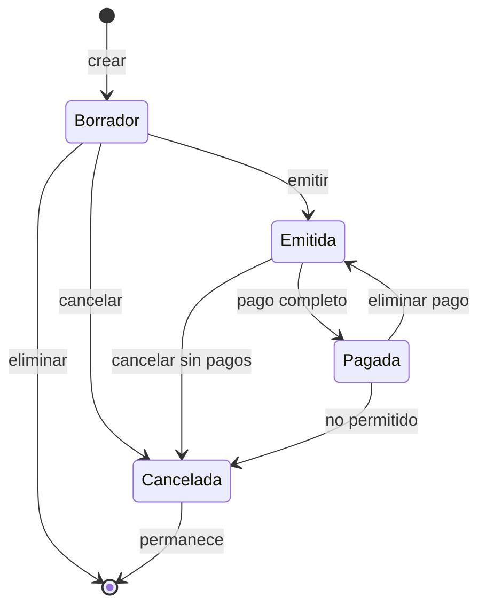

# 05 · Módulos, reglas y flujos

> **Estado:** Vigente.
> **Corte:** 25 de octubre de 2026.
> **Ámbito:** reglas de negocio, fórmulas, máquinas de estado y efectos
> cruzados de todos los módulos de Libro 2.0.0.
> **Fuente de verdad:** `desktop/Libro.Desktop/Services/*.cs`,
> `desktop/Libro.Desktop/Payroll/Isr.cs` y `Util/*.cs`.
> **No cubre:** pantallas ([06](06-mapa-ui.md)), comandos del CLI
> ([07](07-cli.md)) ni columnas de la base ([03](03-modelo-datos.md)).

---

## 1. Principios transversales

Todo el dominio comparte estas reglas:

1. **Dinero en centavos enteros.** No se usa `double` para importes. Las tasas
   sí son `double` en `0..1`.
2. **Redondeo `MidpointRounding.AwayFromZero`** en cada línea y en cada
   conversión de tasa a centavos.
3. **Fechas de negocio `yyyy-MM-dd`.** Se comparan como texto ordinal.
4. **IVA por línea, no por factura.** Cada concepto tiene su propia tasa.
5. **Una sola fuente por ingreso.** Una venta facturada vive en `invoices`; una
   venta no facturada, en `transactions` con `type='ingreso'`. No se duplica.
6. **Los movimientos automáticos no se editan.** `transactions.source` distingue
   `manual`, `inventario` y `nomina`.
7. **Los catálogos se archivan, no se borran.** Contactos, productos, cuentas y
   categorías usan baja lógica.
8. **Las escrituras críticas son transaccionales.** La operación y su auditoría
   suelen confirmarse juntas.
9. **El permiso se valida en la UI/CLI y, en la mayoría de servicios, también en
   el servicio.** La excepción es `CompanyService`.
10. **Las facturas son internas, no CFDI.** No hay timbrado, XML, PAC ni SAT.

---

## 2. Convenciones de cálculo

### 2.1 Importes

```text
iva_linea   = round(subtotal_linea * iva_rate)
total_linea = subtotal_linea + iva_linea
```

- `subtotal_linea` se recibe ya en centavos.
- En movimientos: `subtotal` viene del usuario; `iva` y `total` se recalculan
  en el servicio. El cliente no puede imponer `total`.
- En facturas: `subtotal`, `iva` y `total` de cada línea son propiedades
  calculadas de `InvoiceLineInput`; los totales de la factura se suman de las
  líneas y se vuelven a sumar desde `invoice_items` al emitir.
- En inventario: la compra usa `round(qty * unit_cost)`.
- En nómina: `round` sobre días, ISR e IMSS.

### 2.2 Cantidades

- `qty` es `double` con hasta 3 decimales en la presentación.
- Se usa `qty > 0` para entradas/salidas; el ajuste admite cualquier valor
  absoluto `>= 0`.
- La comparación de stock usa tolerancia `0.000001` solo para detectar un
  ajuste sin diferencia.
- No hay redondeo de stock a 3 decimales al guardar; la UI formatea.

### 2.3 Fechas

- `Dates.TodayIso()` usa la zona de México.
- `Dates.DiffDays(a, b)` cuenta días de calendario; para rangos inclusivos se
  suma 1.
- Un periodo mensual va del día 1 al último del mes.
- Una quincena 1 va del 1 al 15; la 2, del 16 al último día.

---

## 3. Panel

`DashboardService.GetDashboard` calcula el mes actual y una serie de 6 meses.

| Indicador | Fórmula exacta | Notas |
| --- | --- | --- |
| Ingresos del mes | `Σ invoices.subtotal` con `status IN ('emitida','pagada')` y `date` en el mes + `Σ transactions.subtotal` con `type='ingreso'` en el mes | Sin IVA. |
| Gastos del mes | `Σ transactions.subtotal` con `type='gasto'` en el mes | Sin IVA; incluye compras de inventario y nómina pagada. |
| Utilidad del mes | Ingresos − Gastos | No resta COGS por separado. |
| IVA trasladado | `Σ invoices.iva` (emitidas/pagadas del mes) + `Σ transactions.iva` (ingresos del mes) | Por fecha de factura/movimiento, no por cobro. |
| IVA acreditable | `Σ transactions.iva` (gastos del mes) | Por fecha de gasto. |
| Por cobrar | `Σ (invoices.total − invoices.paid)` con `status='emitida'` y `date <= hoy` | Excluye facturas vencidas futuras y borradores. |
| Vencidas | Conteo de `status='emitida'`, `due_date < hoy` y saldo `> 0` | Solo conteo, no monto. |
| Caja | Suma de saldos de cuentas activas | Incluye saldo inicial, movimientos y pagos. |
| Inventario | `Σ round(stock * cost)` de productos activos con `track_stock=1` | Valor a costo, no a precio. |
| Serie 6 meses | Ingresos facturados + otros ingresos vs. gastos, por mes | Para las barras. |
| Stock bajo | 5 productos activos con `track_stock=1` y `stock <= min_stock` | Incluye stock 0. |

**Etiqueta engañosa verificada:** la UI dice “IVA trasladado · Cobrado en
ventas”, pero el cálculo usa facturas **emitidas o pagadas por fecha**, no
pagos cobrados. Una factura emitida y no cobrada ya suma IVA trasladado. Es una
diferencia de criterio (devengo vs. flujo) documentada en
[13-hallazgos-riesgos.md](13-hallazgos-riesgos.md).

**Diferencia de “por cobrar”:** el panel filtra `date <= hoy`; la vista de
Facturas y `ContactService.GetStats` suman **todas** las facturas `emitida`,
incluidas las de fecha futura. La antigüedad de saldos también incluye todas.
No es un error de suma, pero los tres números pueden no coincidir.

---

## 4. Movimientos

### 4.1 Propósito

Registrar **ingresos no facturados** y **gastos** con categoría, cuenta,
contacto opcional, IVA y método. Es la vía para la operación que no pasa por una
factura interna.

### 4.2 Validaciones de `TransactionService.Save`

| Regla | Mensaje |
| --- | --- |
| Fecha `yyyy-MM-dd` válida | “La fecha no es válida.” |
| Tipo `ingreso` o `gasto` | “Selecciona si es un ingreso o un gasto.” |
| `subtotal > 0` | “Escribe un monto mayor a cero.” |
| Descripción no vacía | “Escribe una descripción.” |
| Categoría existente, activa y del tipo correcto | “Un ingreso debe usar una categoría de ingreso.” / “Un gasto debe usar una categoría de gasto o costo.” |
| Cuenta existente y activa | “La cuenta de efectivo no existe o está inactiva.” |
| Contacto existente si se indica | “El contacto seleccionado no existe.” |
| `0 <= iva_rate <= 1` | “La tasa de IVA no es válida.” |

No se valida que el contacto sea cliente o proveedor según el tipo de
movimiento; cualquier contacto existente sirve.

### 4.3 Cálculo y persistencia

```text
iva   = round(subtotal_cents * iva_rate)
total = subtotal_cents + iva
```

- Alta: inserta `source='manual'` y `created_by`.
- Edición: solo si `source='manual'`; actualiza `updated_at`.
- Borrado: solo si `source='manual'`; `DELETE` físico con auditoría.
- Movimientos `inventario` y `nomina` se muestran como automáticos y no se
  pueden editar ni borrar desde Movimientos.

### 4.4 Efecto en otros módulos

| Módulo | Efecto |
| --- | --- |
| Panel | Suma ingresos/gastos del mes e IVA. |
| Reportes | Estado de resultados, flujo y serie mensual. |
| Impuestos | IVA trasladado (ingresos) y acreditable (gastos). |
| Cuentas | El saldo cambia por `total_cents` (con IVA). |
| Auditoría | `create`, `update`, `delete` con el total. |

### 4.5 Totales de la vista

`TransactionService.GetTotals` calcula subtotal/IVA de ingresos y gastos,
conteo y neto para el encabezado de Movimientos. Es una lectura independiente;
no altera datos.

---

## 5. Facturas internas

### 5.1 Propósito y límite fiscal

Una factura interna controla:

- folio por serie;
- cliente;
- conceptos con cantidad, precio, IVA y costo de referencia;
- fecha y vencimiento;
- pagos y saldo;
- emisión, cancelación y motivo.

**No es CFDI.** No hay UUID, XML, cadena original, sello, certificado, PAC,
régimen fiscal del receptor, clave de producto/servicio, unidad SAT ni
validación ante el SAT. El RFC del cliente y de la empresa son datos de
referencia para el documento interno.

### 5.2 Máquina de estados



| Estado | Se edita | Se emite | Se paga | Se cancela | Se borra |
| --- | :---: | :---: | :---: | :---: | :---: |
| `borrador` | Sí | Sí | No | Sí | Sí |
| `emitida` | No | No | Sí | Sí, si `paid=0` | No |
| `pagada` | No | No | No (saldo 0) | No | No |
| `cancelada` | No | No | No | No | No |

Una factura cancelada **no se puede volver a abrir**. Un borrador cancelado
tampoco se puede borrar (`DeleteDraft` exige `borrador`), por lo que queda como
registro permanente.

### 5.3 Creación y edición

`InvoiceService.Save(input, emit, userId)`:

1. exige `invoice.write`;
2. valida contacto, fechas, conceptos;
3. abre transacción;
4. verifica que el contacto exista;
5. calcula totales de líneas;
6. si es nueva:
   - toma `series` de `company.invoice_series` (o `A`);
   - inserta con `number = NULL`, `status='borrador'`;
   - inserta conceptos con `position` 0-based y foto de `unit_cost_cents`;
   - audita `create`;
7. si es edición:
   - exige `status='borrador'`;
   - actualiza cabecera;
   - borra todos los conceptos y los vuelve a insertar;
   - audita `update`;
8. si `emit=true`, llama a `EmitInternal` dentro de la misma transacción.

Validaciones exactas:

| Regla | Límite |
| --- | --- |
| Contacto | `> 0` y existente. |
| Fecha | `yyyy-MM-dd` válida. |
| Vencimiento | `yyyy-MM-dd` válida y `>= fecha`. |
| Conceptos | 1 a 100. |
| Descripción | No vacía, máximo 300 caracteres. |
| Cantidad | `> 0` y `<= 1,000,000`. |
| Precio unitario | `>= 0`. |
| Tasa de IVA | `0..1`. |

No se valida que el contacto sea `cliente`; puede ser `proveedor` o `ambos`.
No se valida que el producto esté activo ni que tenga stock al guardar el
borrador; el stock se exige al emitir.

### 5.4 Emisión

`EmitInternal`:

1. exige `status='borrador'`;
2. verifica que el contacto siga existiendo;
3. exige al menos un concepto;
4. suma `subtotal`, `iva` y `total` desde `invoice_items`;
5. comprueba stock agregado por producto con `track_stock=1`:
   `SUM(qty) > stock` produce error con nombre, disponible y solicitado;
6. obtiene `company.next_invoice_number` y `company.invoice_series`;
7. usa la serie de la factura si no está vacía; si no, la de la empresa; si no,
   `A`;
8. avanza el número mientras exista `(series, number)`;
9. actualiza la factura a `emitida` con folio, totales y `updated_at`;
10. fija `company.next_invoice_number = number + 1`;
11. por cada concepto con producto:
    - si `track_stock=1`, resta stock;
    - **siempre** inserta un movimiento `salida` con cantidad negativa, costo
      de la línea, razón “Venta facturada” y referencia “Factura SERIE-0000”;
12. audita `emit` con el folio.

Consecuencias:

- El folio se asigna **solo al emitir**; los borradores no consumen número.
- Si se salta un número por conflicto, `next_invoice_number` queda en
  `número usado + 1`; los huecos son posibles.
- El stock se descuenta con la fecha de la factura, no con la fecha de emisión.
- Los productos sin control de stock **también** generan movimiento de salida,
  aunque su `stock` no cambie. La bitácora de esos productos no cuadra con
  `products.stock`. Es un hallazgo de consistencia.
- La emisión es atómica: si falla el stock, no se asigna folio ni se descuenta
  nada.

### 5.5 Pagos

`RegisterPayment`:

- exige `invoice.write`;
- fecha válida y monto `> 0`;
- solo facturas `emitida` o `pagada`;
- `monto <= total - paid`;
- si se indica cuenta, debe existir (no se exige activa);
- inserta el pago;
- `newPaid = paid + monto`;
- estado `pagada` si `newPaid >= total`; si no, `emitida`;
- audita `payment` con el monto.

`DeletePayment`:

- exige `invoice.write`;
- el pago debe existir;
- la factura no debe estar cancelada;
- borra el pago;
- `newPaid = max(0, paid - monto)`;
- estado `pagada` solo si `newPaid >= total` **y** `total > 0`; si no,
  `emitida`;
- audita `delete_payment`.

Un pago **no** crea un `transaction`. El ingreso se refleja en el saldo de la
cuenta sumando `payments.amount_cents`, y en el flujo de efectivo. No hay pago
parcial con IVA separado: el monto es el importe cobrado.

### 5.6 Cancelación

`Cancel(invoiceId, reason, userId)`:

- exige `invoice.write` y motivo no vacío;
- no permite cancelar una factura ya cancelada;
- no permite cancelar si `paid_cents > 0`;
- si la factura no es borrador:
  - por cada concepto con producto, si controla stock, devuelve la cantidad;
  - inserta movimiento `entrada` con razón “Cancelación de factura” y fecha de
    hoy;
- marca `cancelada`, guarda motivo, `cancelled_at` y `updated_at`;
- audita `cancel` con el motivo.

Un borrador cancelado **no** genera movimientos de stock porque nunca los
descontó.

### 5.7 Borrado

`DeleteDraft`:

- exige `invoice.write`;
- solo `borrador`;
- borra conceptos y factura;
- audita `delete`.

No se puede borrar una factura emitida, pagada o cancelada.

### 5.8 Consultas y resumen

`GetOverview`:

| Campo | Filtro |
| --- | --- |
| Por cobrar | Todas las `emitida`, sin filtro de fecha. |
| Vencido | `emitida` con `due_date < hoy`, sin exigir saldo `> 0`. |
| Total/conteo del mes | `emitida` o `pagada` con `date` en el mes; usa `total_cents` (con IVA). |
| Borradores | Todos. |

`GetInvoices` filtra por estado, rango de fechas, cliente y texto (nombre, RFC,
folio o notas), con paginación. `GetInvoice` carga contacto, RFC y nombre del
creador; `GetItems` carga SKU y unidad; `GetPayments` carga cuenta y creador.

### 5.9 Casos borde

| Caso | Comportamiento |
| --- | --- |
| Factura con total 0 | Se puede emitir; no se puede pagar (cualquier monto excede saldo 0); queda `emitida`. |
| Pago que iguala el saldo | Pasa a `pagada`. |
| Pago mayor al saldo | Rechazado. |
| Cancelar con pagos | Rechazado; primero borrar pagos. |
| Cancelar dos veces | Rechazado. |
| Editar emitida | Rechazado. |
| Emitir sin conceptos | Rechazado. |
| Emitir sin stock | Rechazado con el primer producto faltante. |
| Producto sin stock en el borrador | Se permite guardar; falla al emitir. |
| Cliente archivado | `EnsureContact` solo verifica existencia; se permite facturar. |
| Cuenta inactiva en pago | Se permite si existe. |
| Folio agotado | El bucle busca el siguiente libre; no hay límite práctico. |

---

## 6. Contactos

### 6.1 Datos y validaciones

| Campo | Regla |
| --- | --- |
| Tipo | `cliente`, `proveedor` o `ambos`. |
| Nombre | Obligatorio, máximo 160. |
| RFC | Máximo 20; se guarda en mayúsculas; no se valida formato. |
| Correo | Opcional; si existe, formato válido. |
| Teléfono | Máximo 60. |
| Dirección | Máximo 500. |
| Notas | Máximo 1,000. |

No hay unicidad por RFC ni por nombre. Se permiten duplicados.

### 6.2 Archivado

- `archived=1` oculta del selector y de la lista por defecto.
- No borra facturas ni movimientos.
- `SetArchived` exige `contacts.write` y audita `archive`/`restore`.
- Un contacto archivado sigue siendo válido para `EnsureContact` de una factura.
- No se puede borrar físicamente desde la app.

### 6.3 Saldos

`Contact.ReceivableCents` se calcula en `GetContacts`:

```text
Σ (invoices.total_cents - invoices.paid_cents)
  WHERE invoices.contact_id = c.id
    AND invoices.status = 'emitida'
```

No filtra por fecha. `GetStats` usa la misma definición para el total por
cobrar. El filtro por tipo incluye `ambos` tanto en clientes como en
proveedores. La búsqueda cubre nombre, RFC y correo.

---

## 7. Inventario

### 7.1 Productos

| Campo | Regla |
| --- | --- |
| Nombre | Obligatorio, máximo 160. |
| SKU | Máximo 80; único si no está vacío. |
| Descripción | Máximo 1,000. |
| Unidad | Obligatoria, máximo 40. |
| Precio/costo | `>= 0`. |
| IVA | `0..1`. |
| Stock mínimo / inicial | `>= 0`; inicial máximo 1,000,000 al crear. |
| Controla stock | Booleano; si es falso, el producto es un servicio. |

Al crear con stock inicial `> 0` y control de stock, se inserta un movimiento
`ajuste` con razón “Saldo inicial” y fecha de hoy. El stock se guarda en
`products.stock`; el movimiento es la bitácora.

Al editar un producto **no** se puede cambiar el stock directamente; se cambia
con un movimiento de ajuste. La edición no toca `stock` ni `cost_cents` salvo
los campos de catálogo. Cambiar `track_stock` de 1 a 0 conserva el stock
histórico pero deja de contar para valor y alertas.

### 7.2 Movimientos

`AddMovement` exige `products.write` **o** `inventory.write`.

| Tipo | `qty` de entrada | Efecto en stock | Costo |
| --- | --- | --- | --- |
| `entrada` | `> 0` | `stock + qty` | Costo promedio ponderado; usa `unit_cost` si `> 0`, si no el actual. |
| `salida` | `> 0` | `stock - qty`; no puede quedar negativo | No cambia costo. |
| `ajuste` | Valor absoluto final `>= 0` | `stock = qty`; la diferencia se guarda como `qty` firmada | No cambia costo. |

Fórmulas:

```text
entrada:
  base      = max(0, stock_actual)
  nuevo     = stock_actual + qty
  costo_nuevo = round((base * costo_actual + qty * costo_entrada) / nuevo)

salida:
  nuevo = stock_actual - qty

ajuste:
  nuevo = qty_absoluta
  delta = nuevo - stock_actual
```

Reglas adicionales:

- El producto debe existir y `track_stock=1`.
- Un ajuste sin diferencia (`|delta| < 0.000001`) se rechaza.
- El stock no puede quedar negativo.
- La razón vacía se sustituye por “Entrada de inventario”, “Salida manual” o
  “Ajuste de inventario”.
- Solo las entradas admiten `account_id`; usarlo en salida/ajuste se rechaza.
- La bitácora es inmutable: no hay edición ni borrado.
- Cada movimiento audita con acción `entrada`, `salida` o `ajuste`, entidad
  `inventory`, y detalle “Producto: +N”.

### 7.3 Compra con cargo a una cuenta

Si `type='entrada'` y `account_id > 0`:

1. `subtotal = round(qty * unit_cost)`; si es `<= 0`, error pidiendo costo.
2. La cuenta debe existir y estar activa.
3. Busca la categoría `Compras de inventario` (`gasto`); si no existe, la crea.
4. `iva = round(subtotal * iva_rate)`.
5. Inserta un `transaction`:
   - `type='gasto'`;
   - `description="Compra de inventario: <producto>"`;
   - `method='Compra'`;
   - `source='inventario'`;
   - `source_id=<id del movimiento>`;
   - `total=subtotal+iva`.
6. Enlaza `inventory_movements.transaction_id`.

La compra afecta caja y gastos de inmediato. No se crea una cuenta por pagar.

### 7.4 Vínculo con facturas

Al emitir una factura:

- se valida stock agregado;
- se descuenta stock de productos con control;
- se inserta una `salida` por cada concepto con producto, incluso si el producto
  no controla stock;
- el costo de la línea es la foto tomada al guardar el concepto.

Al cancelar:

- se devuelve stock solo a productos con control;
- se inserta una `entrada` por cada concepto con producto, con fecha de hoy;
- el costo es el de la línea.

El costo de ventas es **referencial**: se calcula con `unit_cost_cents` de la
línea, no con un método PEPS/UEPS. El costo promedio del producto se actualiza
solo en entradas manuales, no en ventas.

### 7.5 Resumen

| Campo | Fórmula |
| --- | --- |
| Valor | `Σ round(stock * cost)` de activos con `track_stock=1`. |
| Productos | Conteo de activos. |
| Unidades | `Σ stock` de activos con control. |
| Stock bajo | Activos con control, `stock <= min_stock` y `stock > 0`. |
| Agotados | Activos con control y `stock <= 0`. |

### 7.6 Casos borde

- Un producto con stock negativo solo puede aparecer por SQL directo; los
  servicios lo impiden.
- Cambiar el costo de un producto no revaloriza el historial.
- Desactivar un producto no lo elimina de facturas históricas.
- El SKU vacío puede repetirse; el no vacío es único.
- Un producto de servicio puede recibir movimientos manuales, pero
  `AddMovement` lo rechaza porque `track_stock != 1`; la factura sí le crea
  movimientos.

---

## 8. Nómina

### 8.1 Periodos

`CreatePeriod(year, month, periodType, quincena)`:

| Tipo | `quincena` | Inicio | Fin |
| --- | --- | --- | --- |
| `mensual` | `0` | Día 1 | Último día |
| `quincenal` | `1` | Día 1 | Día 15 |
| `quincenal` | `2` | Día 16 | Último día |

- Año `2000..2200`; mes `1..12`.
- La combinación `(year, month, period_type, quincena)` es única; si se repite,
  el servicio traduce el error SQLite a “Ya existe una nómina para ese
  periodo.”
- Al crear, calcula de inmediato los conceptos de los empleados activos que
  intersectan el periodo.
- El periodo nace en `borrador`.

### 8.2 Cálculo por empleado

Empleados incluidos:

```sql
status = 'activo'
AND start_date <= periodo.fin
AND (end_date IS NULL OR end_date >= periodo.inicio)
```

Días:

```text
inicio_efectivo = max(employee.start_date, periodo.inicio)
fin_efectivo    = min(employee.end_date, periodo.fin)
dias_trabajados = diff_days(inicio_efectivo, fin_efectivo) + 1
dias_periodo    = diff_days(periodo.inicio, periodo.fin) + 1
```

Sueldo del periodo:

```text
sueldo_periodo = quincenal ? round(salario_mensual / 2) : salario_mensual
base           = round(sueldo_periodo * dias_trabajados / dias_periodo)
```

Percepciones y deducciones:

```text
gravado = base + percepciones_extra
ISR     = Isr.Compute(gravado, tarifas, tipo_periodo)
IMSS    = round(gravado * company.imss_rate)
neto    = max(0, gravado - ISR - IMSS - INFONAVIT - otras)
```

- `INFONAVIT` y `otras` son capturados manualmente; no se calculan.
- `company.imss_rate` es una tasa plana (default `0.025`), no la tabla real de
  cuotas del IMSS.
- `percepciones_extra` también es manual.
- Los importes se guardan en centavos.

### 8.3 ISR

`Isr.Compute` usa las tarifas de `company.isr_brackets` (JSON). Si el JSON es
inválido o vacío, usa `Isr.DefaultBrackets`.

Para un periodo quincenal, **escala** los límites y la cuota fija por `0.5`:

```text
lower' = lower * 0.5
upper' = upper * 0.5
fixed' = fixed * 0.5
rate'  = rate
```

Selección:

1. el primer rango con `upper != null` y `gravado <= upper`;
2. si ninguno, el último rango;
3. si `gravado < lower`, ISR = `fixed` del rango;
4. si no, `ISR = fixed + (gravado - lower) * rate`;
5. `max(0, round(ISR * 100))`.

La tarifa por defecto es la tabla mensual de referencia incluida en el código,
con 11 rangos desde `0.01` hasta `181,998.01+`. No se actualiza
automáticamente con el SAT; es editable en Configuración.

### 8.4 Edición de conceptos

`UpdateItem`:

- exige `payroll.write`;
- el periodo no debe estar `pagada`;
- `days >= 0`; importes `>= 0`;
- recalcula `neto = max(0, base + extra − ISR − IMSS − INFONAVIT − otras)`;
- actualiza y audita `update`.

`DeleteItem`:

- exige `payroll.write`;
- el periodo no debe estar pagado;
- borra el concepto y audita `delete`.

`Recalculate`:

- exige `payroll.write`;
- no permite pagada;
- conserva `extra`, `INFONAVIT`, `otras` y notas;
- recalcula días, base, ISR e IMSS;
- inserta conceptos nuevos y actualiza existentes;
- **no elimina** conceptos de empleados que ya no están activos o quedaron
  fuera del periodo. Esos conceptos obsoletos permanecen y siguen sumando al
  neto del periodo.
- audita `recalculate`.

### 8.5 Pago

`Pay(periodId, accountId, date)`:

- exige `payroll.write`;
- fecha válida (no necesariamente dentro del periodo);
- periodo existente y no pagado;
- al menos un concepto;
- neto total `> 0`;
- cuenta existente y activa;
- crea un `transaction` de gasto:
  - categoría `Nómina` (`gasto`), se crea si falta;
  - descripción `Nómina <etiqueta>`;
  - `subtotal = total = neto`, `iva = 0`, `iva_rate = 0`;
  - `method='Nómina'`;
  - `source='nomina'`, `source_id=periodId`;
- actualiza el periodo a `pagada`, guarda cuenta, `transaction_id` y `paid_at`
  con `Dates.NowIso()`;
- audita `pay` con neto, cuenta y fecha.

El gasto es por el **neto**, no por el costo patronal. No se registran
contribuciones patronales, subsidio al empleo, prima vacacional, aguinaldo ni
finiquito.

### 8.6 Reversión y borrado

`RevertPayment`:

- exige `payroll.write`;
- el periodo debe estar `pagada`;
- si hay `transaction_id`, verifica que siga siendo `source='nomina'` y
  `source_id=periodId`; si no, aborta;
- borra el gasto vinculado;
- vuelve a `borrador` y limpia cuenta, transacción y `paid_at`;
- audita `revert_payment`.

`DeletePeriod`:

- exige `payroll.write`;
- no permite pagada;
- borra el periodo y sus conceptos en cascada;
- audita `delete` (fuera de la transacción de borrado).

### 8.7 Resumen

`GetSummary`:

| Campo | Fórmula |
| --- | --- |
| Borradores | Conteo de periodos `borrador`. |
| Pagadas | Conteo de periodos `pagada` (histórico total). |
| Neto en borrador | Suma de netos de periodos `borrador`. |
| Pagado este mes | Suma de netos de periodos `pagada` con `paid_at` en el mes. |
| Empleados | Conteo de empleados activos. |

**Defecto de comparación verificado:** `paid_at` se guarda como
`yyyy-MM-ddTHH:mm:ss.fffZ`, pero el filtro compara contra
`yyyy-MM-01 00:00:00` y `yyyy-MM-31 23:59:59`. Por el orden lexicográfico, un
pago del **último día del mes** puede quedar fuera del rango. Además, el
conteo de “pagadas” no se limita al mes. Véase
[13-hallazgos-riesgos.md](13-hallazgos-riesgos.md).

### 8.8 Casos borde

- Un empleado sin salario genera base 0, ISR 0, IMSS 0 y neto 0; el periodo con
  todos los netos en 0 no se puede pagar.
- Un empleado con `end_date` anterior al periodo no se incluye.
- Un empleado inactivo no se incluye aunque tenga fechas vigentes.
- Cambiar el salario después de crear el periodo no actualiza el concepto hasta
  recalcular.
- Cambiar las tarifas de ISR o la tasa de IMSS no actualiza periodos existentes
  hasta recalcular.
- Un periodo pagado no se puede recalcular, editar, borrar ni pagar de nuevo.
- La reversión no valida que la cuenta siga existiendo; solo borra el gasto.

---

## 9. Empleados

### 9.1 Datos

| Campo | Regla |
| --- | --- |
| Nombre | Obligatorio, máximo 160. |
| RFC | Máximo 20; mayúsculas. |
| CURP | Máximo 30; mayúsculas. |
| NSS | Máximo 30. |
| Puesto/departamento | Texto libre. |
| Salario | `>= 0`, mensual. |
| Fecha de ingreso | Obligatoria, ISO. |
| Fecha de baja | Opcional, ISO y `>=` ingreso. |
| Estatus | `activo` o `inactivo`. |
| Banco/cuenta | Texto libre. |

No hay unicidad de RFC, CURP o NSS. No se valida el formato fiscal.

### 9.2 Alta, edición y baja

- `SaveEmployee` exige `payroll.write`, valida y audita `create`/`update`.
- `ToggleEmployee` cambia `status` y audita `restore`/`deactivate`.
- **No** escribe `end_date` al desactivar. Si se desactiva sin fecha de baja, la
  nómina lo excluye por estatus, pero el historial de fechas queda incompleto.
- No hay borrado físico; la FK de `payroll_items` lo impediría si tuviera
  conceptos.

### 9.3 Resumen

`GetSummary`: activos, inactivos y suma de salarios mensuales de activos.

---

## 10. Impuestos (IVA)

### 10.1 Resumen

`TaxService.GetSummary(from, to)`:

```text
IVA trasladado  = Σ invoices.iva (emitida/pagada, date en rango)
                + Σ transactions.iva (ingreso, date en rango)

IVA acreditable = Σ transactions.iva (gasto, date en rango)

IVA neto        = trasladado - acreditable
```

- Las facturas se toman por **fecha de factura**, no por fecha de pago.
- Los pagos no se usan para IVA.
- Las facturas canceladas no se incluyen.
- Los gastos incluyen compras de inventario y nómina (esta última con IVA 0).
- No hay IVA de importaciones, retenciones, tasas 0 %/exentas ni proporción de
  actos gravados. La tasa es libre por línea (`0..1`).

### 10.2 Detalle

`IncomeRows` combina:

- facturas emitidas/pagadas: tipo “Factura”, folio, fecha, cliente, notas;
- ingresos no facturados: tipo “Ingreso”, folio `MOV-<id>`, fecha, contacto,
  descripción.

`Expenses` lista los gastos con categoría, contacto, cuenta y montos.

### 10.3 Anual

`GetAnnual(year)` recorre los 12 meses y devuelve trasladado, acreditable y neto
por mes. No consolida declaraciones ni genera acuses.

### 10.4 Límite

La UI lo dice explícitamente: “Cifras de trabajo, no un acuse fiscal.” No hay
cálculo de ISR anual, IVA retenido, DIOT, contabilidad electrónica ni CFDI.

---

## 11. Reportes

### 11.1 Estado de resultados

`GetIncomeStatement(from, to)`:

```text
Ingresos facturados = Σ invoices.subtotal (emitida/pagada, date en rango)
Otros ingresos      = Σ transactions.subtotal (ingreso, date en rango)
Total ingresos      = facturados + otros
Gastos              = Σ transactions.subtotal (gasto, date en rango)
Utilidad operativa  = total ingresos - gastos
COGS referencia     = Σ round(ii.qty * ii.unit_cost_cents)
                      de facturas emitidas/pagadas en rango
Margen bruto ref.   = ingresos facturados - COGS referencia
```

- Todo sin IVA.
- Los gastos se agrupan por categoría; una categoría borrada por SQL aparece
  como “Sin categoría”.
- La utilidad operativa **no** resta el COGS: ya resta las compras de inventario
  cuando se registraron como gasto. El COGS es una referencia separada.
- La UI advierte que la utilidad mensual puede incluir compras de inventario del
  periodo.

### 11.2 Flujo de efectivo

`GetCashflow(from, to)`:

```text
Cobros de facturas = Σ payments.amount_cents (date en rango)
Otros ingresos     = Σ transactions.total_cents (ingreso, date en rango)
Gastos             = Σ transactions.total_cents (gasto, date en rango)
Neto               = cobros + otros ingresos - gastos
```

- **Con IVA**, a diferencia del estado de resultados.
- Los pagos de facturas se toman por fecha de pago.
- Las compras de inventario y la nómina aparecen como gastos.
- La serie mensual usa el mismo criterio y recorta el primer/último mes al rango.
- No incluye saldo inicial, transferencias entre cuentas ni ajustes de caja.

### 11.3 Antigüedad de saldos

`GetReceivableAging`:

- toma facturas `emitida` con `total - paid > 0`;
- ordena por vencimiento;
- `overdue = diff_days(due_date, hoy)`;
- tramos:
  - `overdue <= 0`: “Por vencer”;
  - `1..30`: “1 a 30 días”;
  - `31..60`: “31 a 60 días”;
  - `61..90`: “61 a 90 días”;
  - `> 90`: “Más de 90 días”;
- una factura vence hoy y cuenta como “Por vencer”;
- `OverdueDays` se muestra como `max(0, overdue)`.

No incluye borradores, pagadas ni canceladas. No hay provisión de incobrables.

### 11.4 Desempeño mensual

`GetMonthlyPerformance` recorre los meses del rango y calcula:

```text
Facturado   = Σ invoices.subtotal (emitida/pagada)
Otros       = Σ transactions.subtotal (ingreso)
Gastos      = Σ transactions.subtotal (gasto)
Utilidad    = facturado + otros - gastos
```

Sin IVA. Si el rango no es válido o `from > to`, devuelve lista vacía.

### 11.5 Saldos de cuentas

`GetAccountBalances`:

```text
saldo = opening_balance_cents
      + Σ transactions.total_cents (ingreso)
      - Σ transactions.total_cents (gasto)
      + Σ payments.amount_cents
```

Solo del `account_id` correspondiente. Incluye IVA. Un pago sin cuenta no
afecta ninguna cuenta. Las cuentas inactivas se excluyen por defecto.

### 11.6 Exportaciones CSV

| Pantalla | Archivo | Columnas |
| --- | --- | --- |
| Inventario | `Inventario-yyyyMMdd.csv` | Producto, SKU, unidad, stock, mínimo, costo, precio, valor, estado, activo. |
| Reportes → Movimientos | `Movimientos-from-a-to.csv` | Fecha, tipo, categoría, contacto, descripción, subtotal, IVA, total, cuenta, origen. |
| Reportes → Facturas | `Facturas-from-a-to.csv` | Folio, fechas, cliente, estado, subtotal, IVA, total, pagado, saldo. |
| Impuestos | `IVA-from-a-to.csv` | Tipo, folio, fecha, cliente, detalle, subtotal, IVA, total; al final, totales de IVA trasladado, acreditable y neto. |

Los CSV se escriben en UTF-8 con BOM y escape de comillas/comas. No hay
exportación PDF, XML ni impresión.

---

## 12. Usuarios, roles y auditoría

### 12.1 Usuarios

- Alta/edición exige `users.manage`.
- Nombre obligatorio; correo válido y único sin distinguir mayúsculas.
- Rol válido (`admin`, `contador`, `capturista`, `consulta`).
- Contraseña obligatoria al crear; mínimo 8 caracteres.
- No se puede quitar el rol admin al último admin activo.
- No se puede desactivar la propia cuenta.
- No se puede desactivar al último admin activo.
- No hay borrado físico.
- `last_login_at` se actualiza en login; al crear un usuario queda `NULL`.
- **Defecto verificado:** al editar, el perfil se actualiza **antes** de validar
  la contraseña nueva. Si la contraseña es inválida, el nombre/correo/rol ya se
  guardaron y la operación lanza error. No hay transacción.

### 12.2 Resumen

`GetSummary`: total, activos y admins activos.

### 12.3 Auditoría

`AuditService.GetEntries(filters, limit=500)` exige `audit.view`, filtra por
texto (usuario, detalle, entidad), acción, entidad y rango de fechas, y une con
`users` para mostrar el nombre. `GetActions` y `GetEntities` alimentan los
filtros. La tabla y las acciones están en [04](04-seguridad.md).

---

## 13. Configuración, cuentas y categorías

### 13.1 Empresa

`SaveCompany` actualiza la fila única:

- nombre, RFC, régimen, dirección, teléfono, correo;
- tasa de IVA;
- serie y siguiente folio;
- tasa de IMSS;
- tarifas de ISR (JSON).

Validaciones de la UI:

- nombre obligatorio;
- IVA e IMSS como porcentaje `0..100`;
- siguiente folio `>= 1`;
- serie de 1 a 10 caracteres alfanuméricos;
- RFC vacío o de 12/13 caracteres;
- JSON de tarifas parseable.

El servicio **no** revalida estos rangos ni exige `settings.manage`; confía en la
UI/CLI. `SaveCompany` no crea la fila si no existe. Si `company` no existe, la
app muestra “Mi negocio” en memoria y una factura no se puede emitir
(`QuerySingle` falla).

### 13.2 Cuentas

- Nombre único; tipo `efectivo`, `banco` o `tarjeta`.
- Saldo inicial en centavos.
- `active=0` es archivo lógico.
- El saldo no se almacena; se calcula.
- **Defecto verificado:** el diálogo ofrece “Otro” (`Tag="otro"`), pero el
  `CHECK` de la base solo admite los tres tipos. Guardar “Otro” falla con error
  de restricción.
- `SaveAccount` y `ArchiveAccount` no revalidan permiso; la UI exige
  `settings.manage` o `accounts.write`.

### 13.3 Categorías

- `kind` `ingreso`, `gasto` o `costo`.
- `(name, kind)` único.
- `archived=1` la oculta para movimientos nuevos.
- La UI solo ofrece ingreso/gasto; `costo` se puede crear por CLI/SQL si se
  envía el valor, pero no hay selector.
- `SaveCategory` no valida el `kind`; un valor inválido produce error SQLite.
- No se puede borrar; solo archivar/desarchivar.

---

## 14. Respaldos

El detalle está en [04](04-seguridad.md) y [08](08-operacion-instalador.md).
Resumen funcional:

- `BackupTo` crea un `.libro` cifrado y verificado.
- `RestoreFrom` verifica, crea respaldo de seguridad, reemplaza y verifica.
- La UI cierra la app después de restaurar.
- El CLI exige `--yes` y refresca la empresa en memoria.
- No hay respaldo automático ni programado.

---

## 15. Efectos cruzados

| Acción | transactions | products.stock | inventory_movements | invoices | payments | accounts | audit |
| --- | :---: | :---: | :---: | :---: | :---: | :---: | :---: |
| Movimiento manual | Alta/edición/borrado | — | — | — | — | Saldo | Sí |
| Factura borrador | — | — | — | Alta/edición | — | — | Sí |
| Emitir factura | — | − | Salida | Estado/folio | — | — | Sí |
| Pago de factura | — | — | — | `paid`/estado | Alta | Saldo | Sí |
| Borrar pago | — | — | — | `paid`/estado | Borrado | Saldo | Sí |
| Cancelar factura | — | + | Entrada | Estado/motivo | — | — | Sí |
| Entrada de inventario | — | + | Entrada | — | — | — | Sí |
| Compra de inventario | Gasto | + | Entrada + enlace | — | — | Saldo | Sí |
| Salida manual | — | − | Salida | — | — | — | Sí |
| Ajuste | — | = | Ajuste | — | — | — | Sí |
| Crear nómina | — | — | — | — | — | — | Sí |
| Pagar nómina | Gasto | — | — | — | — | Saldo | Sí |
| Revertir nómina | Borra gasto | — | — | — | — | Saldo | Sí |
| Respaldo | — | — | — | — | — | — | Sí |
| Restauración | Reemplaza todo | Reemplaza | Reemplaza | Reemplaza | Reemplaza | Reemplaza | Sí |

Leyenda: `+` aumenta, `−` disminuye, `=` fija, `—` no aplica.

### Reglas de no duplicación

- Una venta facturada **no** genera `transaction` de ingreso.
- Un pago de factura **no** genera `transaction`.
- Una compra de inventario **sí** genera `transaction` de gasto.
- La nómina pagada **sí** genera `transaction` de gasto por el neto.
- La cancelación de factura **no** reversa un ingreso en `transactions` porque
  nunca existió.
- El costo de ventas **no** se registra como gasto; solo es referencia.

---

## 16. Invariantes y casos límite

### 16.1 Invariantes que la app mantiene

1. `transactions.total = subtotal + iva` en escrituras de servicio.
2. `invoices.total = subtotal + iva` en emisión.
3. `invoices.paid_cents = Σ payments.amount_cents` mientras no haya SQL directo.
4. Una factura `pagada` tiene `paid >= total` (salvo total 0).
5. Stock no negativo en movimientos y emisión.
6. Una sola fila por empleado y periodo.
7. Una sola empresa por base.
8. Los folios emitidos son únicos por serie.
9. Los movimientos automáticos no se editan ni borran.
10. Los catálogos no se borran.

### 16.2 Casos límite documentados

| Caso | Efecto |
| --- | --- |
| Factura de total 0 | Queda `emitida`; no se puede pagar. |
| Producto sin control en factura | Se crea movimiento de salida sin cambiar stock. |
| Cancelar factura con productos sin control | Se crea entrada sin cambiar stock. |
| Empleado desactivado sin `end_date` | No se incluye en nómina nueva; el historial de fechas queda incompleto. |
| Recalcular nómina tras baja | El concepto del empleado queda y sigue sumando. |
| Pago de nómina el último día del mes | Puede no contar en “pagado este mes”. |
| Factura con cliente archivado | Se permite. |
| Pago con cuenta inactiva | Se permite si la cuenta existe. |
| Cuenta tipo “Otro” | Falla por `CHECK`. |
| Categoría `costo` | Válida en base; la UI no la ofrece. |
| RFC de contacto con formato inválido | Se guarda si mide <= 20; solo la UI de empresa valida 12/13. |
| Fecha de pago de nómina fuera del periodo | Se permite. |
| Respaldo de otra versión | Se restaura sin migrar esquema. |

---

## 17. Recorridos completos

### 17.1 Ciclo mensual típico

1. Configurar empresa, serie, IVA, IMSS y tarifas de ISR.
2. Crear clientes y proveedores.
3. Crear productos con stock inicial o registrar entradas.
4. Registrar gastos no facturados en Movimientos.
5. Crear facturas internas, emitirlas y cobrarlas.
6. Crear periodos de nómina, revisar conceptos y pagar.
7. Revisar Panel, Reportes e Impuestos.
8. Crear respaldo y copiarlo a otro medio.

### 17.2 Factura de principio a fin

```text
Cliente → borrador → conceptos → emitir (folio, stock) →
pago parcial → pago total → pagada
```

Si algo falla:

- sin stock: no se emite;
- sin conceptos: no se emite;
- con pagos: no se cancela;
- con factura emitida: no se edita ni borra.

### 17.3 Compra de inventario

```text
Entrada con cuenta → stock + costo promedio → gasto con IVA →
saldo de cuenta − → auditoría
```

Si no se indica cuenta, solo se actualiza inventario y no hay gasto.

### 17.4 Nómina quincenal

```text
Crear periodo (1–15) → calcular empleados activos →
ajustar extra/INFONAVIT/otras → revisar ISR/IMSS →
pagar con cuenta → gasto por neto → estado pagada
```

Si se pagó por error: revertir (borra gasto) → corregir → pagar de nuevo.

---

## 18. Inconsistencias y deuda funcional

| # | Tema | Evidencia | Impacto |
| --- | --- | --- | --- |
| FUN-01 | “Cobrado en ventas” en IVA | Usa facturas emitidas, no pagos. | Etiqueta engañosa. |
| FUN-02 | “Por cobrar” distinto entre panel, facturas y contactos | Panel filtra `date <= hoy`; los otros no. | Números distintos. |
| FUN-03 | Cuenta “Otro” | `Tag="otro"` vs `CHECK`. | Error al guardar. |
| FUN-04 | Movimientos de productos sin stock | Se insertan salidas/entradas sin cambiar stock. | Bitácora inconsistente. |
| FUN-05 | Recalcular nómina no elimina conceptos obsoletos. | `CalculateInto` solo inserta/actualiza. | Neto inflado. |
| FUN-06 | Pago de nómina el último día del mes. | Comparación de formatos. | Resumen mensual incompleto. |
| FUN-07 | Desactivar empleado no fija `end_date`. | `ToggleEmployee`. | Historial incompleto. |
| FUN-08 | Editar usuario actualiza perfil antes de validar contraseña. | `SaveUser`. | Cambio parcial. |
| FUN-09 | Impresión anunciada pero inexistente. | Sin `PrintDialog`/PDF. | Expectativa incumplida. |
| FUN-10 | Factura de total 0 no se puede pagar. | `amount > 0` y saldo 0. | Queda emitida para siempre. |
| FUN-11 | Sin cuenta por pagar ni cobrar formal. | Solo saldo de facturas y cuentas. | No hay antigüedad de proveedores. |
| FUN-12 | Sin costo de ventas contabilizado. | COGS solo referencial. | Utilidad operativa depende de compras. |
| FUN-13 | Sin multiempresa. | `company.id=1`. | Una base por negocio. |
| FUN-14 | Sin periodos fiscales bloqueados. | Cualquier fecha se puede editar. | Riesgo de cambios retroactivos. |

El detalle y la priorización están en
[13-hallazgos-riesgos.md](13-hallazgos-riesgos.md).

---

## 19. Mantenimiento

Actualiza este documento cuando cambie:

| Cambio | Sección |
| --- | --- |
| Fórmula de totales, IVA o redondeo | 2, 4, 5 |
| Regla de factura, estado o pago | 5 |
| Regla de stock o costo | 7 |
| Cálculo de nómina o ISR | 8 |
| Fórmula de reporte o IVA | 10, 11 |
| Permiso de escritura | 12, [04](04-seguridad.md) |
| Efecto cruzado | 15 |
| Caso límite | 16 |

Checklist para una regla nueva:

1. definir la validación y el mensaje;
2. decidir si es transaccional;
3. actualizar la UI y el CLI;
4. agregar auditoría;
5. agregar una prueba E2E si es observable por CLI;
6. documentar fórmula, estado y efecto cruzado;
7. revisar si cambia un reporte o impuesto.

### Documentos relacionados

- [03-modelo-datos.md](03-modelo-datos.md): tablas y columnas.
- [04-seguridad.md](04-seguridad.md): permisos y auditoría.
- [06-mapa-ui.md](06-mapa-ui.md): dónde se ejecuta cada regla.
- [07-cli.md](07-cli.md): comandos equivalentes.
- [09-pruebas.md](09-pruebas.md): evidencia de los flujos.
- [13-hallazgos-riesgos.md](13-hallazgos-riesgos.md): riesgos funcionales.
