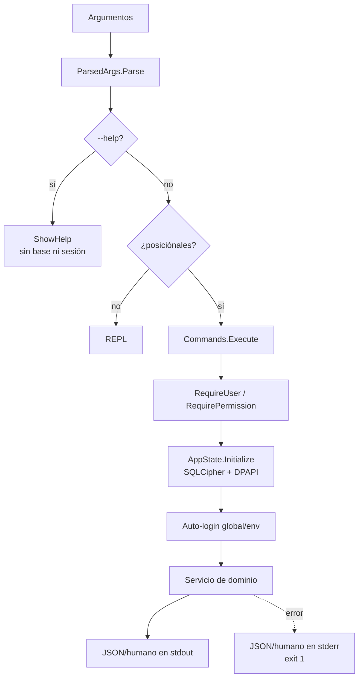

# 07 · CLI para agentes

> **Estado:** Vigente.
> **Corte:** 25 de octubre de 2026.
> **Ámbito:** `agent-harness/` — consola `libro-cli` 1.0.0 sobre el ensamblado
> `Libro.Desktop` 2.0.0. Incluye sintaxis, credenciales, contrato JSON, catálogo
> completo de comandos, permisos, REPL, seguridad y mantenimiento.
> **Fuente de verdad:** `agent-harness/Libro.Cli/{Program,Cli,Commands}.cs`,
> `desktop/Libro.Desktop/Services/**`, `agent-harness/tests/test_cli.py`,
> `agent-harness/{build.ps1,libro-cli.cmd,run-tests.cmd}`.
> **No cubre:** fórmulas contables ([05](05-modulos-flujos.md)), esquema de la
> base ([03](03-modelo-datos.md)), matriz de permisos de la interfaz
> ([04](04-seguridad.md), [06](06-mapa-ui.md)) ni instalación de la app
> ([08](08-operacion-instalador.md)).

---

## 1. Qué es y qué no es

`libro-cli` es una **consola C#/.NET 8 para Windows** que envuelve los servicios
reales de Libro. No es un segundo backend:

- Referencia `desktop/Libro.Desktop/Libro.Desktop.csproj` y usa `AppState`,
  `AuthService`, `CompanyService`, `TransactionService`, `InvoiceService`,
  `InventoryService`, `EmployeeService`, `PayrollService`, `TaxService`,
  `ReportService`, `UserService` y `AuditService`.
- Abre la **misma** base SQLCipher, con la **misma** llave DPAPI y las **mismas**
  reglas de negocio, auditoría y permisos.
- No reimplementa contabilidad, cifrado, respaldos, folios, stock ni nómina.
- No usa Node.js, navegador, HTTP, WebView ni un servicio en la nube.
- **No es CFDI.** Las facturas son documentos internos: no se timbran, no
  generan XML fiscal y no se envían al SAT.

| Propiedad | Valor |
|---|---|
| Proyecto | `agent-harness/Libro.Cli/Libro.Cli.csproj` (consola `net8.0-windows`) |
| Ensamblado | `libro-cli.dll` (se ejecuta con `dotnet`) |
| Launcher | `agent-harness/libro-cli.cmd` |
| Versión del CLI | `1.0.0.0` (atributo del ensamblado) |
| Versión de la app | La de `Libro.dll` (2.0.0.0) |
| Dependencia | SDK/runtime .NET 8 y el proyecto WPF compilable |
| Distribución | No se incluye en el instalador; se compila desde el repositorio |
| Datos | `%LOCALAPPDATA%\Libro\data` o `--data-dir` / `LIBRO_DATA_DIR` |

Principios de diseño que se observan en el código:

1. **Una operación, un proceso** en modo *one-shot*; la sesión se autentica en
   cada invocación.
2. **JSON estable en stdout** para agentes; errores JSON en stderr.
3. **Importes en centavos** (`long`), nunca `double` para dinero.
4. **Fechas `yyyy-MM-dd`**.
5. **Opciones globales antes del comando**; después del comando, las opciones
   pertenecen a la operación.
6. **Descubrimiento**: `help`, `--help`, `schema` y mensajes de error en español.
7. **Sin efectos secundarios en la ayuda**: `--help` se intercepta antes de
   abrir la base o ejecutar la operación.

---

## 2. Compilación y ejecución

### 2.1 Requisitos

- Windows 10/11 x64.
- .NET 8 SDK para compilar; runtime para ejecutar.
- Python 3.9+ solo para las pruebas E2E.
- El repositorio completo: el CLI referencia el proyecto WPF.

En esta máquina el `dotnet` del `PATH` es solo runtime. El SDK está en:

```text
%LOCALAPPDATA%\Microsoft\dotnet\dotnet.exe
```

`build.ps1` y `libro-cli.cmd` ya prefieren esa ruta.

### 2.2 Compilar

```powershell
cd C:\Proyectos\IDK
powershell -ExecutionPolicy Bypass -File agent-harness\build.ps1
```

Resultado:

```text
agent-harness\Libro.Cli\bin\Release\net8.0-windows\libro-cli.dll
```

Compilar y ejecutar las pruebas:

```powershell
powershell -ExecutionPolicy Bypass -File agent-harness\build.ps1 -Test
```

Limpiar y recompilar:

```powershell
powershell -ExecutionPolicy Bypass -File agent-harness\build.ps1 -Clean
```

### 2.3 Launcher

```text
agent-harness\libro-cli.cmd
```

Resolución del ejecutable de .NET, en orden:

1. `LIBRO_CLI_DOTNET`, si está definida.
2. `%LOCALAPPDATA%\Microsoft\dotnet\dotnet.exe`.
3. `dotnet` del `PATH`.
4. Error `No se encontro dotnet...` con código 1.

Si falta `libro-cli.dll`, el launcher indica que se compile primero y sale con
código 1. El launcher propaga el código de salida del CLI.

### 2.4 Ejecución directa

```powershell
& "$env:LOCALAPPDATA\Microsoft\dotnet\dotnet.exe" `
  agent-harness\Libro.Cli\bin\Release\net8.0-windows\libro-cli.dll `
  --json version
```

---

## 3. Modos de ejecución

| Invocación | Modo | Comportamiento |
|---|---|---|
| `libro-cli <grupo> <acción> [opciones]` | One-shot | Ejecuta una operación y termina. Sesión nueva por proceso. |
| `libro-cli [globales]` | REPL | Sin posiciónales, entra al modo interactivo. |
| `libro-cli repl` | REPL | Igual que el anterior. |
| `libro-cli --help` | Ayuda | Imprime la ayuda global y sale con 0, sin abrir la base. |
| `libro-cli <grupo> --help` | Ayuda | Ayuda del grupo, sin abrir la base. |
| `libro-cli help [grupo]` | Ayuda | Igual que `--help`, por posición. |

Flujo de una invocación one-shot:



`ParsedArgs.Parse` **no** abre la base, no valida permisos y no toca el disco.
La base se inicializa cuando un comando llama a `RequireUser`,
`RequirePermission`, `ctx.Initialize()` o `auth login/setup`.

---

## 4. Sintaxis y parsing

### 4.1 Gramática práctica

```text
libro-cli [opciones-globales] <grupo> [acción] [opciones-de-operación]
libro-cli [opciones-globales] --help
libro-cli help [grupo]
libro-cli schema [operación]
libro-cli [opciones-globales]              # REPL
```

- El **grupo** y la **acción** se comparan sin distinguir mayúsculas:
  `Transactions LIST` equivale a `transactions list`.
- La acción es el segundo positional. Los posiciónales adicionales se ignoran
  salvo en `schema` y `help`.
- Un grupo sin acción válida produce el mensaje `Uso: ...` del grupo.
- Un grupo desconocido produce `Comando desconocido: ... Usa help.` con código 1.

### 4.2 Algoritmo de parsing

`ParsedArgs.Parse` recorre los tokens de izquierda a derecha:

| Token | Tratamiento |
|---|---|
| `--` | Activa modo literal: todo lo siguiente es positional, aunque empiece con `--`. |
| `--clave=valor` | Opción con valor explícito; admite valores que empiezan con `--`. |
| `--clave valor` | Opción con el siguiente token como valor, **solo si** no empieza con `--`. |
| `--bandera` | Se registra como flag booleano (lista cerrada). |
| `--clave` sin valor y sin ser bandera | Se registra como flag y no consume el siguiente token. |
| Texto sin `--` | Positional. El primero marca que ya empezó el comando. |

Consecuencias que un agente debe conocer:

1. **Opciones desconocidas se aceptan en silencio.** Un typo como
   `--amout-cents` se convierte en flag y la operación falla más tarde por
   “Falta --amount-cents”, no por “opción desconocida”.
2. **Un valor que empieza con `--` no se consume.** Para enviarlo, usa
   `--reason=--urgente` o `--`.
3. **Las banderas no aceptan `true/false`.** `--include-inactive false` deja
   `false` como positional y activa la bandera.
4. **Las claves no distinguen mayúsculas.** `--JSON` funciona igual que `--json`.
5. **El orden importa para las credenciales.** Antes del primer positional,
   `--email`, `--password`, `--password-env`, `--data-dir`, `--json`, `--debug`,
   `--help`, `--no-color` y `--pretty` se registran como globales. Después del
   comando se registran como opciones de la operación.
6. **`--data-dir`, `--json` y `--debug` se leen de ambos lados** en la práctica
   (`FirstText`/`Has`), pero la convención documentada es ponerlos antes.
7. **No hay expansión de variables, comodines ni archivos.** PowerShell puede
   expandirlos antes de llegar al CLI; entre comillas, no.

### 4.3 Banderas reconocidas

Lista cerrada de `BooleanOptions`:

```text
json  debug  help  include-inactive  include-archived  low
restore  activate  deactivate  inactive  emit  yes  stdin  quiet
no-color  pretty  all  hash
```

`quiet`, `no-color`, `pretty` y `all` se parsean pero **hoy no tienen efecto**.
`restore`, `activate`, `deactivate`, `inactive`, `emit`, `yes`, `hash`, `low`,
`include-inactive`, `include-archived` y `stdin` solo aplican a los comandos que
las leen.

### 4.4 Ejemplos de parsing

```powershell
# Correcto: credenciales globales antes del grupo
libro-cli.cmd --data-dir C:\tmp\libro --json --email admin@demo.mx --password "Clave123!" dashboard

# Correcto: --email pertenece al usuario nuevo, no al login
$env:LIBRO_EMAIL = "admin@demo.mx"
$env:LIBRO_PASSWORD = "Clave123!"
libro-cli.cmd --data-dir C:\tmp\libro --json users save `
  --name "Ana" --email ana@demo.mx --role consulta --new-password "ConsultaLibro123!"

# Correcto: valor que empieza con guiones
libro-cli.cmd --json invoices cancel --id 7 --reason=--duplicada

# Incorrecto: "--urgente" se interpreta como bandera y el motivo queda vacío
libro-cli.cmd --json invoices cancel --id 7 --reason --urgente

# Correcto: ruta con espacios entre comillas
libro-cli.cmd --json reports income --from 2026-10-01 --to 2026-10-31
```

---

## 5. Opciones globales

| Opción | Valor | Efecto | Dónde se lee |
|---|---|---|---|
| `--data-dir <ruta>` | Ruta absoluta o relativa | Fija `LIBRO_DATA_DIR` antes de inicializar. Resuelve a ruta absoluta. | `CliContext` constructor (`FirstText`) |
| `--json` | Bandera | Salida JSON en stdout; errores JSON en stderr. | `Output.Json` (`Has`) |
| `--email <correo>` | Texto | Correo de la sesión para auto-login. | `LoginEmail` (solo global) y `Email` (global o local) |
| `--password <clave>` | Texto | Contraseña de la sesión. Visible en el proceso y el historial. | `LoginPassword` (global) y `Password` (local o global) |
| `--password-env <var>` | Nombre de variable | Lee la contraseña de esa variable; tiene prioridad sobre `--password`. | `LoginPassword` / `Password` |
| `--debug` | Bandera | Añade `detail` con la traza de la excepción a los errores. | `CliContext.Debug` |
| `--help` | Bandera | Muestra ayuda y no ejecuta la operación. | `Program.Main` / REPL |
| `--no-color` | Bandera | Sin efecto actual. | — |
| `--pretty` | Bandera | Sin efecto: el JSON ya sale indentado. | — |

Variables de entorno:

| Variable | Uso |
|---|---|
| `LIBRO_DATA_DIR` | Carpeta de datos; `--data-dir` la sobrescribe en el proceso. |
| `LIBRO_EMAIL` | Correo por defecto para auto-login y `auth login/setup`. |
| `LIBRO_PASSWORD` | Contraseña por defecto. |
| `LIBRO_CLI_DOTNET` | Ejecutable de .NET para `libro-cli.cmd`. |
| `LIBRO_KEEP_TEST_DATA` | Conserva la carpeta temporal de las pruebas. |

La carpeta de datos contiene:

| Archivo | Contenido |
|---|---|
| `contabilidad.db` | Base SQLCipher. |
| `clave.bin` | Llave aleatoria protegida con DPAPI `CurrentUser`. |
| `respaldos\*.libro` | Respaldos cifrados con la misma llave. |
| `libro.log` | Bitácora técnica de la app. |

`--data-dir` es la única forma segura de apuntar a datos de prueba. El CLI
**no** distingue entre datos reales y de prueba: si no se indica, usa la carpeta
real del usuario.

---

## 6. Credenciales y sesión

### 6.1 Resolución de credenciales

Hay dos rutas distintas y es la fuente de confusión más común:

| Consumidor | Correo | Contraseña |
|---|---|---|
| Auto-login de cualquier comando con sesión | `--email` **global** → `LIBRO_EMAIL` | `--password-env` global o local → `--password` **global** → `LIBRO_PASSWORD` |
| `auth login` | `--email` local o global → `LIBRO_EMAIL` → prompt REPL | `--password-env` local o global → `--password` local o global → `LIBRO_PASSWORD` → prompt REPL |
| `auth setup` | `--email` local o global → `LIBRO_EMAIL` | igual que `auth login`; en REPL pide confirmación |
| `auth status` | auto-login global/env; si falla, intenta credenciales locales | igual |
| `auth change-password` | sesión ya autenticada | contraseña actual vía `--password` local o global; nueva vía `--new-password` |
| `users save --email` | correo del usuario nuevo (local) | `--new-password` (local) |

Reglas:

- `--password-env` gana sobre `--password` si ambos están presentes.
- Un `--email` **después** del grupo no sirve para el auto-login; se interpreta
  como opción de la operación. Es el caso de `users save --email`.
- `--password` después del grupo tampoco sirve para el auto-login.
- En one-shot no hay prompts: si faltan credenciales, el comando falla.
- En REPL, `auth login` y `auth setup` piden correo/contraseña si faltan, y la
  contraseña se lee sin eco.

### 6.2 Auto-login

Cualquier acción que llame a `RequireUser` o `RequirePermission`:

1. Inicializa `AppState` (base, llave, migración, catálogos iniciales).
2. Si no hay usuario en memoria, intenta `AuthService.Login` con las
   credenciales globales/entorno.
3. Si falla o faltan, lanza:
   `Faltan credenciales. Usa --email y --password, o define LIBRO_EMAIL y LIBRO_PASSWORD...`
4. Cada login correcto actualiza `users.last_login_at` y escribe una entrada
   `login` en `audit_log`.

Por eso **cada comando one-shot deja un registro de login**. En un script de
20 comandos habrá 20 entradas `login` (más las acciones). Es esperado.

Excepciones que no requieren sesión:

| Comando | ¿Inicializa base? | ¿Requiere credenciales? |
|---|---|---|
| `help`, `version`, `schema` | No | No |
| `doctor` | Solo si la base existe, la llave existe y es cifrada | No |
| `auth setup` | Sí | Solo para crear la cuenta |
| `auth login` | Sí | Sí |
| `auth status` | Sí | No; sin credenciales responde `{"authenticated":false}` |
| `auth logout` | No | No |

> **Matiz importante:** la ayuda de `auth status` dice “no crea datos”, pero el
> comando llama a `Initialize()`: en una instalación nueva crea la carpeta, la
> llave, la base y los catálogos iniciales. No crea usuarios ni empresa. La
> sesión solo se inicia si hay credenciales.

### 6.3 Persistencia de sesión

- **One-shot:** la sesión vive en el proceso. No hay archivo de sesión, cookie
  ni token. El siguiente proceso vuelve a autenticarse.
- **REPL:** la sesión vive en memoria mientras dura el proceso.
- `auth logout` limpia `AppState.CurrentUser`. Si hay credenciales globales o
  `LIBRO_EMAIL`/`LIBRO_PASSWORD`, el siguiente comando que requiera sesión
  **volverá a autenticarse automáticamente**; el logout no borra esas fuentes.
- La contraseña nunca se escribe en la base ni en la salida. Solo se guarda el
  hash scrypt del usuario.

### 6.4 Política de contraseñas y bloqueo

- Mínimo 8 caracteres (`Validation.ValidatePassword`). No se exigen mayúsculas,
  dígitos ni símbolos.
- `AuthService.Login` bloquea tras **10 fallos por correo** dentro de **10
  minutos**, pero el contador es estático y vive en el proceso.
- En one-shot el bloqueo **no acumula entre invocaciones**: cada proceso tiene su
  propio diccionario. Solo protege de fuerza bruta dentro de una misma REPL.
- Un usuario inactivo recibe el mismo mensaje genérico que una contraseña
  incorrecta: `Correo o contraseña incorrectos.`
- Los fallos escriben `login_failed` con `user_id = NULL` y el correo en
  `detail`.

---

## 7. Contrato de salida

### 7.1 JSON de éxito

- Va a **stdout**.
- Codificación UTF-8.
- `camelCase`.
- Indentado con 2 espacios.
- Propiedades `null` omitidas.
- Acentos y signos no se escapan (`UnsafeRelaxedJsonEscaping`).
- Importes: enteros de centavos.
- Fechas: `yyyy-MM-dd`; marcas de tiempo: texto de SQLite
  (`yyyy-MM-dd HH:mm:ss`) o ISO 8601 en campos concretos (`createdAt` de
  respaldos, `lastLoginAt`).
- Listas vacías: `[]`.
- Booleanos: `true`/`false` cuando el DTO es `bool`; los campos de la base son
  `0`/`1` cuando el DTO es `long`.

Ejemplo real de `products save`:

```json
{
  "id": 1,
  "sku": "SERV-001",
  "name": "Servicio Demo",
  "description": "",
  "unit": "servicio",
  "priceCents": 100000,
  "costCents": 20000,
  "ivaRate": 0.16,
  "stock": 10,
  "minStock": 1,
  "trackStock": 1,
  "active": 1,
  "createdAt": "2026-10-25 23:08:43",
  "displayName": "Servicio Demo · SERV-001 · stock 10",
  "isLowStock": false,
  "inventoryValueCents": 200000,
  "inventoryStatus": "Disponible",
  "stockLabel": "10 servicio",
  "marginRate": 0.8
}
```

Los DTOs incluyen **propiedades calculadas**. Por ejemplo, `Product` agrega
`displayName`, `isLowStock`, `inventoryValueCents`, `inventoryStatus`,
`stockLabel` y `marginRate`; `Invoice` agrega `folio`, `displayFolio`,
`balanceCents` e `isOverdue`; `Contact` agrega `displayName`.

### 7.2 Salida humana

Sin `--json`:

- Listas: tabla con encabezados, separador de dos espacios y guiones.
- Sin filas: `(sin resultados)`.
- Detalle: pares `Etiqueta  valor`.
- Importes: formato `es-MX` con dos decimales (`$1,000.00`).
- Cantidades: `#,0.###`.
- Booleanos: `sí`/`no`.
- Textos largos: truncados a 44 caracteres con `…` en tablas.
- Algunos comandos sin representación humana imprimen JSON igualmente
  (`schema` es el caso principal).

La salida humana **no es un contrato estable**. Los agentes deben usar
`--json`.

### 7.3 JSON de error

Va a **stderr**:

```json
{
  "ok": false,
  "error": "Falta --input <archivo.json> o --stdin para contact.save. Consulta `schema contact.save` para ver la forma esperada."
}
```

Con `--debug` se añade `detail` con `Exception.ToString()` (tipo, mensaje y
traza). Sin `--debug`, `detail` se omite.

En modo humano:

```text
ERROR: Falta --input <archivo.json> o --stdin para contact.save...
```

Nunca se imprime la contraseña, el hash, la llave DPAPI ni el contenido binario
de la base.

### 7.4 Mensajes de error frecuentes

| Mensaje | Causa |
|---|---|
| `Falta un comando. Usa help o doctor.` | Solo ocurre si `Commands.Execute` recibe cero posiciónales; la entrada normal sin posiciónales abre la REPL. |
| `Comando desconocido: ...` | Grupo mal escrito. |
| `Uso: <grupo> ...` | Acción faltante o inválida. |
| `Falta --<opción>. ...` | Opción obligatoria ausente. |
| `--<opción> debe ser un número entero.` | Valor no numérico. |
| `Faltan credenciales...` | Auto-login sin fuentes. |
| `Permiso insuficiente: se requiere ...` | Rol sin el permiso. |
| `No existe el ... #N.` | ID inexistente. |
| `Falta --input ... o --stdin ...` | Comando de escritura sin JSON. |
| `JSON inválido: ...` | Entrada mal formada. |
| `La restauración reemplaza la base actual. Repite con --yes.` | Guardia de restauración. |
| `No hay esquema para ...` | Clave de `schema` inexistente. |

---

## 8. Códigos de salida

| Código | Significado |
|---|---|
| `0` | Operación correcta; también ayuda, `version`, `schema` y salida normal de la REPL. |
| `1` | Cualquier error controlado: parsing, credenciales, permisos, validación, JSON, E/S, respaldo, restauración sin `--yes`. |

Notas:

- `CliException` tiene un `ExitCode` configurable, pero **ningún comando usa hoy
  un código distinto de 1**.
- `UnauthorizedAccessException`, `ArgumentException`,
  `InvalidOperationException`, `IOException` y cualquier excepción no prevista se
  convierten en código 1 y mensaje en stderr.
- La REPL **no** termina cuando un comando falla: imprime el error y sigue. Al
  salir con `exit`, `quit`, `q` o EOF, devuelve `0`, aunque haya habido errores.
- `--help` devuelve `0`. Un grupo desconocido con `--help` devuelve `1`.

---

## 9. Ayuda y descubrimiento

### 9.1 Formas de ayuda

| Invocación | Resultado |
|---|---|
| `libro-cli --help` | Ayuda global: uso, opciones, comandos, reglas y nota de CFDI. |
| `libro-cli help` | Igual que la anterior. |
| `libro-cli help <grupo>` | Ayuda del grupo. |
| `libro-cli <grupo> --help` | Ayuda del grupo. |
| `libro-cli <grupo> <acción> --help` | Título con la acción + cuerpo del grupo. |

La ayuda de acción **no** es específica de la acción: reutiliza el texto del
grupo, que ya enumera las opciones de todas sus acciones. El título sí incluye
la acción:

```text
Libro CLI — invoices pay

Uso: libro-cli [globales] invoices list|show|...|pay|delete-payment
...
```

### 9.2 Garantías

- `--help` se evalúa en `Program.Main` **antes** de `Commands.Execute`.
- En la REPL se evalúa antes de ejecutar el comando de la línea.
- No inicializa la base, no autentica, no escribe auditoría y no modifica
  estado.
- Regresión cubierta:
  `test_04b_help_is_side_effect_free` verifica que
  `products toggle --id N --help` no cambia `active`.

### 9.3 JSON de ayuda

```powershell
libro-cli.cmd --json --help
```

```json
{
  "help": "Libro CLI — interfaz agent-native...\n\nUso:\n..."
}
```

### 9.4 `schema`

```powershell
libro-cli.cmd --json schema                    # todos los ejemplos
libro-cli.cmd --json schema invoice.save       # uno
libro-cli.cmd schema transaction.save          # humano: JSON igualmente
```

- Sin argumento devuelve un diccionario `operación → ejemplo`.
- Con argumento devuelve el objeto del ejemplo.
- La clave se forma uniendo los posiciónales restantes con `.`:
  `schema invoice save` equivale a `schema invoice.save`.
- Si la clave no existe, el error lista las disponibles.
- `schema` **no** valida que la operación exista como comando; es un catálogo de
  formas de entrada.

---

## 10. Catálogo completo de comandos

Convenciones de las tablas:

- **Permiso “sesión”**: basta un usuario autenticado de cualquier rol. El
  auto-login exige credenciales.
- **Permiso “— ”**: no requiere sesión.
- **Devuelve**: forma del JSON de éxito.
- Las opciones entre corchetes son opcionales.
- Todos los importes son centavos; todas las fechas `yyyy-MM-dd`.

### 10.1 Utilidades

| Acción | Opciones | Permiso | Devuelve | Notas |
|---|---|---|---|---|
| `doctor` | — | — | Objeto de diagnóstico | No abre la base si falta la llave. |
| `version` | — | — | `{cliVersion, appVersion, runtime}` | No abre la base. |
| `schema [operación]` | positional | — | Ejemplo(s) JSON | No abre la base. |
| `help [grupo]` | positional | — | `{help}` | No abre la base. |
| `repl` | globales | — | — | Modo interactivo. |

#### `doctor`

Campos:

```json
{
  "dataDir": "C:\\...\\libro-doc",
  "databasePath": "C:\\...\\contabilidad.db",
  "keyPath": "C:\\...\\clave.bin",
  "databaseExists": true,
  "keyExists": true,
  "databaseKind": "encrypted",
  "sizeBytes": 155648,
  "backupCount": 0,
  "opened": true,
  "company": "Negocio Demo",
  "counts": {
    "users": 1,
    "accounts": 2,
    "categories": 13,
    "contacts": 1,
    "products": 1,
    "transactions": 1,
    "invoices": 1,
    "employees": 1,
    "payrollPeriods": 1
  }
}
```

`databaseKind`:

| Valor | Significado |
|---|---|
| `missing` | No existe `contabilidad.db`. |
| `empty` | Existe pero está vacío (0 bytes). |
| `plaintext` | Tiene cabecera `SQLite format 3\0`; el primer comando que la abra la migrará a SQLCipher. |
| `encrypted` | No tiene cabecera SQLite; se asume SQLCipher. |

Reglas:

- Solo intenta abrir si `databaseExists && keyExists && kind == "encrypted"`.
- Si la llave falta y la base existe, **no crea una llave nueva**: devuelve
  `note` y `opened: false`. Esto evita dejar la base inaccesible.
- Si la base es plana, no la migra en `doctor`; solo avisa.
- Si la apertura falla, devuelve `openError` y `opened: false`.
- No requiere credenciales; los conteos no exponen datos personales.
- `backupCount` cuenta `*.libro` en la carpeta estándar, no en rutas externas.

#### `version`

```json
{
  "cliVersion": "1.0.0.0",
  "appVersion": "2.0.0.0",
  "runtime": "8.0.x"
}
```

---

### 10.2 `auth`

| Acción | Opciones | Permiso | Devuelve | Notas |
|---|---|---|---|---|
| `setup` | `--company` `--name` `[--email]` `[--password\|--password-env]` | — | Objeto de sesión | Solo si no hay usuarios. Crea admin. |
| `login` | `[--email]` `[--password\|--password-env]` | — | Objeto de sesión | En REPL pide datos. |
| `status` / `whoami` | `[--email]` `[--password]` | — | Objeto de sesión o `{authenticated:false}` | Inicializa la base. |
| `logout` | — | — | `{authenticated:false}` | No abre la base. |
| `change-password` | `--password` (actual) `--new-password` | sesión | `{changed:true}` | Valida la actual y el mínimo de 8. |

Objeto de sesión:

```json
{
  "authenticated": true,
  "user": {
    "id": 1,
    "name": "Admin Demo",
    "email": "admin@demo.mx",
    "role": "admin",
    "roleLabel": "Administrador",
    "active": true,
    "createdAt": "",
    "lastLoginAt": "2026-10-25T23:08:23.450Z"
  },
  "company": "Negocio Demo"
}
```

Notas:

- `setup` exige `--company` y `--name`; el correo puede venir de `--email`
  local/global o `LIBRO_EMAIL`; la contraseña de `--password`,
  `--password-env`, `LIBRO_PASSWORD` o prompt REPL con confirmación.
- `setup` falla con `Ya existe un administrador. Usa auth login.` si hay
  cualquier usuario.
- `login` devuelve el mismo objeto y escribe auditoría `login`.
- `status` sin credenciales devuelve `{"authenticated":false}` **después** de
  inicializar la base; con credenciales válidas inicia sesión y audita.
- `logout` no inicializa la base; solo limpia la sesión en memoria.
- `change-password` no acepta `--new-password` vacío; la actual se verifica con
  scrypt.

---

### 10.3 `company`

| Acción | Opciones | Permiso | Devuelve | Notas |
|---|---|---|---|---|
| `show` | — | sesión | `Company` | Incluye `isrBrackets` como texto JSON. |
| `update` | `--input`/`--stdin` | `settings.manage` (solo CLI) | `Company` actualizado | Reemplazo total; sin validación de negocio. |

`CompanyService.SaveCompany` **no valida** nombre, RFC, tasas ni folio. El CLI
solo comprueba el permiso. Un JSON parcial deja los campos omitidos en sus
valores por defecto del DTO:

| Campo omitido | Valor que queda |
|---|---|
| `name`, `rfc`, `regimenFiscal`, `address`, `phone`, `email` | `""` |
| `ivaRate` | `0.16` |
| `invoiceSeries` | `"A"` |
| `nextInvoiceNumber` | `1` |
| `imssRate` | `0.025` |
| `isrBrackets` | `""` |

Por eso `company update` debe ser **fetch-modify-write**:

```powershell
$company = libro-cli.cmd --json company show | ConvertFrom-Json
$company.phone = "5555555555"
$company | ConvertTo-Json -Depth 4 | Set-Content -Encoding utf8 company.json
libro-cli.cmd --json company update --input company.json
```

Riesgos si no se valida fuera del CLI: nombre vacío, `ivaRate` fuera de `0..1`,
`nextInvoiceNumber` en 0, `isrBrackets` inválido (la nómina fallará al
calcular).

---

### 10.4 `dashboard`

| Acción | Opciones | Permiso | Devuelve | Notas |
|---|---|---|---|---|
| `dashboard` | — | sesión | `DashboardData` | Mes actual. |

Campos principales: `rangeStart`, `rangeEnd`, `revenueCents`,
`otherIncomeCents`, `expenseCents`, `profitCents`, `totalIncomeCents`,
`ivaTrasladadoCents`, `ivaAcreditableCents`, `receivableCents`, `overdueCount`,
`cashCents`, `inventoryCents`, `lowStock[]`, `recentInvoices[]`,
`recentTransactions[]`, `monthly[]`.

Definiciones exactas en [05](05-modulos-flujos.md). El CLI no acepta fechas: el
panel siempre es el mes en curso.

---

### 10.5 `accounts`

| Acción | Opciones | Permiso | Devuelve | Notas |
|---|---|---|---|---|
| `list` | `[--include-inactive]` | sesión | `Account[]` | Sin saldo calculado. |
| `balances` | `[--include-inactive]` | sesión | `AccountBalance[]` | Incluye `balanceCents`. |
| `save` | `--input`/`--stdin` | `accounts.write` **o** `settings.manage` | `Account` | Alta fuerza `active=1`. |
| `archive` | `--id N` `[--restore]` | `accounts.write` **o** `settings.manage` | `{id, active}` | `--restore` reactiva. |

Notas:

- `type` debe ser `efectivo`, `banco` o `tarjeta` según el `CHECK` de la base.
  La UI ofrece “Otro” (`otro`), que la base rechaza; el CLI no lo anuncia.
- En alta, `active` se fuerza a 1 aunque el JSON diga 0.
- En actualización, `save` es reemplazo total: si omites `active`, queda 0 y la
  cuenta se desactiva. Si omites `openingBalanceCents`, queda 0.
- El saldo de `balances` es:
  `opening_balance_cents + Σ movimientos (ingreso +, gasto −) + Σ pagos`.
- `save` intenta recargar la cuenta por ID; en alta usa el nombre para localizar
  el último insertado. Si el nombre se repite, puede devolver otra fila; usa el
  `id` devuelto por la base con cautela.

---

### 10.6 `categories`

| Acción | Opciones | Permiso | Devuelve | Notas |
|---|---|---|---|---|
| `list` | `[--include-archived]` | sesión | `Category[]` | Incluye `archived` 0/1. |
| `save` | `--input`/`--stdin` | `accounts.write` **o** `settings.manage` | `Category` | Alta fuerza `archived=0`. |

Notas:

- `kind` debe ser `ingreso` o `gasto`; el CLI lo valida antes del servicio.
- No hay acción `archive`: para archivar, envía `archived: 1` con `save` e `id`.
- En actualización, omitir `archived` lo deja en 0 (reactiva la categoría).
- No se puede cambiar el `kind` de una categoría usada por movimientos sin
  romper la validación de tipo; el servicio no lo impide.

---

### 10.7 `contacts`

| Acción | Opciones | Permiso | Devuelve | Notas |
|---|---|---|---|---|
| `list` | `[--query]` `[--type]` `[--include-archived]` | sesión | `Contact[]` | Filtra por nombre/RFC/correo/teléfono. |
| `show` | `--id N` | sesión | `Contact` | Incluye `receivableCents`. |
| `stats` | — | sesión | `ContactStats` | Clientes, proveedores, archivados, por cobrar. |
| `save` | `--input`/`--stdin` | `contacts.write` | `Contact` | Alta fuerza `archived=0`. |
| `archive` | `--id N` `[--restore]` | `contacts.write` | `{id, archived}` | Archivado lógico. |

Notas:

- `type`: `cliente`, `proveedor` o `ambos`; el servicio lo valida.
- `save` **no** actualiza `archived`; usa `archive` para ese campo.
- En actualización es reemplazo total: los campos omitidos se vacían.
- `stats.receivableCents` suma facturas `emitida` (no `pagada`), sin filtrar
  vencimiento.
- El correo se valida con `Validation.IsValidEmail`.

---

### 10.8 `products`

| Acción | Opciones | Permiso | Devuelve | Notas |
|---|---|---|---|---|
| `list` | `[--query]` `[--low]` `[--include-inactive]` | sesión | `Product[]` | `--low` = stock ≤ mínimo. |
| `low-stock` | igual que `list` | sesión | `Product[]` | Alias con `OnlyLow=true`. |
| `show` | `--id N` | sesión | `{product, movements[]}` | Incluye movimientos. |
| `summary` | — | sesión | `InventorySummary` | Valor, productos, unidades, bajo stock, agotados. |
| `save` | `--input`/`--stdin` | `inventory.write` **o** `products.write` | `Product` | Alta crea movimiento “Saldo inicial”. |
| `toggle` | `--id N` `[--activate\|--deactivate]` | `inventory.write` **o** `products.write` | `{id, active}` | Sin bandera, invierte. |

Notas:

- `initialStock` solo se usa al crear; en actualización se ignora y el stock
  actual no se toca.
- `trackStock=false` en alta crea stock 0; en actualización no borra el stock
  existente, solo deja de trackearlo.
- `sku` es único; el servicio traduce el error `UNIQUE` a
  `Ya existe un producto con ese SKU.`
- `low-stock` considera `track_stock = 1 && stock <= min_stock`, incluidos los
  agotados. `summary.lowStockCount` excluye los agotados (`stock > 0`).
- En actualización, `active` no se toca; usa `toggle`.
- `save` es reemplazo total: omitir `unit` lo deja en `pieza`, omitir `ivaRate`
  lo deja en 0.16.

---

### 10.9 `transactions`

| Acción | Opciones | Permiso | Devuelve | Notas |
|---|---|---|---|---|
| `list` | `[--from]` `[--to]` `[--type]` `[--category N]` `[--query]` `[--limit]` `[--offset]` | sesión | `{rows[], total}` | `limit` 1..1000, default 100. |
| `show` | `--id N` | sesión | `TransactionRow` | Con nombres de categoría, contacto, cuenta y usuario. |
| `totals` | mismos filtros que `list` | sesión | `TransactionTotals` | Ignora `limit`/`offset`. |
| `save` | `--input`/`--stdin` | `tx.write` | `TransactionRow` | Alta o edición manual. |
| `delete` | `--id N` | `tx.write` | `{deleted:true,id}` | Solo movimientos manuales. |

Validaciones del servicio:

- `date` ISO válida; `type` `ingreso`/`gasto`; `subtotalCents >= 0`.
- Categoría existente y no archivada; ingreso exige categoría `ingreso`; gasto
  no puede usar categoría `ingreso`.
- Cuenta existente y **activa**.
- Contacto existente si se indica.
- `ivaCents = round(subtotal * ivaRate)` con `AwayFromZero`; `total = subtotal +
  iva`.

Notas:

- Al editar, el movimiento debe ser `source = manual`; los generados por
  inventario o nómina se rechazan.
- `delete` también rechaza los automáticos.
- `totals` devuelve `incomeSubtotal`, `incomeIva`, `expenseSubtotal`,
  `expenseIva`, `count`, `net`, `netIva`.
- Los filtros aceptan fechas ISO y no validan el orden; el servicio compara
  cadenas.

---

### 10.10 `invoices`

| Acción | Opciones | Permiso | Devuelve | Notas |
|---|---|---|---|---|
| `list` | `[--status]` `[--query]` `[--from]` `[--to]` `[--limit]` `[--offset]` | sesión | `{rows[], total}` | Default 100. |
| `show` | `--id N` | sesión | `{invoice, items[], payments[]}` | Detalle completo. |
| `overview` | — | sesión | `InvoiceOverview` | Por cobrar, vencido, mes, borradores. |
| `save` | `--input`/`--stdin` `[--emit]` | `invoice.write` | `Invoice` | Solo borradores para editar. |
| `emit` | `--id N` | `invoice.write` | `Invoice` | Asigna folio y descuenta stock. |
| `cancel` | `--id N --reason "<motivo>"` | `invoice.write` | `Invoice` | Requiere motivo; no con pagos. |
| `delete` | `--id N` | `invoice.write` | `{deleted:true,id}` | Solo borradores. |
| `pay` | `--id N` `[--date]` `--amount-cents N` `[--account]` `[--method]` `[--reference]` `[--notes]` | `invoice.write` | `Invoice` | Fecha default hoy; método default `Transferencia`. |
| `delete-payment` | `--id N` (ID del pago) | `invoice.write` | `{deleted:true,id}` | Recalcula estado. |

Notas:

- `status`: `borrador`, `emitida`, `pagada`, `cancelada`.
- `save` calcula subtotal/IVA/total por línea y totales; no acepta totales
  manuales.
- `--emit` guarda y emite en la **misma transacción**.
- Editar una factura no borrador falla con
  `Solo puedes editar facturas en borrador.`
- Emitir exige contacto y al menos un concepto; verifica stock de productos con
  `track_stock = 1` y descuenta inventario.
- Cancelar una emitida sin pagos restaura stock; cancelar un borrador no.
- Cancelar con `paidCents > 0` falla:
  `No puedes cancelar una factura con pagos registrados...`
- `pay` valida fecha y monto > 0; si se indica cuenta, verifica que exista,
  **pero no que esté activa**. Sin cuenta, el pago no afecta saldos de cuentas.
- `delete-payment` cambia el estado a `pagada` si el saldo llega a 0, o a
  `emitida` en caso contrario; no permite pagos de facturas canceladas.
- La factura es interna. `folio` y `displayFolio` son locales; no hay XML ni
  timbre.

---

### 10.11 `inventory`

| Acción | Opciones | Permiso | Devuelve | Notas |
|---|---|---|---|---|
| `list` | igual que `products list` | sesión | `Product[]` | Alias. |
| `summary` | — | sesión | `InventorySummary` | Alias. |
| `movements` | `--id <producto>` | sesión | `InventoryMovement[]` | Historial. |
| `movement` | `--input`/`--stdin` | `inventory.write` **o** `products.write` | `{id, product}` | Entrada/salida/ajuste. |

Notas:

- `type`: `entrada`, `salida`, `ajuste`.
- `entrada` y `salida` exigen `qty > 0`; `ajuste` admite cantidad positiva o
  negativa y fija el stock al valor indicado (no lo suma).
- Una `entrada` con `accountId` genera un gasto de compra (`source =
  inventario`) por `qty * unitCostCents`, con IVA si se indica.
- Una `salida` sin cuenta no genera movimiento contable.
- El stock nunca baja de 0 en una salida; el servicio rechaza si no alcanza.
- `movements` no pagina; devuelve todo el historial del producto.

---

### 10.12 `employees`

| Acción | Opciones | Permiso | Devuelve | Notas |
|---|---|---|---|---|
| `list` | `[--include-inactive]` | `payroll.view` | `Employee[]` | Orden por nombre. |
| `show` | `--id N` | `payroll.view` | `Employee` | Datos completos. |
| `summary` | — | `payroll.view` | `EmployeeSummary` | Activos, inactivos, nómina mensual. |
| `save` | `--input`/`--stdin` | `payroll.write` | `Employee` | Alta o edición. |
| `toggle` | `--id N` `[--activate\|--deactivate]` | `payroll.write` | `{id, active}` | Cambia `status`. |

Notas:

- `save` valida nombre (≤160), fechas ISO, `endDate >= startDate`, salario ≥ 0,
  longitudes de RFC/CURP/NSS.
- `status` debe ser `activo` o `inactivo`.
- `toggle` cambia `status` pero **no** escribe `end_date`; la fecha de baja queda
  manual.
- En edición, omitir campos los vacía (reemplazo total), salvo `status`, que por
  defecto es `activo`.

---

### 10.13 `payroll`

| Acción | Opciones | Permiso | Devuelve | Notas |
|---|---|---|---|---|
| `list` | — | `payroll.view` | `PayrollPeriod[]` | Orden por periodo. |
| `show` | `--id N` | `payroll.view` | `{period, items[]}` | Conceptos por empleado. |
| `summary` | — | `payroll.view` | `PayrollSummary` | Borradores, pagadas, netos. |
| `create` | `[--year]` `[--month]` `[--type mensual\|quincenal]` `[--quincena 1\|2]` | `payroll.write` | `PayrollPeriod` | Calcula conceptos al crear. |
| `recalc` | `--id N` | `payroll.write` | `PayrollPeriod` | Recalcula empleados activos. |
| `update-item` | `--item-id` `--period-id` `[--days]` `[--base-cents]` `[--extra-cents]` `[--isr-cents]` `[--imss-cents]` `[--infonavit-cents]` `[--other-cents]` `[--notes]` | `payroll.write` | `PayrollItem` | **Los numéricos omitidos se ponen en 0.** |
| `delete-item` | `--item-id` `--period-id` | `payroll.write` | `{deleted:true,...}` | Solo borradores. |
| `pay` | `--id N --account N` `[--date]` | `payroll.write` | `PayrollPeriod` | Genera gasto `source=nomina`. |
| `revert` | `--id N` | `payroll.write` | `PayrollPeriod` | Borra el gasto vinculado. |
| `delete` | `--id N` | `payroll.write` | `{deleted:true,id}` | Solo borradores. |

Notas:

- `create` usa el mes actual si se omiten `--year`/`--month`; `--type` default
  `mensual`; `--quincena` default 0. El servicio exige 1 o 2 para quincenal.
- La nómina mensual calcula días del periodo; la quincenal, días 1–15 o 16–fin.
- ISR e IMSS se calculan con la empresa activa (`isrBrackets`, `imssRate`).
- `update-item` recalcula el neto como
  `max(0, base + extra − isr − imss − infonavit − other)`.
  **No es una actualización parcial:** si solo envías `--notes`, los importes y
  los días se reinician a 0. Haz fetch-modify-write con `payroll show`.
- `recalc` no elimina conceptos de empleados que ya no están activos o fuera del
  periodo; pueden quedar filas obsoletas.
- `pay` exige cuenta activa, al menos un empleado y neto > 0; crea la categoría
  “Nómina” si no existe.
- `revert` solo funciona si la nómina está pagada y el gasto vinculado sigue
  siendo `source=nomina` con el mismo `source_id`.
- `delete` rechaza nóminas pagadas.
- `payroll show` devuelve `totalDeductionsCents` y `totalNetCents` calculados
  sobre los conceptos.

---

### 10.14 `taxes`

| Acción | Opciones | Permiso | Devuelve | Notas |
|---|---|---|---|---|
| `summary` | `[--from]` `[--to]` | `tax.view` | `TaxSummary` | Default: mes actual. |
| `annual` | `[--year N]` | `tax.view` | `MonthlyTaxRow[]` | Default: año actual. |

Notas:

- `--from` y `--to` deben ir juntos, ser ISO y `from <= to`.
- `summary` incluye `incomeRows[]` (facturas y otros ingresos) y `expenses[]`.
- `ivaTrasladado = IVA facturado + IVA otros ingresos`;
  `ivaAcreditable = IVA gastos`; `ivaNeto = trasladado − acreditable`.
- `annual` devuelve 12 filas con etiqueta de mes y los mismos tres importes.
- No genera declaraciones, XML ni archivos para el SAT.

---

### 10.15 `reports`

| Acción | Opciones | Permiso | Devuelve | Notas |
|---|---|---|---|---|
| `income` | `[--from]` `[--to]` | `reports.view` | `IncomeStatement` | Default: mes actual. |
| `cashflow` | `[--from]` `[--to]` | `reports.view` | `CashflowSummary` | Default: mes actual. |
| `aging` | — | `reports.view` | `AgingResult` | Antigüedad de saldos. |
| `monthly` | `[--from]` `[--to]` | `reports.view` | `MonthlyPerformanceRow[]` | Default: últimos 12 meses. |
| `balances` | — | `reports.view` | `AccountBalance[]` | Saldos calculados. |

Notas:

- `income` no incluye IVA; `cashflow` sí trabaja con cobros/pagos.
- `aging` agrupa facturas `emitida` por antigüedad y lista cada factura.
- `monthly` devuelve `key`, `label`, `invoicedCents`, `otherIncomeCents`,
  `incomeCents`, `expenseCents`, `profitCents`.
- `balances` es el mismo cálculo de `accounts balances`, sin filtro de inactivas
  (el servicio devuelve todas).
- Los reportes no exportan CSV ni PDF desde el CLI; solo JSON/humano. La UI sí
  exporta CSV (ver [06](06-mapa-ui.md)).

---

### 10.16 `users`

| Acción | Opciones | Permiso | Devuelve | Notas |
|---|---|---|---|---|
| `list` | — | `users.manage` | `UserView[]` | Sin hash. |
| `summary` | — | `users.manage` | `UserSummary` | Total, activos, admins. |
| `save` | `[--id]` `--name` `--email` `--role` `[--new-password]` `[--inactive]` | `users.manage` | `UserView` | Alta exige contraseña. |
| `activate` | `--id N` | `users.manage` | `{id,active:true}` | |
| `deactivate` | `--id N` | `users.manage` | `{id,active:false}` | |
| `reset-password` | `--id N --new-password` | `users.manage` | `{id,changed:true}` | |
| `roles` | — | sesión | `[{key,label,description}]` | Catálogo estático. |

Notas:

- `save` es reemplazo total de nombre, correo, rol y estado; no acepta JSON.
- `--inactive` desactiva; sin la bandera, **siempre activa** el usuario, incluso
  si estaba inactivo.
- `--new-password` es obligatorio al crear y opcional al actualizar.
- Orden de `SaveUser`: primero actualiza nombre/correo/rol/activo y **después**
  valida la contraseña nueva. Si la contraseña es inválida, el perfil ya quedó
  actualizado y la operación falla sin transacción. Verifica la contraseña antes
  o usa `reset-password` después.
- Los usuarios nuevos se crean con `last_login_at = NULL`, aunque el servicio
  calcula `now`.
- `UserView` expone `id`, `name`, `email`, `role`, `roleLabel`, `active`,
  `createdAt`, `lastLoginAt`. Nunca `passwordHash`.
- Un admin puede desactivarse a sí mismo; no hay protección contra dejar el
  sistema sin administradores activos.

---

### 10.17 `audit`

| Acción | Opciones | Permiso | Devuelve | Notas |
|---|---|---|---|---|
| `list` | `[--query]` `[--action]` `[--entity]` `[--from]` `[--to]` `[--limit]` | `audit.view` | `AuditEntry[]` | Default 200; máx. 1000. |

Notas:

- `--offset` se parsea pero **se ignora**; no hay paginación de auditoría.
- `--from`/`--to` filtran por fecha de `created_at` (texto).
- `query` busca en acción, entidad, detalle y usuario.
- Los registros de respaldo/restauración tienen `user_id = NULL` y aparecen como
  “Sistema”.
- El orden es descendente por ID/fecha.

---

### 10.18 `backup`

| Acción | Opciones | Permiso | Devuelve | Notas |
|---|---|---|---|---|
| `create` | `[--output <archivo>]` | `backup.manage` | `{path,sizeBytes,sha256,createdAt}` | Cifrado con la llave actual. |
| `list` | `[--hash]` | `backup.manage` | `BackupRow[]` | Solo carpeta estándar. |
| `restore` | `--file <ruta> --yes` | `backup.manage` | `{restoredFrom,safetyBackup}` | Reemplaza la base. |

Notas:

- `create` sin `--output` escribe
  `respaldos\Libro-yyyyMMdd-HHmmss.libro`. Con `--output`, crea el directorio si
  falta y escribe ahí. Calcula SHA256 en minúsculas.
- `create` verifica `PRAGMA integrity_check` antes de mover el archivo temporal.
- `list` ordena por `LastWriteTimeUtc` descendente y solo mira
  `AppPaths.BackupDirectory`; los respaldos creados con `--output` fuera de esa
  carpeta no aparecen.
- `restore` exige `--yes`; sin la bandera falla **antes** de tocar la base.
- `restore` verifica que el archivo sea SQLCipher legible con la llave actual,
  crea un respaldo de seguridad `Libro-antes-restaurar-*.libro`, copia a
  `.restaurando`, verifica de nuevo y reemplaza.
- Si la verificación falla, conserva la base actual y, si puede, restaura el
  respaldo de seguridad.
- `restore` no cierra el proceso; en one-shot termina igual. En REPL la sesión
  sigue en memoria y puede referenciar un usuario que ya no existe en la base
  restaurada.
- Los respaldos están ligados a DPAPI: no son portables a otra cuenta de Windows
  sin la `clave.bin` correspondiente.

---

## 11. Matriz de permisos

### 11.1 Permisos y roles

| Permiso | admin | contador | capturista | consulta |
|---|:---:|:---:|:---:|:---:|
| `users.manage` | ✓ | — | — | — |
| `settings.manage` | ✓ | — | — | — |
| `backup.manage` | ✓ | — | — | — |
| `audit.view` | ✓ | ✓ | — | — |
| `payroll.view` | ✓ | ✓ | — | — |
| `payroll.write` | ✓ | ✓ | — | — |
| `tax.view` | ✓ | ✓ | — | ✓ |
| `reports.view` | ✓ | ✓ | — | ✓ |
| `tx.write` | ✓ | ✓ | ✓ | — |
| `invoice.write` | ✓ | ✓ | ✓ | — |
| `inventory.write` | ✓ | ✓ | ✓ | — |
| `contacts.write` | ✓ | ✓ | ✓ | — |
| `products.write` | ✓ | ✓ | ✓ | — |
| `accounts.write` | ✓ | ✓ | — | — |

### 11.2 Permiso efectivo por comando

| Comando | Permiso comprobado por el CLI |
|---|---|
| `company update` | `settings.manage` |
| `accounts save`, `accounts archive` | `accounts.write` o `settings.manage` |
| `categories save` | `accounts.write` o `settings.manage` |
| `contacts save`, `contacts archive` | `contacts.write` |
| `products save`, `products toggle` | `inventory.write` o `products.write` |
| `transactions save`, `transactions delete` | `tx.write` |
| `invoices save/emit/cancel/delete/pay/delete-payment` | `invoice.write` |
| `inventory movement` | `inventory.write` o `products.write` |
| `employees list/show/summary` | `payroll.view` |
| `employees save/toggle` | `payroll.write` |
| `payroll list/show/summary` | `payroll.view` |
| `payroll create/recalc/update-item/delete-item/pay/revert/delete` | `payroll.write` |
| `taxes summary/annual` | `tax.view` |
| `reports *` | `reports.view` |
| `users list/summary/save/activate/deactivate/reset-password` | `users.manage` |
| `audit list` | `audit.view` |
| `backup *` | `backup.manage` |

Todo lo demás requiere solo **sesión**. Esto incluye lecturas de productos,
contactos, facturas, movimientos, cuentas, categorías, empleados, panel y
`users roles`. Un `consulta` puede leer esos datos aunque su descripción diga
“solo reportes e impuestos”.

### 11.3 Doble validación

- El CLI comprueba el permiso antes de llamar al servicio.
- La mayoría de los servicios vuelven a comprobarlo (`EnsureWriter`,
  `AppState.Can`).
- **Excepción:** `CompanyService.SaveCompany` no valida permisos; depende del
  gate del CLI o de la UI.
- `ContactService.Save`, `InvoiceService`, `InventoryService`,
  `PayrollService`, `TransactionService`, `UserService` y `AuditService`
  revalidan.
- Ocultar un botón en la UI no es control de acceso; el servicio es la última
  barrera.

---

## 12. Esquemas de entrada JSON

### 12.1 Cómo se leen

- `--input <archivo>` lee UTF-8 desde disco.
- `--stdin` lee todo `Console.In` hasta EOF.
- Si ambos se indican, **gana `--stdin`**.
- El JSON debe ser un objeto (no un arreglo) para todas las operaciones.
- Opciones de deserialización:
  - nombres de propiedad **sin distinguir mayúsculas**;
  - comentarios `//` y `/* */` ignorados;
  - comas finales permitidas;
  - números también aceptados como texto (`"10000"`);
  - propiedades desconocidas ignoradas.
- Un JSON inválido produce `JSON inválido: ...` y código 1.
- Una entrada vacía produce `La entrada JSON está vacía.`
- **Todos los `save` de este catálogo son reemplazo total.** Lo omitido toma el
  valor por defecto del DTO, no el valor actual de la base.

Patrón seguro para actualizar:

```powershell
$current = libro-cli.cmd --json contacts show --id 7 | ConvertFrom-Json
$current.phone = "5555555555"
$current | ConvertTo-Json -Depth 4 | Set-Content -Encoding utf8 contact.json
libro-cli.cmd --json contacts save --input contact.json
```

### 12.2 Catálogo `schema`

| Operación | Comando que la usa | Campos requeridos | Notas |
|---|---|---|---|
| `company.update` | `company update` | `name` | Reemplazo total; sin validación. |
| `account.save` | `accounts save` | `name`, `type` | `type` efectivo/banco/tarjeta. |
| `category.save` | `categories save` | `name`, `kind` | `kind` ingreso/gasto. |
| `contact.save` | `contacts save` | `type`, `name` | Correo válido si se indica. |
| `product.save` | `products save` | `name` | `initialStock` solo en alta. |
| `transaction.save` | `transactions save` | `date`, `type`, `categoryId`, `accountId`, `description`, `subtotalCents` | Categoría y cuenta válidas. |
| `invoice.save` | `invoices save` | `contactId`, `date`, `dueDate`, `lines[]` | Líneas con `description`, `qty`, `unitPriceCents`, `ivaRate`. |
| `inventory.movement` | `inventory movement` | `productId`, `date`, `type`, `qty` | `ajuste` admite cantidad negativa. |
| `employee.save` | `employees save` | `name`, `startDate` | Salario ≥ 0. |
| `payroll.item.update` | **descriptivo** | — | El comando real usa flags, no `--input`. |
| `payment.create` | **descriptivo** | — | El comando real es `invoices pay` con flags. |
| `user.save` | **descriptivo** | — | El comando real es `users save` con flags. |

Los tres últimos existen como documentación de forma, pero **no** se aceptan con
`--input`. Esta inconsistencia está registrada en
[13](13-hallazgos-riesgos.md).

### 12.3 Ejemplos completos

`company.update`:

```json
{
  "name": "Mi negocio",
  "rfc": "XAXX010101000",
  "regimenFiscal": "601",
  "address": "Calle 1, Ciudad de México",
  "phone": "5555555555",
  "email": "contacto@ejemplo.mx",
  "ivaRate": 0.16,
  "invoiceSeries": "A",
  "nextInvoiceNumber": 1,
  "imssRate": 0.025,
  "isrBrackets": "[]"
}
```

`account.save`:

```json
{
  "id": 0,
  "name": "Caja chica",
  "type": "efectivo",
  "openingBalanceCents": 0,
  "active": 1
}
```

`category.save`:

```json
{
  "id": 0,
  "name": "Fletes",
  "kind": "gasto",
  "archived": 0
}
```

`contact.save`:

```json
{
  "id": 0,
  "type": "cliente",
  "name": "Cliente de ejemplo",
  "rfc": "XAXX010101000",
  "email": "cliente@ejemplo.mx",
  "phone": "5555555555",
  "address": "Calle 1, Ciudad de México",
  "notes": ""
}
```

`product.save`:

```json
{
  "id": 0,
  "name": "Producto de ejemplo",
  "sku": "SKU-001",
  "description": "",
  "unit": "pieza",
  "priceCents": 10000,
  "costCents": 6000,
  "ivaRate": 0.16,
  "minStock": 1,
  "trackStock": true,
  "initialStock": 10
}
```

`transaction.save`:

```json
{
  "id": 0,
  "date": "2026-10-25",
  "type": "gasto",
  "categoryId": 4,
  "contactId": null,
  "accountId": 1,
  "description": "Compra de material",
  "subtotalCents": 10000,
  "ivaRate": 0.16,
  "method": "Efectivo",
  "reference": ""
}
```

`invoice.save`:

```json
{
  "id": 0,
  "contactId": 1,
  "date": "2026-10-25",
  "dueDate": "2026-11-24",
  "notes": "",
  "paymentTerms": "Contado",
  "lines": [
    {
      "productId": null,
      "description": "Servicio de ejemplo",
      "qty": 1,
      "unitPriceCents": 100000,
      "ivaRate": 0.16
    }
  ]
}
```

`inventory.movement`:

```json
{
  "productId": 1,
  "date": "2026-10-25",
  "type": "entrada",
  "qty": 1,
  "unitCostCents": 6000,
  "ivaRate": 0.16,
  "reason": "Compra",
  "reference": "",
  "accountId": 1
}
```

`employee.save`:

```json
{
  "id": 0,
  "name": "Empleado de ejemplo",
  "rfc": "XAXX010101000",
  "curp": "",
  "nss": "",
  "position": "Auxiliar",
  "department": "Administración",
  "salaryCents": 800000,
  "startDate": "2026-10-25",
  "status": "activo",
  "bankName": "",
  "bankAccount": ""
}
```

---

## 13. Flujos de trabajo

### 13.1 Instalación de prueba desde cero

```powershell
$demo = Join-Path $env:TEMP "libro-demo-agent"
$cli = ".\agent-harness\libro-cli.cmd"

& $cli --data-dir $demo --json doctor
& $cli --data-dir $demo --json auth setup `
  --company "Negocio Demo" `
  --name "Admin Demo" `
  --email "admin@demo.mx" `
  --password "Secreta123!"
```

A partir de aquí, en procesos nuevos:

```powershell
$env:LIBRO_EMAIL = "admin@demo.mx"
$env:LIBRO_PASSWORD = "Secreta123!"
& $cli --data-dir $demo --json dashboard
```

### 13.2 Gasto diario

```powershell
# 1. Ver categorías y cuentas
& $cli --data-dir $demo --json categories list
& $cli --data-dir $demo --json accounts list

# 2. Guardar el movimiento
@'
{
  "date": "2026-10-25",
  "type": "gasto",
  "categoryId": 4,
  "accountId": 1,
  "description": "Renta de octubre",
  "subtotalCents": 1000000,
  "ivaRate": 0.16,
  "method": "Transferencia",
  "reference": "TRF-1025"
}
'@ | Set-Content -Encoding utf8 "$env:TEMP\gasto.json"

& $cli --data-dir $demo --json transactions save --input "$env:TEMP\gasto.json"

# 3. Verificar totales del mes
& $cli --data-dir $demo --json transactions totals `
  --from 2026-10-01 --to 2026-10-31
```

### 13.3 Factura interna, cobro y cancelación

```powershell
# Crear y emitir
& $cli --data-dir $demo --json invoices save --input "$env:TEMP\invoice.json" --emit

# Consultar
& $cli --data-dir $demo --json invoices show --id 1
& $cli --data-dir $demo --json invoices overview

# Cobrar el total (1000.00 + 16% = 116000 centavos)
& $cli --data-dir $demo --json invoices pay `
  --id 1 --date 2026-10-25 --amount-cents 116000 `
  --account 1 --method Transferencia --reference "SPEI-1"

# Si hay un error y aún no hay pagos:
& $cli --data-dir $demo --json invoices cancel --id 1 --reason "Error de captura"
```

La cancelación de una factura emitida sin pagos devuelve el stock. Una factura
con pagos exige eliminar los pagos primero:

```powershell
& $cli --data-dir $demo --json invoices delete-payment --id <id-pago>
```

### 13.4 Inventario

```powershell
# Entrada con gasto contable
& $cli --data-dir $demo --json inventory movement --input "$env:TEMP\movement.json"

# Consultas
& $cli --data-dir $demo --json inventory summary
& $cli --data-dir $demo --json products low-stock
& $cli --data-dir $demo --json inventory movements --id 1
```

Una entrada con `accountId` genera un gasto por `qty * unitCostCents` con IVA.
Una factura emitida descuenta stock de los productos con `trackStock`.

### 13.5 Nómina

```powershell
# Empleado
& $cli --data-dir $demo --json employees save --input "$env:TEMP\employee.json"

# Periodo mensual
& $cli --data-dir $demo --json payroll create --year 2026 --month 10 --type mensual
& $cli --data-dir $demo --json payroll show --id 1

# Ajuste total de un concepto (no parcial)
& $cli --data-dir $demo --json payroll update-item `
  --item-id 1 --period-id 1 `
  --days 31 --base-cents 800000 `
  --extra-cents 0 --isr-cents 53916 --imss-cents 20000 `
  --infonavit-cents 0 --other-cents 0 --notes "Ajuste manual"

# Pago
& $cli --data-dir $demo --json payroll pay --id 1 --account 1 --date 2026-10-31
```

### 13.6 Cierre mensual

```powershell
& $cli --data-dir $demo --json reports income --from 2026-10-01 --to 2026-10-31
& $cli --data-dir $demo --json reports cashflow --from 2026-10-01 --to 2026-10-31
& $cli --data-dir $demo --json reports aging
& $cli --data-dir $demo --json taxes summary --from 2026-10-01 --to 2026-10-31
& $cli --data-dir $demo --json taxes annual --year 2026
& $cli --data-dir $demo --json dashboard
```

### 13.7 Respaldo y restauración

```powershell
# Crear en la carpeta estándar
& $cli --data-dir $demo --json backup create

# Crear una copia externa
& $cli --data-dir $demo --json backup create --output "D:\Respaldos\Libro-20261025.libro"

# Listar la carpeta estándar (con hash si se pide)
& $cli --data-dir $demo --json backup list --hash

# Restaurar (destructivo, exige --yes)
& $cli --data-dir $demo --json backup restore `
  --file "D:\Respaldos\Libro-20261025.libro" --yes
```

Antes de restaurar, cierra la app y cualquier otro CLI que escriba en la misma
carpeta. La restauración reemplaza archivos.

### 13.8 Provisión de usuarios

```powershell
$env:LIBRO_EMAIL = "admin@demo.mx"
$env:LIBRO_PASSWORD = "Secreta123!"

& $cli --data-dir $demo --json users roles
& $cli --data-dir $demo --json users save `
  --name "Ana Consulta" `
  --email "ana@demo.mx" `
  --role consulta `
  --new-password "ConsultaLibro123!"

& $cli --data-dir $demo --json users list
```

---

## 14. REPL

### 14.1 Entrada y salida

```powershell
.\agent-harness\libro-cli.cmd --data-dir "$env:TEMP\libro-demo-agent"
```

Banner humano:

```text
Libro CLI — modo interactivo
Escribe `help` para ver comandos, `exit` para salir.
Datos: C:\Users\...\libro-demo-agent
Sesión: Admin Demo <admin@demo.mx> · Administrador

Admin Demo>
```

Sin credenciales:

```text
Sesión: sin iniciar (usa `auth login`)
libro>
```

Con `--json`, no hay banner ni prompt; solo JSON por comando.

### 14.2 Comandos de la REPL

| Entrada | Efecto |
|---|---|
| `help` | Ayuda global. |
| `help <grupo>` | Ayuda del grupo. |
| `<grupo> <acción> ...` | Ejecuta el comando. |
| `exit`, `quit`, `q` | Sale (minúsculas exactas). |
| `clear`, `cls` | Limpia la consola si es posible. |
| `# texto` | Comentario; se ignora la línea. |
| Línea vacía | Se ignora. |
| EOF (Ctrl+Z/Enter) | Sale. |

No hay historial, autocompletado, edición de línea ni comandos multilínea.

### 14.3 Tokenizer

`CliContext.Tokenize`:

- Divide por espacios fuera de comillas.
- Acepta comillas simples y dobles.
- Dentro de comillas, `\` solo escapa la comilla activa o una `\` literal; las
  rutas de Windows se conservan:
  `--input "C:\temp\factura.json"` → `C:\temp\factura.json`.
- Una comilla sin cerrar consume el resto de la línea.
- No expande variables ni `~`.
- `#` solo es comentario al inicio de la línea.

### 14.4 Globales y herencia

- Al arrancar, `TryAutoLogin(required:false)` intenta login con globales/env.
- `MergeGlobals` copia `data-dir`, `email`, `password`, `password-env` y las
  banderas `json`/`debug` de la invocación inicial a cada comando.
- **No se puede cambiar `--data-dir` dentro de la REPL.** Si se indica una ruta
  distinta, el comando falla con
  `No se puede cambiar --data-dir dentro de la REPL. Reinicia el proceso.`
- `--json` se puede activar o desactivar por comando; la salida cambia en la
  misma sesión.
- `--debug` se hereda.

### 14.5 Errores y sesión

- Un error imprime el mensaje y **no** termina la REPL.
- Un error de parsing tampoco termina la REPL.
- `auth login` y `auth setup` piden correo/contraseña si faltan.
- La contraseña se lee sin eco y se confirma en `setup`.
- `auth logout` limpia la sesión; si hay credenciales globales/env, el siguiente
  comando puede volver a autenticarse.
- `backup restore` no reinicia la REPL ni invalida la sesión en memoria.

### 14.6 Ejemplo

```text
libro> auth login
Correo: admin@demo.mx
Contraseña: ********
Sesión iniciada.
  Usuario: Admin Demo <admin@demo.mx>
  Rol:     Administrador
  Empresa: Negocio Demo
libro> dashboard
Periodo                  2026-10-01 a 2026-10-31
Ingresos facturados      $1,000.00
...
libro> schema invoice.save
{
  "id": 0,
  ...
}
libro> exit
```

---

## 15. Aislamiento de datos y pruebas

### 15.1 Regla de oro

**Nunca** apuntes pruebas, demos o agentes exploratorios a
`%LOCALAPPDATA%\Libro\data`. Usa siempre una carpeta temporal:

```powershell
$tmp = Join-Path $env:TEMP ("libro-test-" + [guid]::NewGuid().ToString("N"))
.\agent-harness\libro-cli.cmd --data-dir $tmp --json doctor
```

`--data-dir` se aplica antes de `AppState.Initialize()` y también se refleja en
`LIBRO_DATA_DIR` para el proceso.

### 15.2 Ejecutar las pruebas

```powershell
cd C:\Proyectos\IDK
agent-harness\run-tests.cmd
```

o:

```powershell
python -m unittest discover -s agent-harness\tests -v
```

o:

```powershell
powershell -ExecutionPolicy Bypass -File agent-harness\build.ps1 -Test
```

Estado verificado en este corte: **11/11 pruebas correctas**,
`Ran 11 tests in 32.251s`, con `unittest`. El tiempo varía según el equipo. `pytest` no está instalado, pero los
tests son compatibles.

### 15.3 Garantías de las pruebas

- Crean una carpeta única `%TEMP%\libro-cli-tests-*`.
- Pasan `--data-dir` en **todas** las invocaciones.
- Verifican que la carpeta no sea `%LOCALAPPDATA%\Libro\data`.
- No leen, escriben ni restauran datos reales.
- `LIBRO_KEEP_TEST_DATA=1` conserva la carpeta para inspección.
- Cubren ayuda, doctor, setup/login, permisos, CRUD, facturas, inventario,
  nómina, reportes, impuestos, respaldos, errores JSON, REPL y base huérfana.
- `test_04b_help_is_side_effect_free` protege contra la regresión de `--help`
  ejecutando la operación.

Detalle en [09](09-pruebas.md).

---

## 16. Seguridad operativa

### 16.1 Credenciales

- `--password` queda en el historial de PowerShell y en la lista de procesos.
  Prefiere `LIBRO_PASSWORD`, `--password-env` o el prompt de la REPL.
- `--password-env` evita el valor en la línea de comandos, pero la variable de
  entorno sigue visible para el usuario y procesos con los mismos derechos.
- No escribas contraseñas en archivos JSON de entrada: no son parte de ningún
  DTO y se ignorarían, pero quedarían en disco.
- El CLI nunca imprime `password_hash`; `UserView` lo excluye.

### 16.2 Auditoría

- `login` y `login_failed` por cada intento.
- `setup`, `change_password`, `create/update/delete` de las entidades,
  `emit/cancel/payment/delete_payment` de facturas, `pay/revert_payment` de
  nómina, `backup/restore` con usuario `NULL`.
- Cada comando one-shot genera un `login` adicional por el auto-login.
- La auditoría es local y no se puede desactivar desde el CLI.

### 16.3 Cifrado y respaldos

- SQLCipher con llave aleatoria de 32 bytes en `clave.bin`.
- DPAPI `CurrentUser`: la llave solo la puede descifrar la misma cuenta de
  Windows en el mismo perfil.
- Los `.libro` se cifran con la misma llave; no son portables sin `clave.bin`.
- `doctor` no crea una llave si falta; esto evita inutilizar una base existente.
- `restore` verifica integridad y crea un respaldo de seguridad antes de
  reemplazar.

### 16.4 Superficie de ataque

- No hay red, HTTP, WebSocket ni telemetría.
- El CLI acepta rutas arbitrarias de `--data-dir`, `--input`, `--output` y
  `--file`; un agente con permisos de proceso puede leer/escribir esas rutas.
- `--debug` puede exponer rutas internas y trazas; no lo uses en registros
  compartidos.
- La restauración reemplaza archivos; no la ejecutes con la app abierta.
- El bloqueo de login no acumula entre procesos one-shot.
- `company update` permite valores fuera de rango; valida antes de escribir.
- Los permisos de rol se comprueban, pero un admin puede desactivarse o cambiar
  su propio rol y dejar la instalación sin administradores activos.

### 16.5 Privacidad

- La base contiene datos fiscales y personales (RFC, CURP, NSS, cuentas
  bancarias, ingresos). Trátala como información confidencial.
- No envíes `--data-dir` ni respaldos a terceros.
- Para soporte, comparte `doctor` (sin conteos si son sensibles) y mensajes de
  error, no la base.
- Al eliminar una instalación, borra la carpeta de datos y los respaldos; el
  instalador no los elimina.

---

## 17. Rarezas, límites y hallazgos

Esta sección resume lo que un agente debe saber para no equivocarse. Cada
rareza lleva un identificador **CLI-01**…**CLI-43**; el registro completo y su
mapeo a `H-nn` están en [13](13-hallazgos-riesgos.md).

### 17.1 Parsing y CLI

1. **CLI-01** · Las opciones desconocidas se aceptan en silencio.
2. **CLI-02** · Un valor que empieza con `--` exige `--opt=valor`.
3. **CLI-03** · `--pretty`, `--no-color`, `--quiet` y `--all` no tienen efecto.
4. **CLI-04** · `--data-dir` después del comando funciona por `FirstText`, pero la convención
   es antes; las credenciales después del comando **no** sirven para auto-login.
5. **CLI-05** · Los posiciónales extra se ignoran.
6. **CLI-06** · `help <grupo> <acción>` no da ayuda específica de la acción.
7. **CLI-07** · `schema payroll.item.update`, `schema payment.create` y `schema user.save`
   son descriptivos; esos comandos usan flags, no `--input`.
8. **CLI-08** · `auth status` inicializa la base aunque no haya credenciales.
9. **CLI-09** · `auth logout` no impide un auto-login posterior si hay credenciales
   globales/env.
10. **CLI-10** · El bloqueo de login no persiste entre procesos.

### 17.2 Escrituras

11. **CLI-11** · Todos los `save` son reemplazo total; lo omitido se pierde o vuelve al
    default.
12. **CLI-12** · `accounts save` fuerza `active=1` en alta; en edición, omitir `active`
    desactiva.
13. **CLI-13** · `categories save` fuerza `archived=0` en alta; en edición, omitir
    `archived` reactiva.
14. **CLI-14** · `products save` ignora `initialStock` y `active` en edición.
15. **CLI-15** · `contacts save` ignora `archived`.
16. **CLI-16** · `transactions save` y `delete` rechazan movimientos automáticos.
17. **CLI-17** · `invoices save` solo edita borradores; `delete` solo borradores.
18. **CLI-18** · `invoices pay` no exige cuenta y no comprueba que esté activa si se indica.
19. **CLI-19** · `payroll update-item` pone en 0 todo numérico omitido.
20. **CLI-20** · `payroll recalc` puede dejar conceptos obsoletos.
21. **CLI-21** · `users save` reactiva siempre salvo `--inactive`.
22. **CLI-22** · `users save` actualiza el perfil antes de validar la contraseña nueva.
23. **CLI-23** · `employees toggle` no escribe `end_date`.
24. **CLI-24** · `company update` no valida nada.

### 17.3 Consultas y reportes

25. **CLI-25** · `backup list` solo ve la carpeta estándar, no `--output` externos.
26. **CLI-26** · `audit list` ignora `--offset`.
27. **CLI-27** · `dashboard.receivableCents` y `invoices overview` usan definiciones distintas
    de “por cobrar” (vencimiento vs. todas las emitidas).
28. **CLI-28** · `reports balances` y `accounts balances` excluyen cuentas inactivas; solo
    `accounts balances --include-inactive` las muestra.
29. **CLI-29** · `low-stock` incluye agotados; `summary.lowStockCount` no.
30. **CLI-30** · `taxes` y `reports` usan el mes actual por defecto; `monthly` usa 12 meses.
31. **CLI-31** · No hay exportación CSV/PDF desde el CLI.
32. **CLI-32** · No hay impresión de facturas en la app nativa 2.0.0; el README y las notas
    de versión la anunciaban antes de la corrección documental.

### 17.4 Restauración y concurrencia

33. **CLI-33** · `restore` reemplaza la base y no cierra la REPL; la sesión puede quedar
    apuntando a un usuario inexistente.
34. **CLI-34** · `restore` exige `--yes`; sin él no toca nada.
35. **CLI-35** · Los respaldos son DPAPI y no portables entre cuentas.
36. **CLI-36** · SQLite WAL permite concurrencia, pero la restauración y las escrituras
    simultáneas pueden fallar con `database is locked`; cierra la app.
37. **CLI-37** · No ejecutes dos CLIs que escriban la misma carpeta al mismo tiempo.

### 17.5 Alcance

38. **CLI-38** · Solo Windows.
39. **CLI-39** · Solo español; los mensajes y la UI no están localizados.
40. **CLI-40** · No es CFDI/PAC; no hay XML, timbre, cancelación fiscal ni SAT.
41. **CLI-41** · No hay API HTTP; la integración es por proceso/JSON o REPL.
42. **CLI-42** · No hay sesión persistente ni tokens.
43. **CLI-43** · No hay migraciones incrementales: `user_version` se escribe, no se lee.

---

## 18. Inventario del harness

| Archivo | Bytes | Líneas (no vacías) | Responsabilidad |
|---|---:|---:|---|
| `agent-harness/Libro.Cli/Program.cs` | 7,302 | 223 | Entrada, one-shot, REPL, manejo de errores, `--help`. |
| `agent-harness/Libro.Cli/Cli.cs` | 17,806 | 478 | Parser, contexto, credenciales, JSON/tablas, tokenizer, `UserView`. |
| `agent-harness/Libro.Cli/Commands.cs` | 91,754 | 2,021 | Catálogo, permisos, ayuda, `schema`, llamadas a servicios. |
| `agent-harness/Libro.Cli/Libro.Cli.csproj` | 662 | 18 | Consola `net8.0-windows`; referencia el proyecto WPF. |
| `agent-harness/tests/test_cli.py` | 27,843 | 600 | 11 pruebas E2E con `unittest` y carpeta temporal. |
| `agent-harness/skills/cli-anything-libro/SKILL.md` | 12,298 | 292 | Skill operativa para agentes. |
| `agent-harness/build.ps1` | 1,012 | 30 | Compilación Release y pruebas opcionales. |
| `agent-harness/libro-cli.cmd` | 687 | 25 | Launcher con resolución de .NET. |
| `agent-harness/run-tests.cmd` | 370 | 12 | Ejecuta `unittest`. |
| `agent-harness/README.md` | 20,430 | 434 | Guía de uso del harness. |
| `agent-harness/TEST.md` | 16,888 | 246 | Plan, matriz y resultados de pruebas. |

Los tamaños y líneas (sin contar líneas en blanco) son del corte documental y
pueden cambiar con la compilación. El código es la fuente de verdad.

### 18.1 Separación de responsabilidades

- **Program.cs** no conoce reglas de negocio: solo decide modo, captura
  excepciones y delega.
- **Cli.cs** no conoce comandos concretos: parsea, resuelve credenciales,
  formatea y lee JSON.
- **Commands.cs** conoce el catálogo y los permisos, pero no implementa
  contabilidad: llama a los servicios.
- **Servicios** son los mismos de la UI; no hay una copia para el CLI.
- **tests** solo hablan con el proceso compilado; no importan ensamblados.

---

## 19. Mantenimiento

### 19.1 Añadir o cambiar un comando

1. Implementa la operación en el servicio de dominio si es nueva; no dupliques
   lógica en `Commands.cs`.
2. Añade el `case` en el grupo correspondiente.
3. Comprueba permiso con `RequirePermission` o `RequireAnyPermission`.
4. Usa `ctx.ReadInput<T>("operacion")` para escrituras con JSON.
5. Devuelve un DTO serializable; evita `null` innecesarios.
6. Actualiza `HelpText` y `GroupHelp`.
7. Añade el ejemplo a `BuildSchemas` si aplica.
8. Añade cobertura en `tests/test_cli.py` con `--data-dir` temporal.
9. Actualiza `agent-harness/README.md`, `TEST.md`, esta guía y la skill.
10. Compila y ejecuta `build.ps1 -Test`.

### 19.2 Reglas para no romper agentes

- No cambies nombres de propiedades JSON sin versionar.
- No cambies centavos por pesos.
- No cambies fechas ISO por formatos locales.
- No muevas la salida de éxito a stderr ni los errores a stdout.
- No añadas prompts en one-shot.
- No ejecutes operaciones durante `--help`.
- No imprimas secretos.
- No añadas dependencias de red.
- Mantén los códigos 0/1 o documenta uno nuevo.
- Mantén `--data-dir` como aislamiento de datos.

### 19.3 Verificación mínima antes de entregar

```powershell
powershell -ExecutionPolicy Bypass -File agent-harness\build.ps1 -Test
```

Debe terminar con:

```text
Compilación correcta.
0 Advertencia(s)
0 Errores
...
Ran 11 tests in ...
OK
```

Además:

```powershell
.\agent-harness\libro-cli.cmd --help
.\agent-harness\libro-cli.cmd --json version
.\agent-harness\libro-cli.cmd --data-dir $env:TEMP\libro-smoke --json doctor
```

No ejecutes estas pruebas contra `%LOCALAPPDATA%\Libro\data`.

### 19.4 Documentos relacionados

- [02 · Arquitectura](02-arquitectura.md): ubicación del CLI en el sistema.
- [03 · Modelo de datos](03-modelo-datos.md): tablas y DTOs.
- [04 · Seguridad](04-seguridad.md): permisos, DPAPI, auditoría.
- [05 · Módulos y flujos](05-modulos-flujos.md): reglas que el CLI invoca.
- [06 · Mapa de UI](06-mapa-ui.md): equivalente visual de cada operación.
- [08 · Operación e instalador](08-operacion-instalador.md): distribución de la app.
- [09 · Pruebas](09-pruebas.md): evidencia y plan.
- [13 · Hallazgos y riesgos](13-hallazgos-riesgos.md): registro completo.
- [14 · Decisiones](14-decisiones.md): por qué el CLI es así.

---

## 20. Resumen para agentes

1. Usa `--json` siempre.
2. Pasa `--data-dir` a una carpeta temporal si no es producción.
3. Pon credenciales globales **antes** del grupo o usa
   `LIBRO_EMAIL`/`LIBRO_PASSWORD`.
4. No pongas `--email` de sesión después del grupo.
5. Descubre la forma de entrada con `schema <operación>`.
6. Envía importes en centavos y fechas `yyyy-MM-dd`.
7. Para actualizar, haz fetch-modify-write; los `save` son totales.
8. Verifica el `id` devuelto y el estado después de emitir, pagar o restaurar.
9. No canceles facturas con pagos; elimina los pagos primero.
10. No ejecutes `backup restore` sin `--yes` ni con la app abierta.
11. No interpretes una factura como CFDI.
12. Si un comando falla, lee `error` en stderr y el código 1; usa `--debug`
    solo en diagnóstico local.
