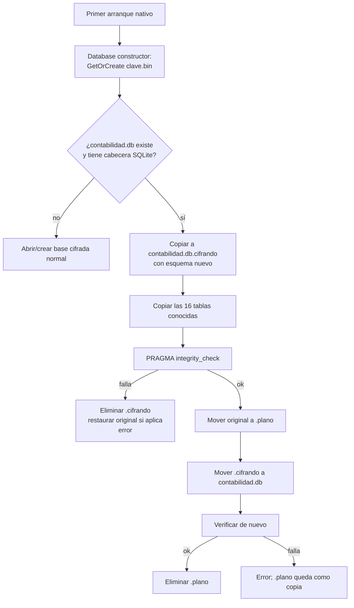
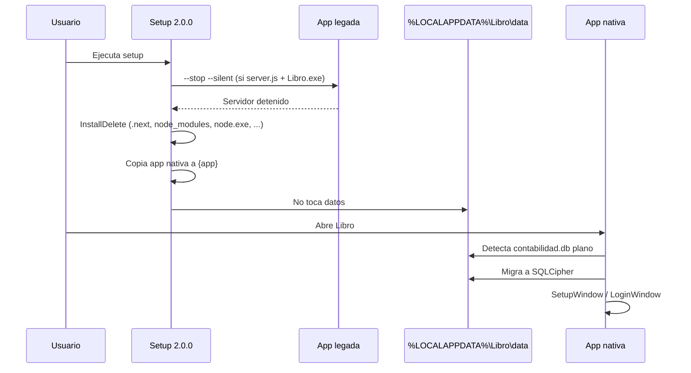

# 08 · Operación e instalador

> **Estado:** Vigente.
> **Corte:** 25 de octubre de 2026.
> **Ámbito:** `installer/libro-native.iss`, `installer/build-native.ps1`,
> `dist/`, la ruta de datos `%LOCALAPPDATA%\Libro\data` y el ciclo de
> instalación, actualización, reparación y desinstalación de Libro 2.0.0.
> **Fuente de verdad:** `installer/libro-native.iss`,
> `installer/build-native.ps1`, `desktop/Libro.Desktop/Data/AppPaths.cs`,
> `desktop/Libro.Desktop/Data/Database.cs`,
> `desktop/Libro.Desktop/SelfTest.cs`, `dist/LEEME.txt` y los artefactos de
> `dist/` del corte.
> **No cubre:** reglas contables ([05](05-modulos-flujos.md)), contrato del CLI
> ([07](07-cli.md)), mapa de la interfaz ([06](06-mapa-ui.md)) ni el instalador
> legado de Next.js ([11](11-legado-nextjs.md)); la comparación con el legado
> está resumida en §18.

---

## 1. Resumen ejecutivo

Libro 2.0.0 se distribuye como un **instalador Inno Setup por usuario**:

| Pregunta | Respuesta |
|---|---|
| Artefacto | `dist\Libro-Setup-2.0.0.exe` |
| Tamaño | 50,513,464 bytes (~48.2 MiB; ~50.5 MB decimal) |
| SHA256 | `A7B78EE1B22405E696A5B7ADD764DD2E9C5E5F5C04641ACA5E10D790AAFDB525` |
| Instalación | Por usuario, sin UAC ni permisos de administrador. |
| Aplicación | `%LOCALAPPDATA%\Programs\Libro` |
| Datos | `%LOCALAPPDATA%\Libro\data`, **nunca** dentro de `{app}` |
| Runtime | .NET 8 self-contained; no requiere .NET instalado en el destino. |
| Navegador / Node.js | No. La app es WPF nativa; el instalador legado de Next.js es historia. |
| Servicio / firewall | No crea servicios, tareas programadas ni reglas de firewall. |
| Actualización | Manual: ejecutar el instalador nuevo. No hay auto-update. |
| Desinstalación | Elimina aplicación y accesos directos; **conserva los datos**. |
| Firma digital | **No**; SmartScreen puede advertir. |
| Migración de datos | Ocurre en el **primer arranque**, no durante la instalación. |
| Facturación | Facturas internas. **No es CFDI**, no timbra y no usa PAC. |

La regla de oro del instalador es una separación estricta:

```text
{app}          = programa reemplazable, propiedad del instalador
%LOCALAPPDATA%\Libro\data = datos del usuario, propiedad del negocio
```

Todo lo que el usuario no puede perder —base, llave DPAPI, respaldos y
bitácora— vive fuera de `{app}`. Por eso una desinstalación, una reinstalación
o una actualización de la aplicación no toca los datos.

### 1.1 Decisiones de operación

| Decisión | Implementación | Consecuencia |
|---|---|---|
| Instalación por usuario | `PrivilegesRequired=lowest` | No pide administrador; cada cuenta de Windows tiene su propia instalación y sus propios datos. |
| Runtime incluido | `dotnet publish --self-contained true -r win-x64` | El instalador pesa ~50 MB y la carpeta publicada ~156 MB, pero el destino no necesita .NET. |
| Misma carpeta entre versiones | `DefaultDirName={localappdata}\Programs\Libro` y `AppId` estable | La actualización reemplaza archivos en el mismo lugar. |
| Datos fuera de `{app}` | `AppPaths.DataDirectory` | El instalador y el desinstalador no pueden borrar la contabilidad por accidente. |
| Datos que sobreviven al desinstalador | `[Dirs] ... Flags: uninsneveruninstall` | Reinstalar conserva todo; borrar de verdad exige acción manual. |
| Sin auto-update | No hay comprobador de versiones ni canal de actualización | El usuario decide cuándo actualizar y puede respaldar antes. |
| Sin firma | No hay `SignTool` en el build | Hay que verificar el SHA256 y educar sobre SmartScreen. |

---

## 2. Artefactos de distribución

### 2.1 `dist/`

| Archivo | Bytes | SHA256 | Estado | Uso |
|---|---:|---|---|---|
| `Libro-Setup-2.0.0.exe` | 50,513,464 | `A7B78EE1B22405E696A5B7ADD764DD2E9C5E5F5C04641ACA5E10D790AAFDB525` | **Vigente** | Instalador nativo para Windows 10/11 x64. |
| `Libro-Setup-2.0.0.exe.sha256` | 89 | — | **Vigente** | Huella en ASCII con el formato `<hash>  <archivo>`. |
| `Libro-Setup-1.0.0.exe` | 36,468,726 | `028BE5C570E98E60B3333C71DEA0CFE70F6C68EB2C530127A159D1F674032EFD` | **Archivado** | Instalador de la versión Next.js. Solo referencia histórica. |
| `Libro-Setup-1.0.0.exe.sha256` | 89 | — | **Archivado** | Huella del instalador legado. |
| `LEEME.txt` | 559 | — | **Vigente** | Advertencia de no instalar 1.0.0 sobre 2.0.0 y recordatorio de la ruta de datos. |

El contenido exacto de `dist\Libro-Setup-2.0.0.exe.sha256` es:

```text
A7B78EE1B22405E696A5B7ADD764DD2E9C5E5F5C04641ACA5E10D790AAFDB525  Libro-Setup-2.0.0.exe
```

La huella está en mayúsculas y separada por **dos espacios**. El hash que
calcula el CLI para sus propios respaldos es distinto: va en minúsculas y se
refiere a archivos `.libro`, no al instalador.

### 2.2 Carpeta de publicación

`installer/native-app/` es la **entrada empaquetada** del instalador, no un
artefacto para entregar suelto:

| Métrica | Valor |
|---|---:|
| Archivos totales | 265 |
| Archivos en la raíz | 248 |
| Archivos satélite en `es\` | 17 |
| Bytes totales | 155,754,703 |
| Bytes en la raíz | 154,521,735 |
| Bytes en `es\` | 1,232,968 |
| Bases de datos `*.db` | 0 |
| `Libro.exe` | 161,792 bytes |
| `Libro.dll` | 638,976 bytes |
| `e_sqlcipher.dll` | 1,852,928 bytes |
| `libro.ico` | **ausente** (véase INS-02) |

El instalador comprime ese contenido con LZMA2 sólido:

```text
50,513,464 / 155,754,703 ≈ 0.3243
```

Es decir, el setup ocupa aproximadamente el **32.4 %** del tamaño
descomprimido. La relación no es una garantía de instalación: el espacio libre
necesario debe cubrir el setup, la carpeta publicada y los datos.

### 2.3 Lo que no se distribuye

- `agent-harness/` y el CLI `libro-cli` no se instalan. El CLI se compila desde
  el repositorio y apunta a la misma carpeta de datos.
- `tools/Libro.DbTool` es diagnóstico y no se instala.
- `src/` (Next.js), `installer/app/` (staging legado, hoy ausente) y
  `installer/libro.iss` son legado archivado.
- `graphify-out/`, `backups/`, `data/`, `dist/` y las salidas de compilación
  están en `.gitignore`.
- No se distribuye `clave.bin`, `contabilidad.db`, `respaldos/` ni
  `libro.log`.

---

## 3. Requisitos y compatibilidad

| Requisito | Detalle | Fuente |
|---|---|---|
| Sistema operativo | Windows 10 o posterior (`MinVersion=10.0`). Windows 11 incluido. | `libro-native.iss` |
| Arquitectura | x64 nativo o ARM64 con emulación x64 (`ArchitecturesAllowed=x64compatible`). No hay build ARM64 nativo. | `libro-native.iss` |
| Permisos | Usuario estándar; no requiere administrador (`PrivilegesRequired=lowest`). | `libro-native.iss` |
| .NET | No se requiere instalación aparte: runtime .NET 8 self-contained dentro de `{app}`. | `build-native.ps1` |
| Espacio en disco | ~50.5 MB para el setup + ~156 MB para la app + datos y respaldos. Se recomienda dejar al menos 500 MB libres. | Cálculo del corte |
| Red | No se requiere para ejecutar. Solo para descargar el instalador o restaurar paquetes al compilar. | Código |
| Navegador | No se usa ni se abre. | Código |
| Node.js | No se usa en la app vigente. | Código |
| SQLCipher | Incluido como `e_sqlcipher.dll`; debe permanecer junto a `Libro.exe`. | `build-native.ps1` |
| Pantalla | WPF; la app está pensada para escritorio. No hay requisito documentado de resolución. | — |
| Idioma | Español únicamente. El instalador usa `Spanish.isl`; la app no está localizada. | `libro-native.iss` |
| Varias cuentas | Cada cuenta de Windows tiene su propia instalación, su carpeta y su llave DPAPI. No hay modo “todos los usuarios”. | `PrivilegesRequired=lowest` + `AppPaths` |

### 3.1 Lo que el instalador no necesita

- No necesita privilegios elevados.
- No necesita .NET Framework, Visual C++ Redistributable ni Node.js.
- No necesita una base de datos existente: en una instalación nueva la app la
  crea al primer arranque.
- No necesita conexión a Internet.
- No necesita desinstalar la versión 1.0.0 antes de actualizar.

### 3.2 Lo que el instalador no hace

- No crea servicios de Windows.
- No crea tareas programadas.
- No abre puertos ni agrega reglas de firewall.
- No registra asociaciones de archivos.
- No escribe variables de entorno.
- No migra la base de datos.
- No crea usuarios, empresa ni datos semilla.
- No elimina datos al desinstalar.
- No firma digitalmente el ejecutable.
- No busca actualizaciones.

---

## 4. Modelo de instalación por usuario

### 4.1 Árbol de rutas

```text
%LOCALAPPDATA%\
├── Programs\
│   └── Libro\                         {app}
│       ├── Libro.exe                  apphost WPF
│       ├── Libro.dll                  ensamblado de la aplicación
│       ├── Libro.deps.json
│       ├── Libro.runtimeconfig.json
│       ├── e_sqlcipher.dll            SQLCipher nativo
│       ├── ...                        runtime .NET 8 y dependencias
│       ├── es\                        recursos satélite en español
│       ├── unins000.exe               desinstalador
│       └── unins000.dat               registro del desinstalador
└── Libro\                             creado por el instalador
    └── data\                          datos del usuario
        ├── contabilidad.db            SQLCipher
        ├── clave.bin                   llave de 32 bytes protegida con DPAPI
        ├── respaldos\
        │   ├── Libro-*.libro
        │   └── Libro-antes-restaurar-*.libro
        └── libro.log                  bitácora técnica local
```

`%LOCALAPPDATA%` suele ser `C:\Users\<usuario>\AppData\Local`. La ruta exacta
la resuelve Windows; no se debe asumir una letra de unidad.

### 4.2 Por qué `{app}` y `data` están separados

1. **Actualización segura:** el instalador puede borrar y reemplazar todo
   `{app}` sin tocar la contabilidad.
2. **Desinstalación segura:** el desinstalador elimina el programa y deja los
   datos.
3. **Reinstalación:** tras desinstalar y volver a instalar, la app encuentra la
   misma base y la misma llave.
4. **Soporte:** la carpeta de datos se puede copiar completa (con la misma
   cuenta de Windows) sin mezclarla con binarios.
5. **Permisos:** el usuario estándar puede escribir en ambas rutas; no hacen
   falta permisos de administrador.

### 4.3 Configuración por usuario

| Elemento | Ubicación | Se crea | Se elimina al desinstalar |
|---|---|---|---|
| Aplicación | `%LOCALAPPDATA%\Programs\Libro` | Instalador | Sí, `[UninstallDelete]` borra `{app}`. |
| Carpeta de datos | `%LOCALAPPDATA%\Libro` | Instalador (`[Dirs]`) | **No** (`uninsneveruninstall`). |
| Subcarpeta `data` | `%LOCALAPPDATA%\Libro\data` | Instalador (`[Dirs]`) | **No** (`uninsneveruninstall`). |
| Base y llave | `<data>\contabilidad.db`, `<data>\clave.bin` | Primer arranque | **No**. |
| Respaldos | `<data>\respaldos` | Primer uso / app | **No**. |
| Bitácora | `<data>\libro.log` | Primer arranque | **No**. |
| Entrada de desinstalación | `HKCU\Software\Microsoft\Windows\CurrentVersion\Uninstall\{28083929-8EB6-45E7-A6CD-D27B813BCC34}_is1` | Instalador | Sí, la elimina el desinstalador. |
| Menú Inicio | `%APPDATA%\Microsoft\Windows\Start Menu\Programs\Libro` | Instalador | Sí. |
| Escritorio | Acceso directo opcional | Instalador, tarea `desktopicon` | Sí. |
| Inicio automático | Acceso directo opcional en Startup | Instalador, tarea `autostart` (desmarcada) | Sí. |

No hay valores de configuración de la app en el Registro. La app usa
`Microsoft.Win32` solo para diálogos de archivo (`OpenFileDialog` /
`SaveFileDialog`), no para persistir ajustes.

### 4.4 La ruta de datos es independiente de `{app}`

`AppPaths.DataDirectory` resuelve, en este orden:

1. `LIBRO_DATA_DIR`, si está definida y no está vacía;
2. `%LOCALAPPDATA%\Libro\data` en caso contrario.

Por eso:

- Cambiar `{app}` con `/DIR` **no** cambia la carpeta de datos.
- Desinstalar y reinstalar en otra ruta **no** mueve los datos.
- Definir `LIBRO_DATA_DIR` para la app y el CLI permite usar una carpeta
  distinta, pero el instalador siempre crea las carpetas estándar.
- Los accesos directos del menú Inicio no definen `LIBRO_DATA_DIR`; si se usa
  una ruta personalizada, hay que definir la variable en el usuario o lanzar
  desde una consola que la tenga.

> **Riesgo operativo:** dos instalaciones o dos procesos que apunten a la misma
> carpeta de datos comparten base y llave. No ejecutes la app y un CLI de
> escritura al mismo tiempo sobre la misma carpeta. SQLite WAL tolera lecturas,
> pero la restauración y las escrituras concurrentes pueden fallar con
> `database is locked`.

---

## 5. Anatomía del instalador

### 5.1 Cabecera y metadatos

`installer/libro-native.iss` define:

```text
#define MyAppName "Libro"
#define MyAppVersion "2.0.0"
#define MyAppPublisher "Libro"
#define MyAppId "{{28083929-8EB6-45E7-A6CD-D27B813BCC34}"
```

El doble `{{` es la forma de Inno de emitir una llave literal. El identificador
real es:

```text
{28083929-8EB6-45E7-A6CD-D27B813BCC34}
```

Ese `AppId` es el mismo que usa el instalador legado 1.0.0. Es deliberado para
actualizar en el mismo lugar, pero también es la causa de INS-03.

### 5.2 Directivas `[Setup]`

| Directiva | Valor | Efecto |
|---|---|---|
| `AppId` | `{28083929-8EB6-45E7-A6CD-D27B813BCC34}` | Identidad de la aplicación; comparte entrada de desinstalación entre versiones. |
| `AppName` | `Libro · Contabilidad` | Nombre visible. |
| `AppVersion` | `2.0.0` | Versión mostrada y usada por Inno. |
| `AppVerName` | `Libro 2.0.0` | Nombre con versión. |
| `AppPublisher` | `Libro` | Editor mostrado. |
| `DefaultDirName` | `{localappdata}\Programs\Libro` | Instalación por usuario. |
| `DefaultGroupName` | `Libro` | Grupo del menú Inicio. |
| `DisableProgramGroupPage` | `yes` | No pregunta el nombre del grupo. |
| `PrivilegesRequired` | `lowest` | Sin UAC; usuario estándar. |
| `OutputDir` | `..\dist` | Salida relativa a `installer\`. |
| `OutputBaseFilename` | `Libro-Setup-2.0.0` | Nombre del setup. |
| `SetupIconFile` | `libro.ico` | Icono del setup; el archivo sí existe en `installer\`. |
| `UninstallDisplayIcon` | `{app}\Libro.exe` | Icono de la entrada de desinstalación; el exe sí existe. |
| `Compression` | `lzma2/max` | Máxima compresión LZMA2. |
| `SolidCompression` | `yes` | Un solo bloque sólido; mejor ratio. |
| `WizardStyle` | `modern` | Asistente moderno de Inno. |
| `ArchitecturesAllowed` | `x64compatible` | x64 nativo o ARM64 con emulación x64. |
| `ArchitecturesInstallIn64BitMode` | `x64compatible` | Instala en modo 64 bits. |
| `MinVersion` | `10.0` | Windows 10 o posterior. |
| `CloseApplications` | `yes` | Inno intenta cerrar archivos en uso (Restart Manager). |
| `RestartApplications` | `no` | No reinicia la app automáticamente. |
| `SetupLogging` | `yes` | Genera log de instalación. |
| `UninstallLogMode` | `overwrite` | El desinstalador nuevo no hereda acciones del anterior. |
| `VersionInfoVersion` | `2.0.0.0` | Recurso de versión del setup. |
| `VersionInfoCompany` | `Libro` | Metadato del setup. |
| `VersionInfoDescription` | `Instalador de Libro · Contabilidad` | Metadato. |
| `VersionInfoProductName` | `Libro · Contabilidad` | Metadato. |
| `VersionInfoProductVersion` | `2.0.0` | Metadato. |

No hay `SignTool`, `LicenseFile`, `AppPublisherURL`, `AppSupportURL`,
`ChangesAssociations`, `AppMutex` ni `UsePreviousAppDir` explícito.

`UsePreviousAppDir` queda en su valor predeterminado (`yes`): si Inno encuentra
una instalación previa con el mismo `AppId`, reutiliza su carpeta aunque el
usuario haya elegido otra en la versión anterior.

### 5.3 `[Languages]`

```text
Name: "spanish"; MessagesFile: "compiler:Languages\Spanish.isl"
```

El asistente, los botones y los mensajes estándar de Inno salen en español. No
hay selector de idioma.

### 5.4 `[Tasks]`

| Tarea | Descripción | Estado inicial | Efecto |
|---|---|---|---|
| `desktopicon` | Crear un acceso directo en el escritorio | Marcada por Inno (las tareas sin `Flags` se muestran marcadas) | Crea `{autodesktop}\Libro.lnk`. |
| `autostart` | Iniciar Libro al iniciar sesión en Windows | **Desmarcada** (`Flags: unchecked`) | Crea `{userstartup}\Libro.lnk` sin argumentos. |

La tarea de escritorio es opcional; el usuario puede desmarcarla. La de inicio
automático está desmarcada por defecto para no imponer consumo de recursos.

### 5.5 `[Files]`

```text
Source: "native-app\*"; DestDir: "{app}";
  Flags: ignoreversion recursesubdirs createallsubdirs
```

- Copia **todo** `installer/native-app`, incluidos `es\` y el runtime.
- `ignoreversion` fuerza la sobrescritura aunque la versión del archivo sea
  igual o menor. Es lo que permite reinstalar o “reparar” ejecutando el mismo
  setup.
- `recursesubdirs createallsubdirs` conserva la estructura.
- No hay una lista explícita de archivos: si la publicación incluye un archivo
  no deseado, se empaqueta. El build intenta evitarlo con guardias (§11.3).

### 5.6 `[Dirs]`

```text
Name: "{localappdata}\Libro"; Flags: uninsneveruninstall
Name: "{localappdata}\Libro\data"; Flags: uninsneveruninstall
```

Crea las dos carpetas si no existen y las marca para que el desinstalador
**nunca** las elimine. No crea `respaldos\`; eso lo hace la app al inicializar
la base o al crear el primer respaldo.

### 5.7 `[InstallDelete]`

Se ejecuta antes de copiar los archivos nuevos. Su objetivo es limpiar la
instalación legada de Node/Next.js y accesos directos obsoletos:

| Ruta | Motivo |
|---|---|
| `{app}\.next` | Build de Next.js. |
| `{app}\node_modules` | Dependencias Node. |
| `{app}\node.exe` | Runtime Node embebido. |
| `{app}\server.js` | Servidor Next.js. |
| `{app}\start-server.cmd` | Lanzador del servidor legado. |
| `{app}\package.json` | Manifiesto Node. |
| `{app}\LEEME.txt` | Léeme legado. |
| `{app}\libro.ico` | Icono legado; **no se reemplaza** (INS-02). |
| `{app}\Libro.exe` | Lanzador legado; se reemplaza por el apphost nativo. |
| `{app}\CommunityToolkit.Mvvm.dll` | Dependencia de una versión intermedia. |
| `{group}\Detener Libro.lnk` | Acceso directo legado que ya no aplica. |
| `{userstartup}\Libro.lnk` | Inicio automático legado. |
| `{autodesktop}\Libro.lnk` | Escritorio legado; se recrea si la tarea está marcada. |

La carpeta de datos **no** aparece aquí. Está fuera de `{app}` y el instalador
no la toca.

### 5.8 `[Icons]`

| Icono | Destino | Archivo | Icono | Tarea |
|---|---|---|---|---|
| `Libro` | `{group}` | `{app}\Libro.exe` | `{app}\libro.ico` | Siempre |
| `Carpeta de datos` | `{group}` | `{localappdata}\Libro` | `{app}\libro.ico` | Siempre |
| `Desinstalar Libro` | `{group}` | `{uninstallexe}` | `{app}\libro.ico` | Siempre |
| `Libro` | `{autodesktop}` | `{app}\Libro.exe` | `{app}\libro.ico` | `desktopicon` |
| `Libro` | `{userstartup}` | `{app}\Libro.exe` | `{app}\libro.ico` | `autostart` |

`WorkingDir` es `{app}` en los accesos a la aplicación. El acceso “Carpeta de
datos” abre `%LOCALAPPDATA%\Libro`, no directamente `data`, para que el usuario
pueda ver también la carpeta contenedora.

**Hallazgo INS-02:** `{app}\libro.ico` no existe en `native-app`. El icono del
ejecutable sí está embebido por `ApplicationIcon` en el `.csproj`, pero los
accesos directos apuntan a un archivo ausente. La instalación no falla; el
icono de los accesos queda a merced del comportamiento de reserva de Inno y
Windows. Se corrige en la próxima compilación, no en el artefacto 2.0.0 ya
publicado.

### 5.9 `[Run]`

```text
Filename: "{app}\Libro.exe"; Description: "Abrir Libro ahora";
  Flags: nowait postinstall skipifsilent
```

- Al terminar, ofrece abrir la app.
- `nowait` no bloquea el cierre del instalador.
- `postinstall` lo muestra en la página final.
- `skipifsilent` evita abrir la app en instalaciones silenciosas.
- No pasa argumentos: la app sigue su flujo normal (`SetupWindow` si no hay
  usuarios, `LoginWindow` si ya existen).

### 5.10 `[UninstallDelete]`

```text
Type: filesandordirs; Name: "{app}"
Type: filesandordirs; Name: "{group}"
```

Refuerza la limpieza de la aplicación y del grupo del menú Inicio. No incluye
`{localappdata}\Libro` ni `{localappdata}\Libro\data`. Esa omisión es
intencional y es la garantía de conservación.

### 5.11 `[Code]`

#### `PrepareToInstall`

```text
if FileExists('{app}\server.js') and FileExists('{app}\Libro.exe') then
begin
  Exec('{app}\Libro.exe', '--stop --silent', '', SW_HIDE, ewWaitUntilTerminated, ResultCode);
  Sleep(1200);
end;
Result := '';
```

- Solo actúa si detecta una instalación **legada** de Next.js: deben existir
  `server.js` y `Libro.exe` en `{app}`.
- Ejecuta el lanzador legado con `--stop --silent`, que detiene el servidor
  Node.
- Espera 1.2 segundos para que se liberen archivos.
- Devuelve cadena vacía: no bloquea la instalación.
- En una instalación nativa no hay `server.js`, así que no hace nada. La app
  nativa se cierra mediante `CloseApplications=yes` si está abierta.

#### `InitializeWizard`

Personaliza el texto de bienvenida:

```text
Este instalador actualiza Libro a su versión nativa para Windows.

Tus datos, usuarios y respaldos se conservan y se cifran automáticamente.
%LOCALAPPDATA%\Libro\data

No necesitas desinstalar la versión anterior.
```

Es un mensaje informativo; no ejecuta migración ni valida la base.

### 5.12 Lo que no existe en el script

| Ausencia | Consecuencia |
|---|---|
| `[Registry]` | No hay configuración de app en el Registro; solo la entrada estándar de desinstalación de Inno. |
| `[Services]` | No hay servicio ni ejecución en segundo plano. |
| `[Run]` con servidor | No se inicia Node ni un servidor HTTP. |
| `[UninstallRun]` | El desinstalador no ejecuta `Libro.exe --stop`; precisamente se eliminó para no bloquear la desinstalación nativa. |
| `AppMutex` | Inno no detecta la app por mutex; usa Restart Manager (`CloseApplications`). |
| `SignTool` | No hay firma Authenticode. |

---

## 6. Flujo de instalación

### 6.1 Diagrama

```mermaid
flowchart TD
    A[Usuario ejecuta Libro-Setup-2.0.0.exe] --> B{Windows 10+ y x64compatible}
    B -- no --> X[Inno muestra error y termina]
    B -- sí --> C[Asistente en español]
    C --> D[Tareas: escritorio / inicio automático]
    D --> E[PrepareToInstall]
    E --> F{¿server.js y Libro.exe legados?}
    F -- sí --> G[Libro.exe --stop --silent<br/>Sleep 1200 ms]
    F -- no --> H[InstallDelete]
    G --> H
    H --> I[Copia native-app\* a {app}]
    I --> J[Crea {localappdata}\Libro y data]
    J --> K[Crea accesos directos]
    K --> L[Registra desinstalador en HKCU]
    L --> M{¿Instalación silenciosa?}
    M -- no --> N[Ofrece abrir Libro]
    M -- sí --> O[Termina sin abrir]
    N --> P[Primer arranque]
    O --> P
    P --> Q[AppState.Initialize:<br/>llave DPAPI, base, esquema, semillas]
    Q --> R{¿Hay usuarios?}
    R -- no --> S[SetupWindow]
    R -- sí --> T[LoginWindow]
```

### 6.2 Paso a paso

1. **Validación del sistema.** Inno comprueba `MinVersion=10.0`,
   `ArchitecturesAllowed=x64compatible` y los permisos. Si falla, no instala.
2. **Bienvenida.** Se muestra el texto de `InitializeWizard`, que explica la
   conservación de datos.
3. **Tareas.** El usuario decide escritorio e inicio automático. La segunda
   está desmarcada.
4. **Preparación.** Si hay legado, se detiene el servidor Node. Si la app nativa
   está abierta, `CloseApplications=yes` puede pedir cerrarla.
5. **Limpieza.** `[InstallDelete]` elimina los artefactos legados y los accesos
   obsoletos.
6. **Copia.** Se copian los 265 archivos de `native-app` a `{app}` con
   `ignoreversion`.
7. **Carpetas de datos.** Se crean `%LOCALAPPDATA%\Libro` y
   `%LOCALAPPDATA%\Libro\data` si no existen. No se escribe nada dentro.
8. **Accesos directos.** Se crean los del menú Inicio y, si se marcó, el de
   escritorio y el de inicio automático.
9. **Registro.** Inno registra la entrada de desinstalación en HKCU y guarda su
   log de desinstalación (`unins000.dat`).
10. **Cierre.** Se ofrece abrir la app.
11. **Primer arranque.** La app crea la llave DPAPI, la base SQLCipher, el
    esquema, los catálogos semilla y muestra `SetupWindow` o `LoginWindow`.

La instalación **no** crea la base. Si el usuario instala y nunca abre la app,
`%LOCALAPPDATA%\Libro\data` queda vacía (sin `contabilidad.db` ni
`clave.bin`).

### 6.3 Tiempos y tamaño

| Fase | Comportamiento |
|---|---|
| Copia | Depende del disco; ~156 MB descomprimidos. |
| Compresión | LZMA2 sólido; la descompresión puede tardar más que una copia simple. |
| Primer arranque | Crea base y llave; en equipo lento puede tardar unos segundos. |
| Migración legada | Copia todas las filas de 16 tablas y verifica integridad; puede tardar más con datos grandes. |

No hay un temporizador ni un límite de tamaño documentado. Para bases muy
grandes, prueba la migración en una copia antes de hacerla en producción.

---

## 7. Datos, cifrado y conservación

### 7.1 Contenido de la carpeta de datos

| Archivo / carpeta | Se crea | Contenido | Sensibilidad |
|---|---|---|---|
| `contabilidad.db` | Primer arranque | Base SQLCipher con empresa, usuarios, movimientos, facturas, nómina, etc. | **Alta**. |
| `contabilidad.db-wal` / `-shm` | Mientras hay conexiones | WAL de SQLite. | **Alta**. |
| `clave.bin` | Primer arranque | Llave aleatoria de 32 bytes cifrada con DPAPI `CurrentUser`. | **Crítica**. Sin ella no se abre la base. |
| `respaldos\*.libro` | Al crear respaldos | Copia SQLCipher completa. | **Alta**. |
| `respaldos\Libro-antes-restaurar-*.libro` | Antes de restaurar | Respaldo de seguridad automático. | **Alta**. |
| `libro.log` | Primer arranque / eventos | Rutas, errores y eventos técnicos. | Media. Puede contener rutas y mensajes internos. |

La base y los respaldos no tienen cabecera `SQLite format 3\0`; están cifrados.
La llave no se escribe en texto plano.

### 7.2 DPAPI

- Se usa `ProtectedData.Protect(..., DataProtectionScope.CurrentUser)`.
- La llave solo la puede descifrar la **misma cuenta de Windows** en el mismo
  perfil.
- No hay contraseña maestra adicional.
- Copiar `clave.bin` y `contabilidad.db` a otra cuenta u otro equipo no
  garantiza poder abrirlos. DPAPI puede involucrar el perfil y la máquina.
- Los respaldos `.libro` están cifrados con la misma llave; tampoco son
  portables por sí solos.

**Regla operativa:** `clave.bin` y `contabilidad.db` son una pareja. No borres,
muevas ni reemplaces uno sin el otro. Si restauras una base de otro equipo,
necesitas también su `clave.bin` y la misma cuenta de Windows; si no, no hay
recuperación criptográfica.

### 7.3 Qué conserva y qué elimina cada operación

| Operación | `{app}` | `%LOCALAPPDATA%\Libro\data` | `clave.bin` | Respaldos |
|---|---|---|---|---|
| Instalar 2.0.0 nueva | Crea | Crea carpetas vacías | No | No |
| Actualizar 1.0.0 → 2.0.0 | Reemplaza | **No toca** | **No toca** | **No toca** |
| Reinstalar 2.0.0 | Sobrescribe | **No toca** | **No toca** | **No toca** |
| Desinstalar | Elimina | **Conserva** | **Conserva** | **Conserva** |
| Borrar `%LOCALAPPDATA%\Libro` a mano | — | **Elimina** | **Elimina** | **Elimina** |
| Restaurar un `.libro` | — | Reemplaza la base | Conserva | Crea respaldo de seguridad |

### 7.4 Migración de la base legada

La migración ocurre en `Database.Initialize`, no en el instalador:



Detalles verificados:

- Detecta la cabecera `SQLite format 3\0`.
- Crea la base cifrada en `contabilidad.db.cifrando`.
- Copia **solo** las tablas de `Database.Tables`: `company`, `users`,
  `sessions`, `audit_log`, `accounts`, `categories`, `contacts`, `products`,
  `transactions`, `inventory_movements`, `invoices`, `invoice_items`,
  `payments`, `employees`, `payroll_periods`, `payroll_items`.
- Si una tabla no existe en el origen, la omite; la tabla nueva queda vacía.
- Copia las columnas presentes en el origen. Si el esquema legado tiene una
  columna que no existe en el destino, el `INSERT` falla y la migración se
  aborta.
- Verifica `PRAGMA integrity_check` antes y después de mover.
- Conserva el original como `contabilidad.db.plano` hasta que la base cifrada
  pasa la verificación; luego lo elimina.
- Si falla, intenta restaurar el original y lanza
  `No se pudo convertir la base existente al formato cifrado. No se modificó el
  archivo original.`

**Matiz de recuperación:** si la verificación falla **después** de mover el
archivo cifrado a `contabilidad.db`, el `catch` no restaura `.plano`
automáticamente porque `contabilidad.db` ya existe. El `.plano` queda en disco
como copia de recuperación. El mensaje “No se modificó el archivo original” es
demasiado optimista en ese caso. Véase INS-07.

**Copia de seguridad antes de migrar:** el instalador no la crea. La app crea
`.plano` de forma temporal, pero lo elimina al terminar con éxito. Si necesitas
volver a la versión 1.0.0 o conservar el texto plano, copia
`contabilidad.db` **antes del primer arranque** de 2.0.0.

### 7.5 Respaldos legados

La versión 1.0.0 guardaba respaldos en:

```text
%LOCALAPPDATA%\Libro\data\respaldos\contabilidad-YYYY-MM-DD_HHMMSS.db
```

Son bases SQLite **en texto plano**. La app nativa:

- lista solo `*.libro` en la lista de respaldos;
- permite elegir `*.db` en el diálogo de restauración, pero
  `Database.RestoreFrom` abre el archivo con la llave SQLCipher y falla si es
  texto plano;
- no convierte automáticamente los respaldos legados.

Los `.db` legados permanecen en `respaldos\` después de la actualización, pero
no se pueden restaurar desde la UI/CLI nativos. Opciones:

1. Conservarlos y, si se necesita uno, usar una copia de la app 1.0.0 en un
   entorno aislado para consultarlo.
2. Copiar el `.db` elegido a `%LOCALAPPDATA%\Libro\data\contabilidad.db` con la
   app cerrada y la base actual respaldada; al arrancar, la app lo detecta como
   texto plano y lo migra. Es una recuperación manual y destructiva.
3. Exportar la información desde la app legada antes de retirarla.

No hay importador de respaldos legados en la UI nativa.

---

## 8. Instalación nueva

### 8.1 Procedimiento recomendado

1. Verifica el SHA256 del setup contra el valor publicado.
2. Cierra cualquier instancia de Libro y de `libro-cli`.
3. Ejecuta `Libro-Setup-2.0.0.exe`.
4. Si SmartScreen advierte, elige **Más información → Ejecutar de todas
   formas** solo después de verificar la huella.
5. Elige si quieres acceso directo en el escritorio.
6. Deja desmarcado “Iniciar Libro al iniciar sesión” salvo que sea deliberate.
7. Termina el asistente y abre Libro.
8. En `SetupWindow`, captura empresa, nombre del administrador, correo y
   contraseña (mínimo 8 caracteres).
9. Crea un respaldo inicial desde **Configuración → Respaldos**.
10. Verifica la ruta `%LOCALAPPDATA%\Libro\data` y la existencia de
    `contabilidad.db` y `clave.bin`.

### 8.2 Qué esperar en el primer arranque

| Paso | Resultado |
|---|---|
| `AppState.Initialize` | Crea `%LOCALAPPDATA%\Libro\data`, `respaldos\`, `clave.bin`, `contabilidad.db`. |
| Esquema | Crea las 16 tablas si no existen. |
| Semillas | 13 categorías y 2 cuentas (`Caja`, `Banco`). |
| Usuarios | Ninguno; se muestra `SetupWindow`. |
| Empresa | Se crea con `AuthService.Setup`. |
| Auditoría | Se registra el alta inicial. |
| Login | La sesión queda en memoria; no hay “recordarme”. |

La empresa **no** se crea hasta que el usuario completa `SetupWindow`. El
instalador no la crea.

### 8.3 Verificación mínima

```powershell
$setup = "dist\Libro-Setup-2.0.0.exe"
Get-FileHash $setup -Algorithm SHA256
(Get-Item $setup).Length

$app = Join-Path $env:LOCALAPPDATA "Programs\Libro"
Test-Path (Join-Path $app "Libro.exe")
Test-Path (Join-Path $app "e_sqlcipher.dll")
(Get-Item (Join-Path $app "Libro.exe")).VersionInfo.FileVersion

$data = Join-Path $env:LOCALAPPDATA "Libro\data"
Test-Path (Join-Path $data "contabilidad.db")
Test-Path (Join-Path $data "clave.bin")
```

Resultados esperados:

```text
A7B78EE1B22405E696A5B7ADD764DD2E9C5E5F5C04641ACA5E10D790AAFDB525
50513464
True
True
2.0.0.0
True
True
```

En una instalación nueva, antes del primer arranque las dos últimas
comprobaciones son `False`; después del alta son `True`.

---

## 9. Actualización

### 9.1 Caso A: 1.0.0 (Next.js) → 2.0.0

Es el caso que el instalador maneja explícitamente.



Antes de ejecutar el setup:

1. Abre la app legada y crea un respaldo.
2. Copia **toda** la carpeta `%LOCALAPPDATA%\Libro\data` a un medio externo.
3. Copia en particular `contabilidad.db` en texto plano; la migración lo
   reemplaza y elimina `.plano` al terminar.
4. Cierra la app legada y verifica que no quede `node.exe` ni el puerto 3000
   escuchando.
5. Ejecuta el setup 2.0.0.
6. Abre la app nativa y verifica empresa, usuarios, movimientos, facturas y
   reportes.
7. Crea un respaldo nuevo `.libro` y conserva el `.db` legado aparte.

No es necesario desinstalar 1.0.0. El setup comparte `AppId` y carpeta.

### 9.2 Caso B: 2.0.0 → 2.0.0 (reparación o reinstalación)

- Ejecutar el mismo setup sobrescribe `{app}` con `ignoreversion`.
- No hay migración de datos.
- Los usuarios, la empresa y los respaldos se conservan.
- Útil si falta `e_sqlcipher.dll`, si un archivo se corrompió o si el
  desinstalador quedó inconsistente.
- Si la app está abierta, ciérrala; `CloseApplications=yes` puede pedirlo.

### 9.3 Caso C: 2.0.0 → 2.x futuro

El procedimiento previsto es el mismo, pero hay una limitación estructural:

- `Database.Initialize` ejecuta `Schema.Sql` con `CREATE TABLE IF NOT EXISTS`.
- No hay `ALTER TABLE`, migraciones incrementales ni lectura de
  `PRAGMA user_version`.
- Agregar una columna o tabla nueva no se aplica a bases existentes solo con
  instalar la nueva versión.

Antes de publicar una 2.x que cambie el esquema, hay que implementar una
migración explícita. Si no, una base existente puede fallar al consultar la
columna nueva. Véase [03](03-modelo-datos.md) y [13](13-hallazgos-riesgos.md).

### 9.4 Caso D: 2.0.0 → 1.0.0 (downgrade)

**No soportado.** Riesgos:

- El instalador 1.0.0 comparte `AppId` y sobrescribe `{app}` con archivos
  Node/Next.js.
- La app 1.0.0 usa SQLite en texto plano; no puede abrir la base SQLCipher.
- El instalador 1.0.0 no conoce `clave.bin` ni los respaldos `.libro`.
- El desinstalador 1.0.0 pregunta si borrar `%LOCALAPPDATA%\Libro`; una
  respuesta equivocada elimina todos los datos.
- `dist\LEEME.txt` advierte expresamente no instalar 1.0.0 sobre 2.0.0.

Si necesitas volver atrás, la vía segura es restaurar una copia **previa a la
migración** en un entorno controlado, no ejecutar el instalador legado sobre la
instalación nativa.

### 9.5 Caso E: cambiar la carpeta de instalación

- `DefaultDirName` es `%LOCALAPPDATA%\Programs\Libro`.
- `UsePreviousAppDir` (predeterminado `yes`) reutiliza la carpeta anterior.
- `/DIR="..."` en el setup permite otra carpeta.
- La carpeta de datos **no** cambia: sigue siendo
  `%LOCALAPPDATA%\Libro\data` o `LIBRO_DATA_DIR`.
- Si cambias `{app}`, revisa que los accesos directos apunten a la nueva ruta;
  Inno los recrea.
- No instales dos copias en carpetas distintas esperando que compartan datos:
  compartirían la misma carpeta de datos y la misma llave, con riesgo de
  concurrencia.

### 9.6 Caso F: actualización con la app abierta

- `CloseApplications=yes` permite a Inno detectar archivos en uso y pedir el
  cierre.
- `RestartApplications=no` evita que Inno reinicie la app.
- `PrepareToInstall` solo detiene el servidor legado, no la app nativa.
- Si la app nativa está abierta y mantiene `Libro.dll` o `e_sqlcipher.dll`
  bloqueados, la copia puede fallar. Ciérrala manualmente antes de actualizar.
- Si hay un CLI escribiendo, ciérralo también.

### 9.7 Caso G: servidor legado aún activo

Si `%LOCALAPPDATA%\Programs\Libro\server.js` y `Libro.exe` existen,
`PrepareToInstall` ejecuta `--stop --silent`. Si el proceso no responde:

1. Espera unos segundos.
2. Comprueba el puerto 3000:

   ```powershell
   Get-NetTCPConnection -LocalPort 3000 -State Listen -ErrorAction SilentlyContinue
   ```

3. Si sigue activo, ciérralo desde el Administrador de tareas o con el acceso
   **Detener Libro** de la versión anterior.
4. Vuelve a ejecutar el setup.

### 9.8 Checklist de actualización

Antes:

- [ ] Respaldo `.libro` creado y verificado.
- [ ] Copia completa de `%LOCALAPPDATA%\Libro\data` en medio externo.
- [ ] Copia del `contabilidad.db` legado (si aplica).
- [ ] App y CLI cerrados.
- [ ] Espacio libre suficiente.
- [ ] SHA256 del setup verificado.

Después:

- [ ] La app abre y muestra la empresa correcta.
- [ ] Los usuarios pueden iniciar sesión.
- [ ] Los conteos de movimientos, facturas y nómina coinciden.
- [ ] Los reportes y el IVA cuadran.
- [ ] Se creó un respaldo `.libro` nuevo.
- [ ] `doctor` reporta `databaseKind = encrypted` y `opened = true`.
- [ ] No quedan `node.exe`, `server.js` ni `.next` en `{app}`.

---

## 10. Desinstalación

### 10.1 Formas de desinstalar

1. **Configuración de Windows → Aplicaciones → Libro → Desinstalar.**
2. **Menú Inicio → Libro → Desinstalar Libro.**
3. Directamente:

   ```powershell
   & "$env:LOCALAPPDATA\Programs\Libro\unins000.exe"
   ```

4. Silenciosa:

   ```powershell
   & "$env:LOCALAPPDATA\Programs\Libro\unins000.exe" /VERYSILENT /SUPPRESSMSGBOXES /NORESTART
   ```

### 10.2 Qué elimina

- Archivos y subcarpetas de `%LOCALAPPDATA%\Programs\Libro` (`{app}`).
- Accesos directos del menú Inicio, escritorio e inicio automático.
- Entrada de desinstalación en HKCU.
- Restos de `{group}`.
- `unins000.exe`, `unins000.dat` y el log del desinstalador dentro de `{app}`.

### 10.3 Qué conserva

- `%LOCALAPPDATA%\Libro` (carpeta contenedora).
- `%LOCALAPPDATA%\Libro\data` y todo su contenido:
  - `contabilidad.db` y WAL/SHM;
  - `clave.bin`;
  - `respaldos\`;
  - `libro.log`.
- Cualquier copia externa de respaldos.

La conservación no es un descuido: `[Dirs]` usa `uninsneveruninstall` y
`[UninstallDelete]` no incluye la carpeta de datos.

### 10.4 Reinstalar después de desinstalar

1. Ejecuta el setup de nuevo.
2. La app encuentra `contabilidad.db` y `clave.bin`.
3. No muestra `SetupWindow`; muestra `LoginWindow`.
4. Los datos, usuarios y respaldos siguen ahí.
5. La llave DPAPI debe seguir siendo válida para la misma cuenta de Windows.

Si la app no abre después de reinstalar, no borres `clave.bin`: revisa
`libro.log`, verifica que la cuenta de Windows sea la misma y usa `doctor`.

### 10.5 Borrado definitivo

Para retirar Libro de un equipo y **no** dejar datos:

1. Crea un respaldo `.libro` si aún lo necesitas.
2. Copia `%LOCALAPPDATA%\Libro\data` a un medio seguro si vas a migrar.
3. Desinstala la aplicación.
4. Verifica que `%LOCALAPPDATA%\Programs\Libro` ya no exista.
5. Elimina manualmente:

   ```powershell
   Remove-Item "$env:LOCALAPPDATA\Libro" -Recurse -Force
   ```

6. Vacía la Papelera de reciclaje si corresponde.
7. Si el equipo se va a reutilizar o vender, considera un borrado seguro del
   disco; la base estaba cifrada, pero la llave DPAPI y el perfil pueden seguir
   en el equipo.

> **Irreversible.** Sin `clave.bin` y sin una copia de la base no hay forma de
> recuperar los datos. El borrado manual de `%LOCALAPPDATA%\Libro` elimina base,
> llave y respaldos a la vez.

### 10.6 Desinstalación bloqueada

Síntomas y causas:

| Síntoma | Causa probable | Acción |
|---|---|---|
| El desinstalador no termina | Una versión anterior heredó `[UninstallRun] Libro.exe --stop` y la app nativa no entiende `--stop`. | Reinstala 2.0.0 (el nuevo `UninstallLogMode=overwrite` corrige el log) y desinstala de nuevo. |
| “No se puede eliminar el archivo” | La app o un CLI tienen DLLs abiertas. | Cierra todo; reinicia si es necesario. |
| El desinstalador no aparece | Instalación dañada o entrada de Registro eliminada. | Reinstala 2.0.0 y desinstala desde Configuración. |
| Quedan accesos directos | Inno no pudo borrarlos o se crearon a mano. | Elimínalos manualmente. |
| Quedan datos | Comportamiento esperado. | Borra `%LOCALAPPDATA%\Libro` a mano si es intencional. |

---

## 11. Pipeline de construcción

### 11.1 Requisitos

| Herramienta | Ruta esperada | Alternativa |
|---|---|---|
| .NET 8 SDK | `%LOCALAPPDATA%\Microsoft\dotnet\dotnet.exe` | `dotnet` del `PATH`. |
| Inno Setup 6 | `%LOCALAPPDATA%\Programs\Inno Setup 6\ISCC.exe` | No hay fallback; el script falla. |
| PowerShell | Windows PowerShell 5.1 o PowerShell 7 | El script usa cmdlets estándar. |
| Windows x64 | Para publicar `win-x64`. | — |
| `installer\libro.ico` | Icono del setup. | Debe existir; el script no lo valida explícitamente, pero Inno lo necesita. |

### 11.2 Comando

```powershell
cd C:\Proyectos\IDK
powershell -NoProfile -ExecutionPolicy Bypass -File installer\build-native.ps1
```

El script usa `$ErrorActionPreference = "Stop"`: cualquier error detiene el
proceso.

### 11.3 Paso 1: publicación

```powershell
$Dotnet publish $Project -c Release -r win-x64 --self-contained true `
    -p:DebugType=None -p:DebugSymbols=false -o $AppDir
```

- `-c Release`: compilación optimizada.
- `-r win-x64`: runtime de Windows 64 bits.
- `--self-contained true`: incluye .NET 8 y WPF.
- `DebugType=None`, `DebugSymbols=false`: no genera PDB.
- `-o installer/native-app`: salida directa al staging.
- Antes de publicar, el script **borra** `installer/native-app` completo.

La publicación incluye el apphost `Libro.exe`, `Libro.dll`, dependencias,
`e_sqlcipher.dll`, el runtime y los recursos satélite.

### 11.4 Paso 2: poda de culturas

Se eliminan solo estas carpetas de cultura, si existen:

```text
cs  de  fr  it  ja  ko  pl  pt-BR  ru  tr  zh-Hans  zh-Hant
```

Se conserva `es` (español). No se tocan `runtimes` ni otras carpetas que
puedan contener dependencias nativas. La lista es manual: si .NET agrega una
cultura nueva, se quedará en el paquete hasta que se actualice la lista.

### 11.5 Guardias de publicación

| Guardia | Condición | Error |
|---|---|---|
| Apphost | Debe existir `Libro.exe`. | “No se generó Libro.exe.” |
| SQLCipher | Debe existir `e_sqlcipher.dll`. | “Falta e_sqlcipher.dll.” |
| Base de datos | No debe haber ningún `*.db` recursivo. | “La carpeta publicada contiene una base de datos; no debe distribuirse.” |

Las guardias **no** comprueban `clave.bin`, `*.libro`, `*.db-wal`, `*.db-shm`
ni `libro.log`. La publicación se genera desde cero, así que el riesgo es bajo,
pero un archivo copiado manualmente al staging podría pasar. Véase INS-09.

### 11.6 Paso 3: autoprueba

```powershell
$SelfTestLog = Join-Path $env:TEMP "libro-selftest-build.log"
$env:LIBRO_SELFTEST_LOG = $SelfTestLog
$test = Start-Process -FilePath "$AppDir\Libro.exe" `
    -ArgumentList "--self-test" -Wait -PassThru
if ($test.ExitCode -ne 0) { throw ... }
if (-not (Select-String -Path $SelfTestLog -Pattern "SELFTEST_OK" -Quiet)) { throw ... }
```

- Ejecuta la app publicada, no el proyecto compilado.
- Usa un log temporal.
- Comprueba el código de salida y, sobre todo, `SELFTEST_OK`.
- Si falla, el build se detiene antes de Inno.
- **Matiz:** `Libro.exe --self-test` siempre termina con código 0 porque
  `SelfTest.Run()` captura las excepciones y `Shutdown()` no recibe código. La
  señal fiable es el contenido del log. Véase INS-05.

### 11.7 Paso 4: Inno Setup

```powershell
& $Iscc $Iss
```

- Compila `installer/libro-native.iss`.
- Salida: `dist\Libro-Setup-2.0.0.exe`.
- Si `ISCC` falla, el script se detiene.
- No hay firma ni timestamp.

### 11.8 Paso 5: SHA256

```powershell
$Hash = (Get-FileHash $Setup -Algorithm SHA256).Hash
"$Hash  $(Split-Path $Setup -Leaf)" |
    Set-Content -Path "$Setup.sha256" -Encoding ASCII
```

- Escribe `<hash>  <nombre>` en ASCII.
- El hash es el del setup completo, no el de `Libro.exe`.
- Imprime la ruta, el tamaño y la fecha del setup.

### 11.9 Salidas

```text
installer/native-app/                 265 archivos, 155,754,703 bytes
dist/Libro-Setup-2.0.0.exe            50,513,464 bytes
dist/Libro-Setup-2.0.0.exe.sha256     89 bytes
```

El script no borra instaladores anteriores de `dist`. Si se cambia la versión,
conviene archivar o eliminar el setup previo para evitar confusiones.

### 11.10 Reproducibilidad

El hash **no** es reproducible byte a byte entre compilaciones:

- .NET inserta timestamps y metadatos de compilación.
- Inno incluye fechas y rutas en el setup.
- El orden de archivos y la compresión pueden variar.

Por eso cada build publicado debe tener su propio SHA256. No compares hashes
entre builds; compara el hash del artefacto que se va a instalar con el hash
publicado para ese artefacto.

### 11.11 Firma de código (pendiente)

No hay `SignTool` ni certificado. Consecuencias:

- SmartScreen puede mostrar “Windows protegió tu PC”.
- El editor aparece como desconocido.
- Un tercero no puede verificar autenticidad con Authenticode.

Mitigación actual:

1. Publicar el SHA256 por un canal confiable.
2. Verificar la huella antes de instalar.
3. Firmar en una versión futura y sellar el timestamp.

---

## 12. Autoprueba interna

### 12.1 Qué ejecuta

```powershell
$env:LIBRO_SELFTEST_LOG = "$env:TEMP\libro-selftest.log"
& "$env:LOCALAPPDATA\Programs\Libro\Libro.exe" --self-test
Get-Content $env:LIBRO_SELFTEST_LOG -Encoding utf8
```

`SelfTest.Run()` escribe un log UTF-8 sin BOM y termina. No abre ventanas, no
usa la base real y no requiere credenciales.

### 12.2 Cobertura

| Grupo | Comprobaciones |
|---|---|
| scrypt | Vector conocido `Contraseña123!` y rechazo de una contraseña incorrecta. |
| Base cifrada nueva | Crea `clave.bin`, base sin cabecera SQLite, inserta empresa y usuario, reabre y verifica. |
| Migración plana | Crea una base SQLite con las 16 tablas y filas, inicializa, verifica conteos, importes, cifrado y ausencia de `.plano`. |
| Llave incorrecta | Copia una base cifrada sin su llave y confirma que la apertura se rechaza. |
| Respaldo | Crea un `.libro`, verifica que está cifrado. |
| Corrupción | Altera el byte 100 del respaldo y confirma que se rechaza sin dañar la base. |
| Restauración | Restaura el respaldo válido y verifica que la base resultante está cifrada. |

En el corte se ejecutó la autoprueba sobre `installer/native-app/Libro.exe`:

```text
EXIT=0
35 comprobaciones OK
SELFTEST_OK
```

### 12.3 Interpretación del resultado

- La última línea debe ser exactamente `SELFTEST_OK`.
- Si es `SELFTEST_FAIL`, la línea siguiente contiene la excepción.
- El código de salida del proceso es 0 incluso en fallo; **no** confíes solo en
  `$LASTEXITCODE`.
- El log se escribe en `LIBRO_SELFTEST_LOG` o, por defecto, en
  `%TEMP%\libro-selftest.log`.
- Windows PowerShell 5.1 puede mostrar los acentos como caracteres extraños si
  lee el archivo sin `-Encoding utf8`. El contenido es UTF-8 válido.

### 12.4 Qué no cubre

- No prueba la interfaz WPF ni los diálogos.
- No prueba la instalación ni el desinstalador.
- No prueba DPAPI en otra cuenta de Windows.
- No prueba la migración de una base real con esquemas inesperados.
- No prueba concurrencia, bloqueos de SQLite ni restauración con la app
  abierta.
- No prueba la firma ni SmartScreen.

Esas pruebas son manuales o están en `agent-harness/tests` para el CLI.

---

## 13. Instalación y desinstalación silenciosas

### 13.1 Instalar

```powershell
$setup = "dist\Libro-Setup-2.0.0.exe"
$log = Join-Path $env:TEMP "libro-install.log"

$p = Start-Process -FilePath $setup -Wait -PassThru -ArgumentList @(
    "/VERYSILENT",
    "/SUPPRESSMSGBOXES",
    "/NORESTART",
    "/LOG=$log",
    '/TASKS=""'
)
$p.ExitCode
```

| Argumento | Efecto |
|---|---|
| `/VERYSILENT` | Sin interfaz ni preguntas. |
| `/SUPPRESSMSGBOXES` | Suprime cuadros de mensaje. |
| `/NORESTART` | No reinicia Windows. |
| `/LOG=<ruta>` | Escribe el log de instalación en esa ruta. |
| `/TASKS=""` | No crea accesos de escritorio ni de inicio automático. |
| `/TASKS="desktopicon"` | Crea solo el acceso de escritorio. |
| `/TASKS="desktopicon,autostart"` | Crea ambos. |
| `/MERGETASKS="desktopicon"` | Conserva las tareas existentes y agrega la indicada. |
| `/DIR="C:\ruta"` | Cambia `{app}`; no cambia la carpeta de datos. |
| `/NOICONS` | No crea el grupo del menú Inicio. |

Códigos de salida habituales de Inno:

| Código | Significado |
|---|---|
| 0 | Instalación correcta. |
| 1 | El usuario canceló. |
| 2 o mayor | Error fatal; revisa el log. |

### 13.2 Desinstalar

```powershell
$unins = "$env:LOCALAPPDATA\Programs\Libro\unins000.exe"
$p = Start-Process -FilePath $unins -Wait -PassThru -ArgumentList @(
    "/VERYSILENT",
    "/SUPPRESSMSGBOXES",
    "/NORESTART",
    "/LOG=$env:TEMP\libro-uninstall.log"
)
$p.ExitCode
```

La desinstalación silenciosa no pregunta por los datos porque el desinstalador
nunca los borra.

### 13.3 Automatización y CI

- No instales en un agente compartido sin limpiar `{app}` y
  `%LOCALAPPDATA%\Libro` después.
- La instalación crea las carpetas de datos aunque no se abra la app.
- Si usas `/DIR` temporal, la carpeta de datos sigue siendo la estándar; define
  `LIBRO_DATA_DIR` para la app si necesitas aislamiento.
- En CI, prefiere compilar y ejecutar la autoprueba sin instalar; el setup se
  prueba en una VM limpia.
- SmartScreen es una capa del sistema operativo y no se puede desactivar con
  argumentos del setup.

---

## 14. Verificación posterior a la instalación

### 14.1 Checklist técnico

- [ ] El SHA256 del setup coincide con el publicado.
- [ ] El tamaño coincide (50,513,464 bytes en este corte).
- [ ] `%LOCALAPPDATA%\Programs\Libro\Libro.exe` existe.
- [ ] `Libro.exe` reporta `FileVersion = 2.0.0.0` y
      `ProductVersion = 2.0.0`.
- [ ] `e_sqlcipher.dll` existe junto al ejecutable.
- [ ] La carpeta `es\` existe y contiene los recursos satélite.
- [ ] No hay `node.exe`, `server.js`, `package.json`, `.next` ni
      `node_modules` en `{app}`.
- [ ] `%LOCALAPPDATA%\Libro` y `%LOCALAPPDATA%\Libro\data` existen.
- [ ] En instalación nueva, aún no hay `contabilidad.db` antes del primer
      arranque.
- [ ] El menú Inicio muestra Libro, Carpeta de datos y Desinstalar Libro.
- [ ] El acceso de escritorio existe solo si se marcó la tarea.
- [ ] El inicio automático existe solo si se marcó la tarea.
- [ ] La app abre, muestra Setup/Login y permite entrar.
- [ ] La app crea `contabilidad.db`, `clave.bin`, `respaldos\` y `libro.log`.
- [ ] `doctor` reporta `databaseKind = encrypted` y `opened = true`.
- [ ] Un respaldo `.libro` se crea y se puede listar.
- [ ] El desinstalador elimina `{app}` y conserva `data`.
- [ ] Reinstalar después de desinstalar conserva usuarios y datos.

### 14.2 Comandos

```powershell
$setup = "dist\Libro-Setup-2.0.0.exe"
Get-FileHash $setup -Algorithm SHA256
(Get-Item $setup).Length

$app = Join-Path $env:LOCALAPPDATA "Programs\Libro"
Get-ChildItem $app -File | Select-Object Name, Length
(Get-Item (Join-Path $app "Libro.exe")).VersionInfo |
    Select-Object FileVersion, ProductVersion, FileDescription, CompanyName

$data = Join-Path $env:LOCALAPPDATA "Libro\data"
Get-ChildItem $data -Force | Select-Object Name, Length, LastWriteTime

# Autoprueba sobre la app instalada
$env:LIBRO_SELFTEST_LOG = "$env:TEMP\libro-selftest-installed.log"
& (Join-Path $app "Libro.exe") --self-test
Get-Content $env:LIBRO_SELFTEST_LOG -Encoding utf8
Remove-Item Env:LIBRO_SELFTEST_LOG

# Diagnóstico de solo lectura (no crea llave si falta)
& ".\agent-harness\libro-cli.cmd" --json doctor
```

No ejecutes comandos de escritura del CLI contra
`%LOCALAPPDATA%\Libro\data` en una prueba. Usa `--data-dir` temporal.

### 14.3 Evidencia del corte

| Comprobación | Resultado |
|---|---|
| SHA256 del setup | `A7B78EE1B22405E696A5B7ADD764DD2E9C5E5F5C04641ACA5E10D790AAFDB525` |
| Tamaño del setup | 50,513,464 bytes |
| SHA256 del instalador legado | `028BE5C570E98E60B3333C71DEA0CFE70F6C68EB2C530127A159D1F674032EFD` |
| Tamaño del instalador legado | 36,468,726 bytes |
| Publicación nativa | 265 archivos, 155,754,703 bytes |
| Autoprueba sobre la publicación | 35 OK, `SELFTEST_OK`, salida 0 |
| `Libro.exe` | 2.0.0.0 / 2.0.0 |
| `e_sqlcipher.dll` | Presente, 1,852,928 bytes |
| `*.db` en la publicación | 0 |
| `libro.ico` en la publicación | Ausente (INS-02) |

No hay una instalación real en la máquina de este corte (`NO INSTALADO`), por
lo que los chequeos de accesos directos y desinstalación se basan en el script,
en la verificación de ciclo de `RELEASE-NOTES-2.0.0.md` y en la evidencia de la
máquina de desarrollo. No se presentan como una ejecución nueva en esta sesión.

---

## 15. Runbook de operaciones

### 15.1 Instalación nueva

```text
1. Verificar SHA256.
2. Ejecutar setup.
3. Elegir tareas.
4. Abrir Libro.
5. Completar SetupWindow.
6. Crear respaldo inicial.
7. Verificar data\contabilidad.db y clave.bin.
```

### 15.2 Actualización desde 1.0.0

```text
1. Abrir app legada.
2. Crear respaldo legado.
3. Copiar %LOCALAPPDATA%\Libro\data completa a un medio externo.
4. Copiar contabilidad.db plano aparte.
5. Cerrar app legada y verificar puerto 3000.
6. Ejecutar setup 2.0.0.
7. Abrir app nativa; verificar migración.
8. Verificar empresa, usuarios, movimientos, facturas, nómina, reportes.
9. Crear respaldo .libro nuevo.
10. Conservar el .db legado fuera de la carpeta activa.
```

### 15.3 Reparación

```text
1. Cerrar app y CLI.
2. Ejecutar el mismo setup 2.0.0.
3. Abrir app.
4. Verificar login y datos.
```

### 15.4 Respaldo antes de una operación riesgosa

```text
1. Abrir Configuración → Respaldos.
2. Crear respaldo.
3. Copiar el .libro a un medio externo.
4. Copiar clave.bin junto con la base si se copia toda la carpeta.
5. Verificar que el respaldo aparece en la lista y tiene tamaño > 0.
```

También se puede usar el CLI:

```powershell
& ".\agent-harness\libro-cli.cmd" --json backup create
& ".\agent-harness\libro-cli.cmd" --json backup create --output "D:\Respaldos\Libro-20261025.libro"
& ".\agent-harness\libro-cli.cmd" --json backup list --hash
```

El CLI usa la misma carpeta de datos. Para una copia externa, `--output`; esa
copia no aparece en `backup list`, que solo mira la carpeta estándar.

### 15.5 Restauración

Desde la UI:

```text
Configuración → Respaldos → Restaurar → elegir .libro → confirmar.
```

Desde el CLI:

```powershell
& ".\agent-harness\libro-cli.cmd" --json backup restore `
  --file "D:\Respaldos\Libro-20261025.libro" --yes
```

Reglas:

- Cerrar la app y otros CLI antes de restaurar.
- La restauración reemplaza la base completa.
- Se crea un respaldo de seguridad `Libro-antes-restaurar-*.libro`.
- Si el archivo no es SQLCipher legible con la llave actual, se rechaza.
- Los `.db` legados en texto plano no se pueden restaurar por esta vía.
- La restauración no cierra la app; en la UI se cierra después del éxito.

### 15.6 Mover a otro equipo o cuenta

No hay un “exportar todo” portátil. Opciones:

1. **Misma cuenta y mismo perfil:** copiar `%LOCALAPPDATA%\Libro\data` completa
   (base + `clave.bin` + respaldos) y restaurar en la misma ruta. DPAPI debe
   poder descifrar la llave.
2. **Otra cuenta u otro equipo:** DPAPI `CurrentUser` probablemente impide
   abrir la base. Exporta reportes/CSV o vuelve a capturar; no hay garantía de
   recuperación.
3. **Respaldo `.libro`:** sirve para restaurar en la misma cuenta; no es
   portable por sí solo.

Antes de mover, crea un respaldo y verifica que se puede restaurar en el
destino. No borres el original hasta confirmarlo.

### 15.7 Soporte

Para diagnosticar sin exponer datos:

```powershell
& ".\agent-harness\libro-cli.cmd" --json doctor
Get-Content "$env:LOCALAPPDATA\Libro\data\libro.log" -Tail 100
```

Comparte:

- versión de Libro (`Libro.exe` / `version`);
- salida de `doctor` (sin conteos sensibles si aplica);
- mensaje de error y código;
- log de instalación (`/LOG`);
- pasos para reproducir.

No compartas:

- `contabilidad.db`;
- `clave.bin`;
- respaldos `.libro`;
- contraseñas;
- datos personales/fiscales sin anonimizar.

---

## 16. Solución de problemas

| Síntoma | Causa probable | Solución |
|---|---|---|
| SmartScreen: “Windows protegió tu PC” | Instalador sin firma. | Verifica SHA256; **Más información → Ejecutar de todas formas**. No desactives SmartScreen globalmente. |
| “Esta aplicación no se puede ejecutar en este equipo” | Arquitectura no compatible. | Usa Windows 10/11 x64 o ARM64 con emulación x64. No hay build ARM64 nativo. |
| El setup dice que requiere Windows 10 | `MinVersion=10.0`. | Actualiza Windows; no hay soporte para Windows 7/8. |
| El setup no encuentra Inno/ISCC | Compilación, no instalación. | Instala Inno Setup 6 en `%LOCALAPPDATA%\Programs\Inno Setup 6`. |
| El setup falla al copiar archivos | App/CLI abiertos o antivirus. | Cierra todo; revisa el log; excluye la carpeta si el antivirus la bloquea. |
| Quedan archivos de Node/Next.js | Instalación legada parcial. | Reinstala 2.0.0; `[InstallDelete]` los elimina. Verifica `{app}`. |
| El puerto 3000 sigue ocupado | Servidor legado no se detuvo. | Detén el servidor anterior; vuelve a ejecutar el setup. |
| La app no abre y no muestra ventana | Falta `e_sqlcipher.dll`, base/llave inconsistente o excepción de arranque. | Reinstala; revisa `libro.log`; ejecuta `--self-test`; no borres `clave.bin`. |
| “No se pudo abrir la base cifrada...” | Llave incorrecta, base dañada o cuenta de Windows distinta. | Restaura `clave.bin` + base de la misma cuenta; usa un respaldo; no regeneres la llave a ciegas. |
| “Falta e_sqlcipher.dll” | Copia incompleta o antivirus. | Reinstala; verifica el archivo; revisa cuarentena. |
| `database is locked` | App/CLI concurrentes o restauración en curso. | Cierra procesos; espera; reintenta. |
| El respaldo no restaura | `.db` legado, archivo corrupto o de otra cuenta. | Usa un `.libro` de la misma cuenta; verifica el hash; no insistas con el archivo dañado. |
| La app abre pero no hay datos | Se está usando otra carpeta (`LIBRO_DATA_DIR`) u otra cuenta. | Revisa la ruta y la variable de entorno; abre “Carpeta de datos”. |
| El icono del acceso es genérico | `{app}\libro.ico` no se publica (INS-02). | Cosmético; usa el acceso al exe o corrige el instalador en la próxima versión. |
| El desinstalador se cuelga | Log de desinstalación legado con `--stop`. | Reinstala 2.0.0 y desinstala de nuevo. |
| Quedan datos tras desinstalar | Comportamiento intencional. | Borra `%LOCALAPPDATA%\Libro` manualmente si es intencional. |
| La app se abre en español y no se puede cambiar | No hay localización. | Esperado. |
| El instalador no crea la base | La base se crea al primer arranque. | Abre la app y completa el alta. |
| El setup se instaló en otra carpeta | `UsePreviousAppDir` reutilizó la anterior o se usó `/DIR`. | Revisa `{app}`; la datos no cambian. |

---

## 17. Seguridad y privacidad del instalador

### 17.1 Superficie

| Elemento | Riesgo | Mitigación |
|---|---|---|
| Setup sin firma | Suplantación o alteración. | SHA256 publicado; firmar en el futuro. |
| `dist/` escribible | Sustitución del setup. | Restringir permisos; verificar hash antes de distribuir. |
| Staging `native-app` | Puede contener datos si se copian a mano. | Guardia `*.db`; revisar `clave.bin`, `*.libro`, `*.db-wal`, `libro.log` antes de compilar. |
| `LIBRO_DATA_DIR` | Apunta a una carpeta arbitraria. | Validar la ruta; no usar en producción sin control. |
| `--debug` en CLI | Trazas con rutas internas. | No compartir logs sin sanear. |
| Datos en `%LOCALAPPDATA%` | Acceso con la cuenta de Windows. | Cifrado SQLCipher + DPAPI; bloqueo de sesión; disco cifrado. |
| Respaldos `.libro` | Copia completa cifrada. | Misma llave DPAPI; no copiar `clave.bin` junto con el respaldo a un medio no seguro. |
| `libro.log` | Rutas y errores. | Sanear antes de compartir. |
| Desinstalador conserva datos | Privacidad al reutilizar el equipo. | Borrado manual de `%LOCALAPPDATA%\Libro`; borrado seguro del disco. |

### 17.2 Recomendaciones

1. Firmar el setup y el ejecutable en la próxima versión.
2. Publicar el SHA256 en un canal distinto del binario (web, repositorio,
   correo).
3. No distribuir `installer/native-app` como ZIP; usar el setup.
4. No incluir `clave.bin`, `contabilidad.db`, `respaldos\` ni `libro.log` en el
   paquete.
5. Cifrar el medio externo donde se copien base y llave.
6. Restringir la escritura a `dist/` y al staging.
7. Auditar el contenido del staging antes de compilar:

   ```powershell
   Get-ChildItem installer\native-app -Recurse -File |
       Where-Object { $_.Name -match '\.(db|libro|log|bin)$' -or $_.Name -eq 'clave.bin' }
   ```

8. Verificar el setup en una VM limpia antes de distribuirlo.
9. No desactivar SmartScreen ni el antivirus de forma permanente.
10. Documentar la versión y el hash entregados a cada cliente.

### 17.3 Privacidad de datos

La base contiene RFC, CURP, NSS, cuentas bancarias, ingresos, egresos y
nómina. Es información confidencial. El instalador no la envía a ningún lado;
la app no tiene telemetría ni red. La protección depende de:

- el cifrado SQLCipher;
- la llave DPAPI de la cuenta de Windows;
- el control de acceso físico y de sesión;
- los respaldos y su custodia.

El instalador no puede proteger datos que el usuario copia a un medio sin
cifrar. La documentación de soporte debe insistir en no compartir la carpeta
`data` completa.

---

## 18. Comparación con el instalador legado

| Aspecto | 1.0.0 (legado) | 2.0.0 (vigente) |
|---|---|---|
| Stack | Next.js / Node.js / SQLite plano | WPF / .NET 8 / SQLCipher |
| Script | `installer/libro.iss` | `installer/libro-native.iss` |
| Build | `installer/build.ps1` | `installer/build-native.ps1` |
| Runtime | Node embebido | .NET 8 self-contained |
| AppId | `{28083929-...}` | El mismo |
| Carpeta | `%LOCALAPPDATA%\Programs\Libro` | La misma |
| Datos | `%LOCALAPPDATA%\Libro\data` | La misma |
| Base | `contabilidad.db` SQLite plano | `contabilidad.db` SQLCipher |
| Respaldos | `respaldos\contabilidad-*.db` | `respaldos\Libro-*.libro` |
| Servidor | HTTP local en el puerto 3000 | No hay servidor |
| Navegador | Abre el navegador | No |
| `[UninstallRun]` | `Libro.exe --stop --silent` | **No existe** |
| Desinstalación de datos | Pregunta si conservar; si “No”, borra `%LOCALAPPDATA%\Libro` | Nunca borra datos |
| `UninstallLogMode` | Predeterminado | `overwrite` |
| Inicio automático | `--startup` | Sin argumentos |
| Acceso “Detener Libro” | Sí | Eliminado |
| Firma | No | No |
| Autoprueba | No | `--self-test` |
| Migración | No aplica | Detecta texto plano y cifra al primer arranque |

### 18.1 Por qué no se debe instalar 1.0.0 sobre 2.0.0

- Comparten `AppId` y entrada de desinstalación.
- El setup legado copia Node/Next.js sobre `{app}` y puede dejar la app nativa
  inservible.
- La app legada no puede leer SQLCipher; la base parece “vacía” o da error.
- El desinstalador legado puede ofrecer borrar `%LOCALAPPDATA%\Libro`, lo que
  eliminaría base, llave y respaldos.
- `dist\LEEME.txt` lo advierte.

El instalador legado se conserva solo como referencia histórica. No forma parte
del producto vigente.

---

## 19. Hallazgos del instalador

Los identificadores `INS-nn` son locales de este documento. El registro
consolidado y su equivalencia con `H-nn` están en
[13-hallazgos-riesgos.md](13-hallazgos-riesgos.md).

| ID | Severidad | Hallazgo | Evidencia | Impacto | Recomendación |
|---|---|---|---|---|---|
| INS-01 | Media | El setup no está firmado digitalmente. | `build-native.ps1` no usa `SignTool`; `[Setup]` no tiene `SignTool`. | SmartScreen advierte; no hay autenticidad criptográfica. | Firmar setup y exe con certificado y timestamp. |
| INS-02 | Baja | `[Icons]` referencia `{app}\libro.ico`, pero `native-app` no incluye ese archivo. | `Test-Path installer/native-app/libro.ico` = `False`; `[InstallDelete]` borra el icono legado. | Los accesos directos pueden mostrar un icono genérico. | Agregar `Source: "libro.ico"; DestDir: "{app}"` o usar `{app}\Libro.exe` como `IconFilename`. |
| INS-03 | Alta | El instalador 2.0.0 comparte `AppId` con 1.0.0. | Ambos `.iss` usan `{28083929-...}`. | Un downgrade o una instalación legada puede reemplazar la app nativa y confundir los datos. | Mantener el aviso de `LEEME.txt`; a futuro, bloquear 1.0.0 o usar un `AppId` distinto para el legado. |
| INS-04 | Media | La versión está hardcodeada en tres lugares. | `Libro.Desktop.csproj` (`Version/FileVersion`), `libro-native.iss` (`MyAppVersion`), `build-native.ps1` (`$Version`). | Un bump incompleto produce un setup con versión o nombre inconsistentes. | Unificar la versión en una sola fuente y validarla en el build. |
| INS-05 | Media | `Libro.exe --self-test` siempre sale con código 0. | `SelfTest.Run()` captura excepciones; `Shutdown()` sin código. | Un pipeline que solo mire el exit code puede aceptar una autoprueba fallida. | Mantener la comprobación de `SELFTEST_OK`; a futuro, `Shutdown(1)` en fallo. |
| INS-06 | Alta | Los respaldos legados `.db` no se migran ni se listan; el diálogo de restauración acepta `.db` pero `RestoreFrom` exige SQLCipher. | `SettingsView.xaml.cs` filtro `*.libro;*.db`; `Database.RestoreFrom` abre con llave. | Un usuario puede creer que sus respaldos viejos están disponibles y descubrir que no. | Documentar la limitación; agregar importador o convertir respaldos legados antes de retirar 1.0.0. |
| INS-07 | Media | Si la verificación falla después de mover la base cifrada, el `.plano` no se restaura automáticamente y el mensaje dice que el original no se modificó. | `MigratePlaintextDatabase` mueve el original a `.plano`, mueve el cifrado y verifica; el `catch` solo restaura si falta `contabilidad.db`. | Recuperación manual; el mensaje puede confundir. | Restaurar `.plano` siempre que exista y la base nueva no verifique; ajustar el mensaje. |
| INS-08 | Media | El instalador no crea un respaldo automático antes de migrar. | `InitializeWizard` solo informa; la migración ocurre en el primer arranque y borra `.plano` al éxito. | Si el usuario no respaldó, no hay vuelta atrás al texto plano. | Añadir aviso/backup previo o conservar `.plano` con confirmación. |
| INS-09 | Media | La guardia del build solo rechaza `*.db`. | `build-native.ps1` busca `*.db`; no busca `clave.bin`, `*.libro`, `*.db-wal`, `libro.log`. | Un staging contaminado podría distribuir secretos. | Ampliar la guardia y revisar el staging antes de compilar. |
| INS-10 | Baja | No hay `AppMutex` ni parada explícita de la app nativa. | `[Setup]` no define `AppMutex`; `PrepareToInstall` solo actúa sobre el legado. | Si la app está abierta, la copia puede fallar o requerir Restart Manager. | Añadir `AppMutex` o documentar el cierre manual. |
| INS-11 | Baja | No hay build ARM64 nativo. | `RuntimeIdentifier win-x64`; `x64compatible`. | En ARM64 se ejecuta bajo emulación; rendimiento y consumo mayores. | Publicar `win-arm64` si se requiere soporte nativo. |
| INS-12 | Alta | No hay migraciones incrementales de esquema; una futura 2.x no actualizará bases existentes. | `Schema.Sql` usa `CREATE TABLE IF NOT EXISTS`; `user_version` solo se escribe. | Un upgrade futuro puede romper consultas o dejar columnas ausentes. | Implementar migraciones versionadas antes de cambiar el esquema. |
| INS-13 | Baja | La lista de culturas a podar es manual. | `build-native.ps1` enumera 12 culturas. | Nuevas culturas de .NET se quedan en el paquete. | Revisar la lista en cada actualización del SDK. |
| INS-14 | Baja | El log de autoprueba es UTF-8 sin BOM y PowerShell 5.1 lo muestra con mojibake. | `SelfTest` escribe `UTF8Encoding(false)`; `Get-Content` sin `-Encoding utf8`. | Confusión al leer acentos; no afecta el resultado. | Usar `Get-Content -Encoding utf8` en la documentación y scripts. |

---

## 20. Mantenimiento del instalador

### 20.1 Checklist para una nueva versión

1. Actualizar la versión en:
   - `desktop/Libro.Desktop/Libro.Desktop.csproj` (`<Version>`, `<FileVersion>`);
   - `installer/libro-native.iss` (`MyAppVersion`);
   - `installer/build-native.ps1` (`$Version`).
2. Revisar que `installer/libro.ico` exista.
3. Actualizar el texto de `InitializeWizard` si cambia la ruta o el formato.
4. Revisar `[InstallDelete]` si el legado cambia.
5. Revisar `[Dirs]` y `[UninstallDelete]` para no borrar datos por accidente.
6. Compilar:

   ```powershell
   powershell -NoProfile -ExecutionPolicy Bypass -File installer\build-native.ps1
   ```

7. Verificar `SELFTEST_OK` en el log.
8. Probar en una VM limpia:
   - instalación nueva;
   - primer arranque;
   - alta de empresa/administrador;
   - respaldo;
   - desinstalación con datos intactos;
   - reinstalación y login.
9. Probar una actualización desde 1.0.0 con una copia de datos reales
   anonimizada.
10. Verificar accesos directos, iconos y tareas.
11. Calcular y publicar el SHA256.
12. Actualizar `dist/LEEME.txt`, `README.md`, `RELEASE-NOTES-*.md` y
    `docs/README.md`.
13. Archivar el instalador anterior; no reutilizar el mismo nombre con bytes
    distintos.

### 20.2 Qué no cambiar sin migración

- El nombre `contabilidad.db`.
- La ruta `%LOCALAPPDATA%\Libro\data`.
- El nombre `clave.bin`.
- El formato `.libro`.
- El `AppId` (salvo decisión deliberada de romper la actualización).
- Las 16 tablas y sus columnas, sin una migración explícita.
- El contrato de `--self-test` y `SELFTEST_OK`.
- La separación `{app}` / `data`.

### 20.3 Verificación de que el artefacto es el correcto

```powershell
$expected = "A7B78EE1B22405E696A5B7ADD764DD2E9C5E5F5C04641ACA5E10D790AAFDB525"
$actual = (Get-FileHash "dist\Libro-Setup-2.0.0.exe" -Algorithm SHA256).Hash
if ($actual -ne $expected) { throw "Hash incorrecto: $actual" }
"Hash correcto"
```

No publiques un instalador si el hash no coincide con el documentado. Si
recompilas, el hash cambia: actualiza la documentación y vuelve a distribuirlo
como un artefacto nuevo.

---

## 21. Documentos relacionados

- [01 · Visión y alcance](01-vision-alcance.md): qué es y qué no es Libro.
- [02 · Arquitectura](02-arquitectura.md): proyectos, publicación y artefactos.
- [03 · Modelo de datos](03-modelo-datos.md): las 16 tablas y la migración.
- [04 · Seguridad](04-seguridad.md): SQLCipher, DPAPI, respaldos y amenazas.
- [05 · Módulos y flujos](05-modulos-flujos.md): reglas que se usan tras instalar.
- [06 · Mapa de UI](06-mapa-ui.md): pantallas de configuración y respaldos.
- [07 · CLI](07-cli.md): `doctor`, `backup` y automatización.
- [09 · Pruebas](09-pruebas.md): autoprueba y pruebas E2E.
- [10 · Inventario de archivos](10-inventario-archivos.md): cada archivo del
  repositorio.
- [11 · Legado Next.js](11-legado-nextjs.md): instalador y app anteriores.
- [12 · Glosario](12-glosario.md): términos de instalación, cifrado y fiscales.
- [13 · Hallazgos y riesgos](13-hallazgos-riesgos.md): registro consolidado.
- [14 · Decisiones](14-decisiones.md): por qué el instalador es así.
- [15 · Evidencia Graphify](15-evidencia-graphify.md): artefactos derivados.

---

## 22. Resumen para operaciones

1. Instala con `Libro-Setup-2.0.0.exe`; no requiere administrador.
2. Verifica el SHA256 antes de ejecutar.
3. La app vive en `%LOCALAPPDATA%\Programs\Libro`; los datos en
   `%LOCALAPPDATA%\Libro\data`.
4. El instalador **no** migra la base; la migración ocurre al primer arranque.
5. Antes de actualizar desde 1.0.0, copia `contabilidad.db` en texto plano y
   toda la carpeta de datos.
6. No borres `clave.bin`; sin ella no se abre la base ni se restauran los
   respaldos.
7. Desinstalar conserva los datos; borrar de verdad exige eliminar
   `%LOCALAPPDATA%\Libro` a mano.
8. Los respaldos `.libro` son de la misma cuenta de Windows; no son portables
   por sí solos.
9. El instalador no está firmado; SmartScreen puede advertir.
10. Las facturas son internas: **No es CFDI**.
